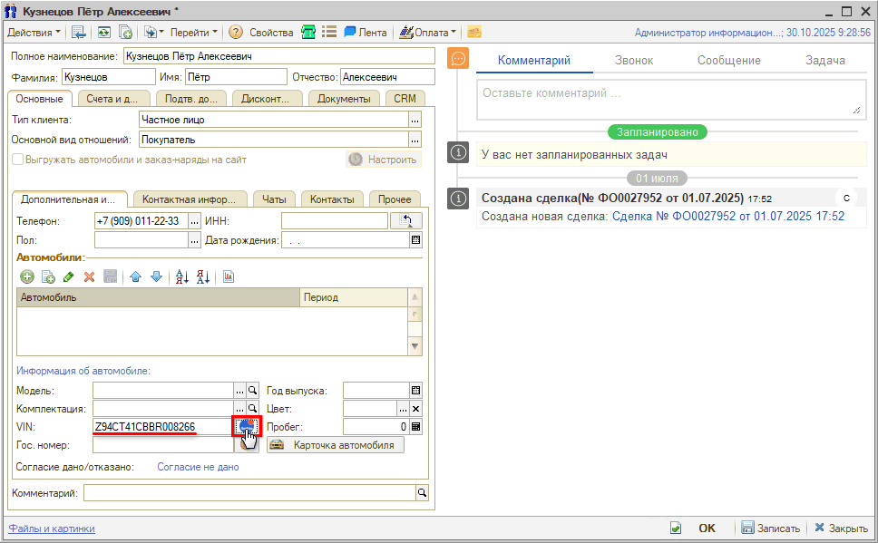
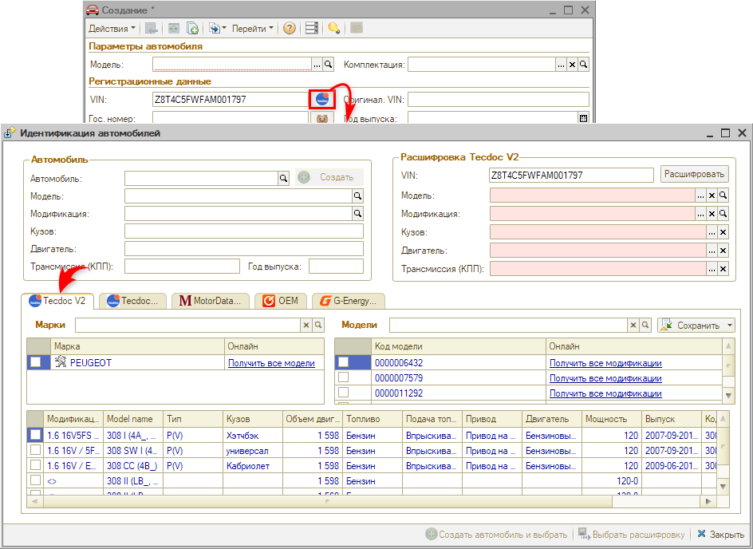
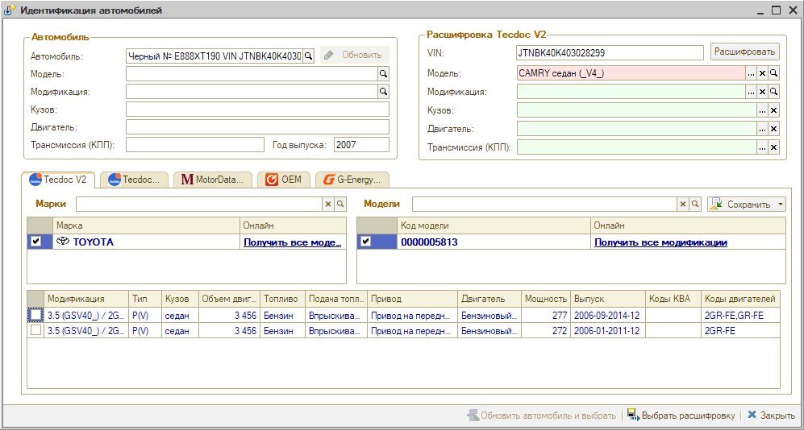
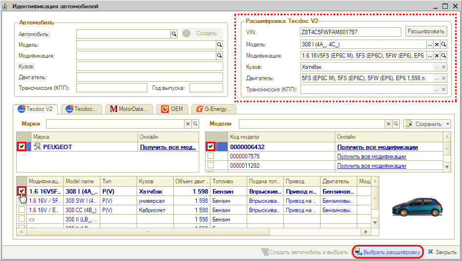
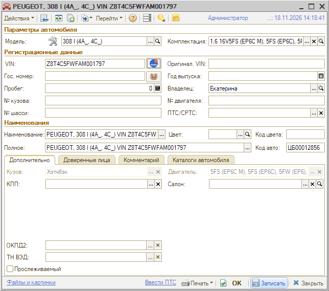
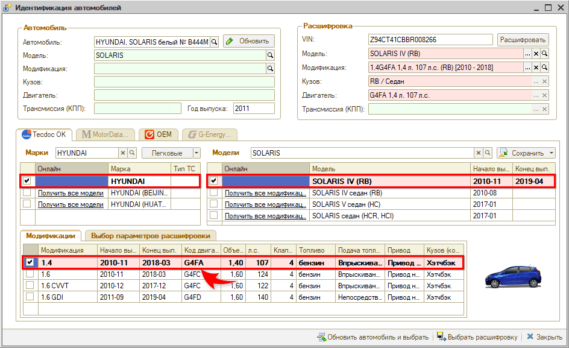
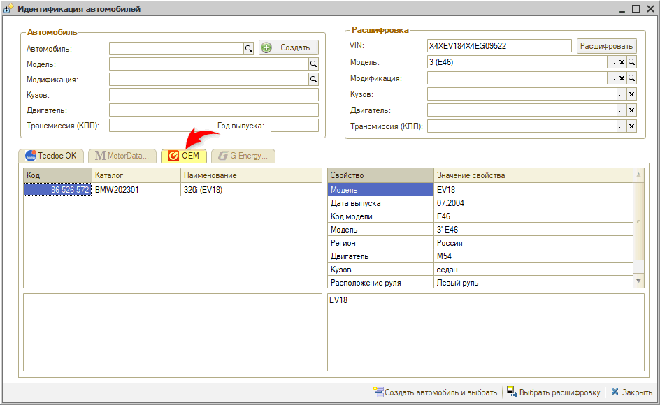
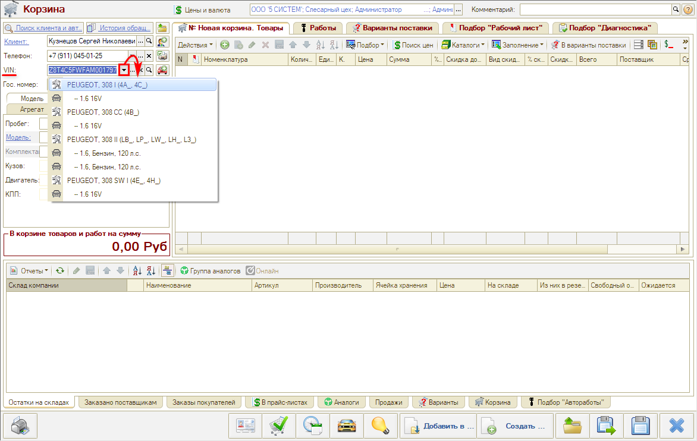
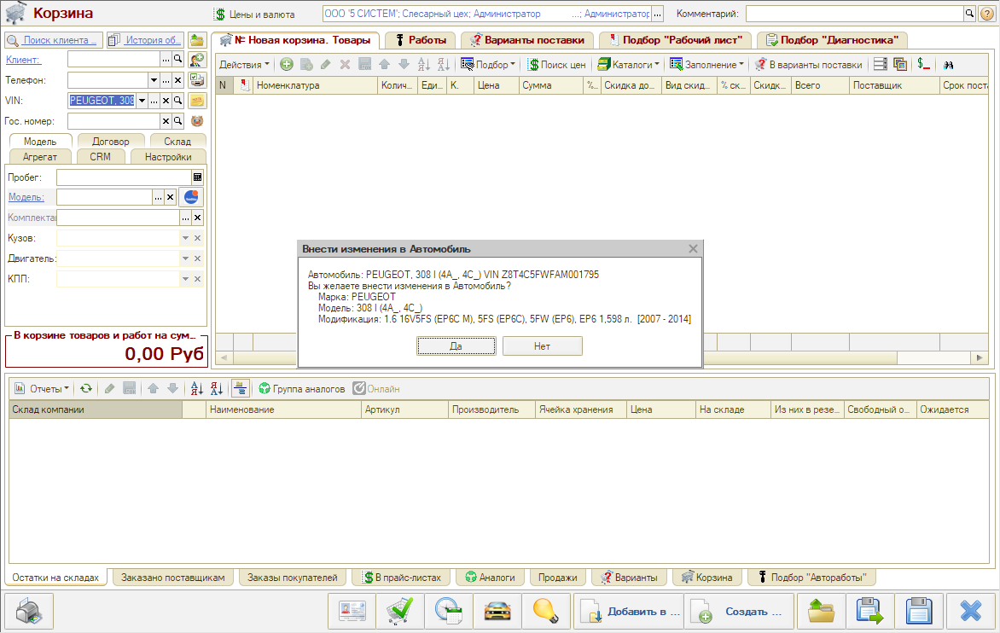
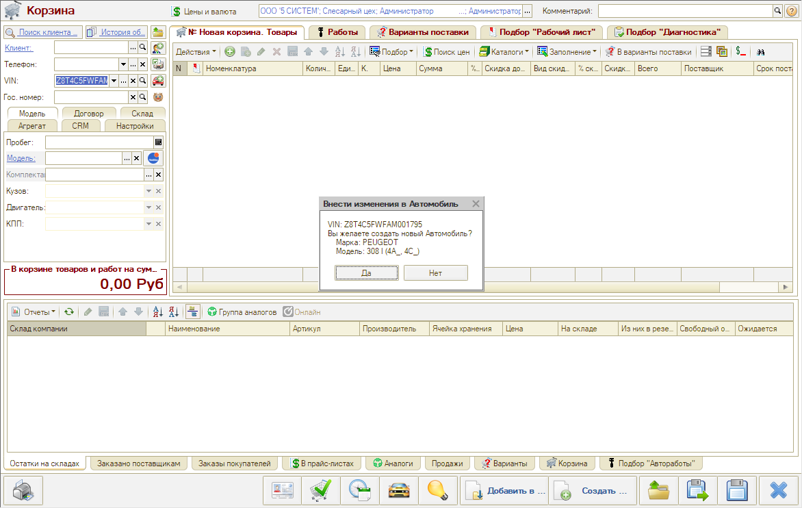

# Расшифровка автомобиля по VIN

<table><tr><td><b>Время чтения:</b> 12 мин.</td><td><b>Обновлено:</b> 19.11.2026</td></tr></table>

Источник: https://www.5systems.ru/help/rasshifrovka-avtomobilya-po-vin

###### *Опубликовано 01.09.2026: [https://kb.5systems.ru/articles/5s-auto/avtoservis/rasshifrovka-avtomobilya-po-vin](https://kb.5systems.ru/articles/5s-auto/avtoservis/rasshifrovka-avtomobilya-po-vin)*

> *Статья редактируется, релиз 2.8.5 в процессе тестирования и отладки.*

## Содержание

- [Введение](#введение)
- [Предварительная настройка](#предварительная-настройка)
- [Переход к расшифровке по VIN](#переход-к-расшифровке-по-vin)
- [Идентификация автомобиля по VIN](#идентификация-автомобиля-по-vin)
  - [Расшифровка в Tecdoc V2](#расшифровка-в-tecdoc-v2)
  - [Расшифровка в Tecdoc](#расшифровка-в-tecdoc)
  - [Сопоставление данных из каталогов TecDoc и OEM](#сопоставление-данных-из-каталогов-tecdoc-и-oem)
  - [Идентификация в OEM каталогах](#идентификация-в-oem-каталогах)
- [Выбор автомобиля из списка, если VIN не расшифрован](#выбор-автомобиля-из-списка-если-vin-не-расшифрован)
- [Сохранение моделей и модификаций автомобилей из Tecdoc в базу 1С](#сохранение-моделей-и-модификаций-автомобилей-из-tecdoc-в-базу-1с)
- [Видео по теме](#видео-по-теме)

## Введение

***VIN-номер*** — это уникальный номер автомобиля, состоящий из 17 символов, разделенных на 3 части — всемирный индекс изготовителя (3 символа), описательная часть (6 символов) и отличительная часть (8 символов). Общепринятое расположение — под ветровым стеклом, слева на приборной панели и на водительской двери.

В программе можно расшифровать автомобиль по VIN-коду в каталогах Tecdoc и создать автомобиль на основании расшифрованных данных. Это позволяет значительно ускорить создание автомобиля и получать более точные данные для подбора работ и запчастей. Начиная с релиза 2.8.5 расшифровка автомобиля по VIN выполняется через сервисы расшифровки 5SYSTEMS.

> 🛠 Комментарий для черновика: *Изменен алгоритм расшифровки VIN, добавлена возможность подключения сервисов расшифровки 5SYSTEMS (описание разработчика от 16.11.2026). Как подключается сервис (настройка в программе, обращение в техподдержку?), нужен ли для него отдельный тариф и что именно изменилось в алгоритме?*

## Предварительная настройка

Для начала необходимо создать папку в справочнике «[Модели автомобилей](../Модели%20автомобилей%20и%20другие%20справочники/modeli-avtomobiley-i-drugie-spravochniki.md)» *(Автосервис → Приемка → Справочники → Марки и модели а/м)* для моделей Tecdoc и привязать ее к каталогу в справочнике «(пп) Каталоги подбора»:

Все расшифрованные в Tecdoc модели будут сохраняться в справочнике моделей автомобилей в указанной папке:

> 🛠 Комментарий для черновика: *Нужно ли делать эту настройку для работы с новой расшифровкой?*

## Переход к расшифровке по VIN

Для перехода к расшифровке по VIN необходимо ввести VIN автомобиля или выбрать автомобиль с указанным VIN и нажать кнопку «Расшифровать а/м» (универсальная обработка для расшифровки в Laximo и TecDoc). Сделать это можно в следующих местах программы:

1. Регистрация обращения через [АРМ Клиенты и автомобили](../../Работа%20с%20клиентами/Работа%20в%20АРМ%20Клиенты%20и%20автомобили/rabota-v-arm-klienty-i-avtomobili.md):

   

2. Карточка автомобиля:

   

3. Карточка клиента:

   

4. Корзина:

   

5. Сделка:

   

## Идентификация автомобиля по VIN

После перехода к расшифровке по VIN открывается окно «Идентификация автомобилей», где происходит расшифровка автомобиля в каталогах Tecdoc и идентификация в OEM каталогах. Окно открывается сразу по кнопке с иконкой Tecdoc, без промежуточного меню:

Если модель уже выбрана, откроется то же окно, но с заполненными данными. При открытии окна активна закладка «Tecdoc V2»:

### Расшифровка в Tecdoc V2

Закладка «Tecdoc V2» открывается по умолчанию. Закладка «Tecdoc» с прежним алгоритмом остается. Чтобы расшифровать автомобиль на закладке «Tecdoc V2»:

1. Отметьте марку галочкой в таблице «Марки». Модели этой марки появятся в таблице «Модели».
2. Отметьте модель галочкой. Ее модификации появятся в нижней таблице.
3. Отметьте галочкой подходящую модификацию. Модель, модификация, кузов, двигатель и трансмиссия заполнятся в области «Расшифровка Tecdoc V2».

   

4. Нажмите «Выбрать расшифровку». В карточку автомобиля перейдут модель, комплектация, наименование, кузов и двигатель.
5. При записи карточки программа спросит владельца: «Не заполнен владелец автомобиля. Перейти к форме выбора владельца?». Нажмите «Да», чтобы выбрать владельца, или «Нет», чтобы сохранить автомобиль без владельца.

   

> 🛠 Комментарий для черновика: *Что именно изменилось в алгоритме расшифровки на V2 по сравнению с закладкой «Tecdoc»? Из описания разработчика не ясно, поэтому сравнение в статью пока не вошло. Уточнить.*

> 🛠 Комментарий для черновика: *Сравнение таблиц модификаций по скриншотам 11 (закладка «Tecdoc») и 26 (закладка «Tecdoc V2»). На V2 появились столбцы «Код модели», «Model name», «Тип», «Двигатель», «Мощность». Не видны столбцы старой таблицы «Начало выпуска», «Конец выпуска», «Код двигателя», «л.с.», «Клапанов». Обе таблицы обрезаны справа, поэтому полный состав столбцов нужно сверить по программе.*

> 🛠 Комментарий для черновика: *Нужно ли перед отметкой нажимать ссылки «Получить все модели» и «Получить все модификации» в таблицах? На скриншоте 26 модели уже загружены, но ссылки в таблицах есть.*

> 🛠 Комментарий для черновика: *В карточке (скриншот 27) не заполнены «КПП» и «Год выпуска». В области «Расшифровка Tecdoc V2» КПП тоже пусто, года там нет. Так и должно быть или эти параметры надо подтягивать? Уточнить.*

### Расшифровка в Tecdoc

Если автомобиль однозначно расшифрован, то в области «Расшифровка» заполняются данные и о модели, и о модификации:

*Примечание:* Если модификация определена, то на вкладке рядом с наименованием «Tecdoc» появляется отметка «OK».

> 🛠 Комментарий для черновика: *На закладке «Tecdoc V2» отметка «OK» после расшифровки не появляется (скриншот 07 из папки). Уточнить у разработчика: ошибка или так задумано. Если ошибка, этот абзац про «OK» касается только закладки «Tecdoc».*

Если у автомобиля не определена модификация, то можно уточнить данные автомобиля по ПТС.

Если нет ПТС под рукой, то принять решение о модификации автомобиля можно по информации из OEM каталога. Например, ознакомьтесь с информацией о двигателе:

На основе информации о двигателе выберите нужную модификацию вручную. Для этого:

1. нажмите ссылку «Получить все модификации»:

   

2. выберите из списка подходящую модификацию:

   

Если автомобиль не расшифрован автоматически, то можно идентифицировать его вручную. Для этого:

1. Выберите тип автомобиля и получите все модели подходящей марки:

   

2. Выберите модель и получите все модификации по модели:

   

3. Выберите подходящую модификацию:

   

   > 🛠 Комментарий для черновика: *Проверить, что шаги ручной расшифровки на закладке «Tecdoc V2» такие же; если столбцы в таблице модификаций другие — переснять 12–14 на V2.*

Все выбранные параметры расшифровки (марка, модель, модификация) автоматически сохраняются (создаются или обновляются) в справочнике «Модели автомобилей» и «Варианты комплектации» со ссылкой на каталог Tecdoc.

После автоматического или ручного выбора параметров расшифровки выберите одно из действий:

1. Выбрать расшифровку — если необходимо заполнить данные по автомобилю без сохранения (карточка автомобиля, карточка клиента).
2. Создать автомобиль и выбрать — если необходимо заполнить данные по автомобилю и автоматически создать автомобиль.
3. Обновить автомобиль и выбрать — если необходимо заполнить данные по автомобилю и автоматически обновить автомобиль.

> 🛠 Комментарий для черновика: *Названия кнопок на «Tecdoc V2» совпадают с текстом (скриншоты 26 и 28). Уточнить, когда доступна кнопка «Создать автомобиль и выбрать»: на скриншоте 26 она неактивна.*

### Сопоставление данных из каталогов TecDoc и OEM

Два каталога содержат информацию разного предназначения:

- TecDoc используется как основной каталог для получения информации о марках, моделях и модификациях автомобилей;
- Каталог Laximo содержит данные про запчасти, применяемость деталей; в рамках расшифровки а/м идентификация в OEM-каталогах используется для уточнения модификации автомобиля.

Конкретные автоработы учитывают специфику конкретной модификации (коробка ручная/автоматическая, крыша, привод и т.д.). Некоторые работы при этом могут иметь другую трудоемкость. Также и применяемые запчасти могут отличаться. Чтобы четко подобрать нормы времени и запчасти, требуется четко определиться с комплектациями.

Сопоставление данных из обоих каталогов позволяет выбрать наиболее точный вариант расшифровки. Например, если в TecDoc не расшифровывается VIN и выходит слишком много вариантов расшифровки — используется код двигателя и другие параметры из каталога Laximo.

Таким образом, интеграция с данными каталогами дает удобство и скорость работы, позволяет пользователю работать внутри «1С», никуда не переключаясь: вся информация доступна внутри программы.

### Идентификация в OEM каталогах

Для просмотра информации об автомобиле по VIN в OEM каталоге перейдите на вкладку OEM:

Для получения информации должна быть настроена интеграция с OEM каталогами. См. [Настройка интеграции с каталогами Laximo](../../Интеграция%20с%20внешними%20сервисами/Настройка%20интеграции%20с%20каталогами%20Laximo/nastroyka-integracii-s-katalogami-laximo.md).

## Выбор автомобиля из списка, если VIN не расшифрован

Если VIN не расшифровывается, автомобиль можно выбрать из списка прямо в поле на формах Корзины, заказ-наряда, заявки на ремонт и АРМ «Запись на ремонт». Окно «Идентификация автомобилей» для этого открывать не нужно.

Название поля зависит от того, что в нем введено. Если введен только VIN, поле называется «VIN». Если поле пустое или автомобиль уже расшифрован, поле называется «Автомобиль».

Чтобы открыть список, нажмите кнопку справа от поля. Модель показана вместе с маркой, например «PEUGEOT, 308 I (4A_, 4C_)», а модификации идут под своей моделью. Выберите модель, затем модификацию.

После выбора модификации программа спрашивает, что сделать с автомобилем. Если автомобиль с этим VIN уже есть в базе, появится вопрос «Вы желаете внести изменения в автомобиль?»:

Нажмите «Да», чтобы внести изменения. Если автомобиля с этим VIN нет, программа спросит: «Вы желаете создать новый автомобиль?»:

Нажмите «Да», чтобы создать автомобиль.

> 🛠 Комментарий для черновика: *Что происходит при нажатии «Нет» в обоих окнах? Что меняется в корзине после «Да»: заполняется поле «Автомобиль» или карточка? Уточнить у разработчика.*

> 🛠 Комментарий для черновика: *Одинаково ли работает выбор в заказ-наряде, заявке на ремонт и АРМ «Запись на ремонт»? Скриншоты только из Корзины. Проверить по программе и при отличиях добавить.*

## Сохранение моделей и модификаций автомобилей из Tecdoc в базу 1С

С помощью обработки «Расшифровка VIN» есть возможность загрузить расшифрованные модели и модификации автомобилей в базу 1С, не создавая автомобиль. При этом заполнится справочник «Модели автомобилей» в папке, указанной в *Предварительной настройке*, и справочник «Варианты комплектации» для модели.

Поскольку расшифровывать VIN автомобиля не нужно, удобно перейти к обработке для данного случая через меню программы: *CRM → Обработки → Расшифровка VIN*.

Для того, чтобы сохранить модели автомобилей:

1. выберите тип автомобиля (легковые или коммерческие).
2. выберите марку автомобиля и нажмите кнопку-ссылку «Получить все модели»:

   

3. нажмите кнопку «Сохранить модели в ИБ»:

   

В результате в базу сохранятся все модели, которые были получены по марке и видны в таблице «Модели».

Для того, чтобы сохранить модификации автомобилей:

1. выберите модель автомобиля и нажмите кнопку-ссылку «Получить все модификации»:

   

2. нажмите кнопку «Сохранить модификации в ИБ»:

   

В результате в базу сохранятся все модификации, которые были получены по модели и видны в таблице «Модификации».

> 🛠 Комментарий для черновика: *Проверить по программе, есть ли в обработке «Расшифровка VIN» (сохранение моделей и модификаций в базу) закладка «Tecdoc V2» и открывается ли она по умолчанию. Если есть: дописать об этом в разделе и проверить, совпадают ли порядок сохранения и названия кнопок; если отличаются — поправить текст и переснять скриншоты 21–24 на закладке «Tecdoc V2».*

## Видео по теме

См. видеоинструкции:

**1. [Как создать карточку автомобиля через TecDoc](../../../../lessons/Урок%206.%20Подбор%20запчастей%20и%20работ/Как%20создать%20автомобиль%20в%20Корзине/kak-sozdat-avtomobil-v-korzine.md):**

**2. [Как идентифицировать автомобиль в Онлайн-каталоге](../../../../lessons/Урок%207.%20Онлайн-каталог%20запчастей/Как%20идентифицировать%20автомобиль%20в%20Онлайн-каталоге/kak-identificirovat-avtomobil-v-onlayn-kataloge.md):**

---

**Теги:** VIN, расшифровка автомобиля, TecDoc, Tecdoc V2, OEM, Laximo, идентификация автомобиля
