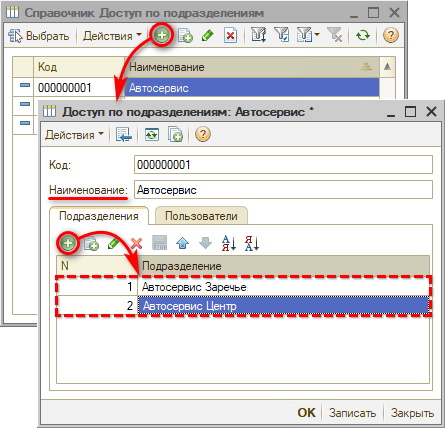

# Отбор номенклатуры по подразделениям

<table><tr><td><b>Время чтения:</b> 8 мин.</td><td><b>Создано:</b> 23.09.2026</td></tr></table>

> *Актуально начиная с версии релиза 5S AUTO **2.8.5**.*

## Содержание

- [Введение](#введение)
- [Для кого действуют ограничения](#для-кого-действуют-ограничения)
- [Как работает отбор](#как-работает-отбор)
  - [Вложенные группы](#вложенные-группы)
  - [Поиск номенклатуры в документах](#поиск-номенклатуры-в-документах)
  - [Где отбор не действует](#где-отбор-не-действует)
- [Штрихкоды и коды маркировки](#штрихкоды-и-коды-маркировки)
  - [Один штрихкод у нескольких карточек](#один-штрихкод-у-нескольких-карточек)
  - [Выбор карточки при сканировании](#выбор-карточки-при-сканировании)
  - [Сообщения при сканировании](#сообщения-при-сканировании)
- [Настройка](#настройка)
  - [1. Доступ пользователей к подразделениям](#1-доступ-пользователей-к-подразделениям)
  - [2. Настройка группы номенклатуры](#2-настройка-группы-номенклатуры)
  - [3. Снятие ограничения с группы](#3-снятие-ограничения-с-группы)
  - [4. Скрытие группы от всех пользователей](#4-скрытие-группы-от-всех-пользователей)
  - [5. Защита настроек от изменения](#5-защита-настроек-от-изменения)

## Введение

Функционал **«Отбор номенклатуры по подразделениям»** разграничивает доступ к номенклатуре между подразделениями компании: сотрудник работает только с товарами своего подразделения и не видит товары других подразделений. Это удобно компаниям с несколькими подразделениями и разным ассортиментом – например, автосервисом и шинным магазином: сотрудники не выбирают по ошибке чужой товар, а списки номенклатуры становятся короче.

Ограничение задается не на каждой позиции, а на **[группе](https://kb.5systems.ru/articles/5s-auto/sklad-i-zapchasti/nomenklatura#группы-элементов)** справочника «[Номенклатура](https://kb.5systems.ru/articles/5s-auto/sklad-i-zapchasti/nomenklatura)»: у группы включается признак «Использовать в подразделениях» и перечисляются подразделения, которым она доступна. Недоступная номенклатура скрыта:

- в справочнике «Номенклатура»: закрытые группы не отображаются в дереве групп, а в списке их папки видны, но номенклатура в них не отображается;
- в форме выбора и в подборе номенклатуры;
- при поиске по строке ввода в документах;
- при [сканировании штрихкода](https://kb.5systems.ru/articles/5s-auto/sklad-i-zapchasti/skanirovanie-shtrikhkodov-tovarov) и [кода маркировки](https://kb.5systems.ru/articles/5s-auto/markirovka/operacii-s-kodami-markirovki#2-сканирование-кодов-маркировки-в-документе), в том числе во [Фронте кассира](https://kb.5systems.ru/articles/5s-auto/kassa/uproschennyy-front-kassira);
- в мобильном приложении и на [терминале сбора данных](https://kb.5systems.ru/articles/5s-auto/sklad-i-zapchasti/rabota-s-prilozheniem-5s-tsd).

> 🛠 Комментарий для черновика: *Проверено 19.10.2026: в дереве групп закрытые группы скрыты, а в списке справочника их папки видны, но пустые (в списке установлен отбор «Ссылка не в группе из списка (…)» – он виден в строке внизу формы). Уточнить, так задумано или папки закрытых групп в списке тоже должны быть скрыты; если исправят – поправить первый пункт списка. Подбор из заказ-наряда открывает тот же справочник «Номенклатура» – в нем все отображается так же.*

Отбор работает во всех документах, где номенклатура подбирается или вводится строкой: заказ-наряд, реализация товаров, поступление товаров, перемещение товаров, заказ покупателя, заказ поставщику, заявка на ремонт, складские ордера, возвраты и другие. Отдельных настроек в документах нет.

## Для кого действуют ограничения

Ограничения действуют на пользователя, у которого настроен доступ к подразделениям, – то есть он включен в справочник «Доступ по подразделениям» (см. [ниже](#1-доступ-пользователей-к-подразделениям)). Такой пользователь видит:

- номенклатуру групп, открытых для его подразделений;
- номенклатуру в группах без ограничения (где признак «Использовать в подразделениях» не установлен) и в корне справочника.

Пользователю с ролью «Пользователь RLS» доступ к подразделениям настраивается обязательно (см. статью «[Доступ к данным по подразделениям (RLS) → Настройка доступа к подразделениям](https://kb.5systems.ru/articles/5s-auto/administrirovanie-i-nastroyka-sistemy/dostup-k-dannym-po-podrazdeleniyam-rls#настройка-доступа-к-подразделениям)»), поэтому отбор номенклатуры действует на него всегда.

Если доступ к подразделениям не настроен, пользователь видит всю номенклатуру – например, администраторы и сотрудники, которые работают по всем подразделениям.

> 🛠 Комментарий для черновика: *По описанию разработчика ограничения действуют и на пользователя с ролью «Пользователь RLS» без доступных подразделений – он видит только номенклатуру в корне и в группах без ограничения. В текст не включено: по статье о RLS такому пользователю доступ к своему подразделению настраивается обязательно, так что этот случай – ошибка настройки.*

> [!WARNING]
> Ограничения действуют независимо от ролей пользователя: сотрудник, которому настроен доступ к подразделениям, видит только номенклатуру своих подразделений, даже если у него роль «Полные права». Администраторам и сотрудникам, которым нужна вся номенклатура, доступ к подразделениям не настраивайте или укажите в нем все подразделения компании. Во втором случае группы, скрытые от всех пользователей (см. [ниже](#4-скрытие-группы-от-всех-пользователей)), будут скрыты и от них, а новое подразделение компании нужно будет добавить в их доступ.

> 🛠 Комментарий для черновика: *Вариант «все подразделения» – по логике отбора (видны группы, открытые хотя бы для одного из доступных подразделений), в программе не проверялся.*

> 🛠 Комментарий для черновика: *Предупреждение – по проверке 19.10.2026: отбор действует на пользователей, включенных в справочник, с ролями «Пользователь RLS», «Пользователь», «Пользователь» + «Минимальный набор прав», «Полные права» – отбор одинаковый; тот же пользователь без доступа к подразделениям (не включен в справочник) видит всю номенклатуру. В отличие от RLS для документов, основные роли ограничения не снимают. Уточнить, так задумано или администраторов отбор не должен ограничивать.*

> 🛠 Комментарий для черновика: *При входе в программу пользователя с ролью «Пользователь RLS» (проверено 19.10.2026) выводится ошибка: «ОбщийМодуль._5с_МотивацияСотрудниковКлиентСервер.Модуль(70)}: Ошибка при вызове метода контекста (Вывести): … Ошибка при исполнении запроса набора данных: … ОШИБКА: целое вне диапазона». К отбору номенклатуры, видимо, не относится – передать разработчику отдельно.*

## Как работает отбор

### Вложенные группы

Позиция скрыта, если доступ к ней закрывает любая группа-родитель вверх по иерархии. Подгруппа не может открыть то, что закрыла вышестоящая группа, даже если в самой подгруппе указано доступное подразделение.

### Поиск номенклатуры в документах

При поиске по строке ввода в документах номенклатура ищется по фразе: например, по запросу «масл фил» найдутся масляные фильтры. Позиции из подразделений пользователя выводятся в начале списка. В форме выбора и в подборе такой сортировки нет.

Если найдено больше 50 позиций, программа выводит сообщение «Количество найденных элементов больше 50! Измените строку поиска.» – уточните строку поиска. Недоступные позиции в это число не входят.

> 🛠 Комментарий для черновика: *Проверено 19.10.2026 (тестовый пользователь с ролью «Полные права»): при поиске по строке в заказ-наряде недоступные позиции не отображаются, позиции подразделения пользователя выводятся вверху списка. Сообщение о 50 позициях не проверялось.*

### Где отбор не действует

- Произвольные отчеты, консоль запросов, внешние обработки и печатные формы показывают всю номенклатуру, в том числе закрытую.
- Документы, которые уже созданы с закрытой номенклатурой, открываются и перепроводятся как раньше – закрытая номенклатура в них отображается.

## Штрихкоды и коды маркировки

### Один штрихкод у нескольких карточек

Один и тот же штрихкод можно присвоить разным карточкам номенклатуры, если они относятся к разным подразделениям. Штрихкод считается занятым, только если подразделения карточек пересекаются. Карточка, которая не ограничена ни одной группой, доступна всем подразделениям, поэтому с ней штрихкод пересекается всегда. Карточка, скрытая от всех, не конфликтует ни с какой другой.

При попытке присвоить занятый штрихкод программа, как и раньше, выводит сообщение «Штрихкод не уникален!» или «<штрихкод> - штрихкод не уникален! Штрихкод не записан!». О назначении штрихкодов – в статье «[Назначение штрихкодов товарам](https://kb.5systems.ru/articles/5s-auto/sklad-i-zapchasti/naznachenie-shtrikhkodov-tovaram)».

### Выбор карточки при сканировании

Если один штрихкод присвоен нескольким доступным пользователю карточкам, при сканировании программа выбирает карточку так:

1. Недоступные карточки не учитываются.
2. Если код сканируется в конкретную строку документа и номенклатура этой строки есть среди найденных карточек, выбирается она.
3. Иначе выбирается карточка с наибольшим остатком на складах доступных пользователю подразделений. Подразделение склада указывается в справочнике «Склады компании».
4. Если остатка нет ни у одной карточки, выбирается первая по коду.

Коды маркировки обрабатываются по тем же правилам: из кода маркировки определяется GTIN, по нему – штрихкод. О сканировании – в статье «[Сканирование штрихкодов](https://kb.5systems.ru/articles/5s-auto/sklad-i-zapchasti/skanirovanie-shtrikhkodov-tovarov)».

> 🛠 Комментарий для черновика: *исправлена ли ошибка при сканировании кода маркировки в строку документа, когда один GTIN присвоен двум доступным карточкам: номенклатура строки не учитывается, и появляется ошибка о несоответствии кода номенклатуре (по описанию разработчика от 23.09.2026 – не исправлена)? Если исправлена – в какой версии конфигурации; если нет – описать в статье как ограничение.*

### Сообщения при сканировании

| Ситуация | Сообщение |
| --- | --- |
| Штрихкод есть в базе, но вся номенклатура с ним недоступна пользователю. Позиция в документ не добавляется, создать новую карточку программа не предлагает | «Штрихкод <штрихкод> принадлежит номенклатуре, недоступной в ваших подразделениях.» |
| Штрихкод не найден, но карточка с таким артикулом есть, и она недоступна пользователю | «Карточка с таким артикулом есть, но она недоступна в ваших подразделениях. Штрихкод не привязан.» |
| Сканирование штрихкода недоступной номенклатуры во [Фронте кассира](https://kb.5systems.ru/articles/5s-auto/kassa/uproschennyy-front-kassira) | «Товар с этим штрихкодом недоступен в ваших подразделениях» |

## Настройка

### 1. Доступ пользователей к подразделениям

Доступ сотрудников к подразделениям задается в справочнике «Доступ по подразделениям»: каждый его элемент – перечень подразделений и список пользователей, которым эти подразделения доступны.

Настроить доступ можно двумя способами:

- **в карточке пользователя** – в справочнике «[Пользователи](https://kb.5systems.ru/articles/5s-auto/polzovateli-i-prava/polzovateli#справочник-пользователи)» на вкладке «Доступ к подразделениям» выберите нужные элементы справочника «Доступ по подразделениям» и запишите карточку: пользователь автоматически добавится в выбранные элементы – см. «[Доступ к данным по подразделениям (RLS) → Настройка доступа к подразделениям](https://kb.5systems.ru/articles/5s-auto/administrirovanie-i-nastroyka-sistemy/dostup-k-dannym-po-podrazdeleniyam-rls#настройка-доступа-к-подразделениям)»;
- **в самом справочнике** – создайте или откройте элемент, на вкладке «Подразделения» укажите подразделения, на вкладке «Пользователи» – сотрудников и запишите изменения – см. «[Доступ к данным по подразделениям (RLS) → Настройка справочника «Доступ по подразделениям»](https://kb.5systems.ru/articles/5s-auto/administrirovanie-i-nastroyka-sistemy/dostup-k-dannym-po-podrazdeleniyam-rls#настройка-справочника-доступ-по-подразделениям)».

В карточке пользователя выбираются уже готовые перечни подразделений, поэтому элементы справочника нужно заполнить заранее. Проверить, к каким подразделениям у сотрудника есть доступ, можно в его карточке на вкладке «Доступ к подразделениям».

> 🛠 Комментарий для черновика: *справочник «Доступ по подразделениям» в меню интерфейса не выведен (в статье «Доступ к данным по подразделениям (RLS)» путь к нему также не указан). Сейчас он открывается через верхнее меню «Сервис → Все операции → Справочники» – в чистовую версию этот путь не пишем.*

### 2. Настройка группы номенклатуры

1. Откройте справочник «Номенклатура» (*Автосервис → Приемка → Справочники → Номенклатура*), выделите нужную группу – курсор в колонке «Наименование» – и нажмите «Изменить». В карточке группы перейдите на вкладку «Подразделения».
2. Установите флажок «Использовать в подразделениях». До установки флажка таблица подразделений недоступна.
3. В таблице добавьте подразделения, которым доступна группа. Можно указать несколько подразделений.
4. Запишите группу. Повторяющиеся подразделения программа удалит при записи.

> 🛠 Комментарий для черновика: *Права на настройку не уточнены. В описании разработчика права указаны на уровне конфигурации: просмотр и изменение реквизита «Использовать в подразделениях» и табличной части «Подразделения» справочника «Номенклатура» (без права просмотра поля на вкладке не отображаются). Отдельных прав для этого в «Правах и настройках» нет (проверено 19.10.2026 в расширенных правах); права доступа к справочникам «Номенклатура» и «Подразделения компании» включены по умолчанию. Проверено 19.10.2026 на тестовом пользователе, включенном в справочник «Доступ по подразделениям» (курсор на колонке «Наименование»): с ролями «Пользователь RLS», «Пользователь», «Пользователь» + «Минимальный набор прав» и «Полные права» пользователь открывает на редактирование все группы номенклатуры, в том числе закрытые для него, видит и меняет флажок и таблицу. Добавив свое подразделение в закрытую группу и перезайдя в справочник, он видит ее номенклатуру – то есть любой ограниченный пользователь может снять ограничение сам себе.*
>
> *Нужно уточнить: как запретить ограниченному пользователю менять флажок «Использовать в подразделениях» и таблицу «Подразделения» (у каких ролей или по какому праву должно быть изменение); нужно ли для этого установить право «Право доступа Номенклатура» в значение «Редактирование по группам». Проверено 19.10.2026 (роль «Пользователь», «Право доступа Номенклатура» = «Редактирование по группам», в списке групп для редактирования – только «Тест – Автосервис»): закрытую группу «Тест – Магазин» изменить нельзя, только просмотр – снять ограничение самому себе не получается; видимость не меняется (в дереве закрытая группа скрыта, в списке пустая); позиция из открытой группы редактируется, из группы без ограничения («Тест – Без ограничений», не в списке для редактирования) – только просмотр, но подбирается в заказ-наряд; создать позицию в открытой группе можно, в корне справочника – нельзя. Защита через «Редактирование по группам» описана в разделе «5. Защита настроек от изменения».*

> 🛠 Комментарий для черновика: *Вопрос (19.10.2026): в списке справочника «Номенклатура» карточка группы открывается на редактирование (кнопка «Изменить») не всегда – зависит от колонки, на которой стоит курсор в строке группы: если курсор в колонке «Артикул», «Производитель» или «ТН ВЭД», ничего не происходит, без сообщений; если в колонке «Наименование», «Тип номенклатуры» или в первой колонке со значками папок – карточка группы открывается. Так задумано? Если нет – исправить и убрать из шага 1 уточнение «курсор в колонке «Наименование»»; если да – оставить. Из-за этого при проверке 19.10.2026 казалось, что группы перестали открываться у всех пользователей.*

Признак «Использовать в подразделениях» есть только у групп, у отдельной позиции номенклатуры его нет. Ограничение действует на группу и на всю вложенную в нее номенклатуру.

> [!CAUTION]
> Изменения вступают в силу после того, как пользователи перезайдут в программу: список закрытых групп рассчитывается при входе. Исключение – сотрудник, который изменил настройку группы: у него список обновляется сразу при записи.

Чтобы сотрудники не могли сами изменить настройки групп, ограничьте им редактирование справочника – см. [ниже](#5-защита-настроек-от-изменения).

### 3. Снятие ограничения с группы

Чтобы группа снова стала доступна всем, снимите флажок «Использовать в подразделениях». Если в таблице указаны подразделения, программа спросит:

> Отбор по подразделениям выключается. Очистить список подразделений?

При ответе «Да» таблица очищается, и группа становится доступна всем пользователям. При ответе «Нет» флажок снова устанавливается – ограничение остается.

### 4. Скрытие группы от всех пользователей

Чтобы убрать ветку номенклатуры из оборота, не помечая позиции на удаление, установите флажок «Использовать в подразделениях» и оставьте в таблице одну строку с пустым подразделением. Группа и вся вложенная в нее номенклатура будут скрыты от всех пользователей, на которых действуют ограничения.

Если в таблице есть и пустая строка, и строки с подразделениями, при записи пустая строка удаляется и действуют указанные подразделения.

Если записать группу с установленным флажком и пустой таблицей, в окне служебных сообщений появится предупреждение:

> Группа "<Наименование группы>" и вся вложенная в нее номенклатура будут скрыты у всех пользователей: включен отбор по подразделениям, но ни одно подразделение не указано.

Это предупреждение, группа все равно записывается.

### 5. Защита настроек от изменения

Отбор по подразделениям скрывает номенклатуру, но сам по себе не запрещает менять настройки групп: сотрудник, которому доступен справочник «Номенклатура», может открыть закрытую для него группу, добавить в таблицу свое подразделение – и сразу увидеть ее номенклатуру. Чтобы этого не произошло, ограничьте сотрудникам редактирование справочника по группам:

1. Откройте «Права и настройки» (см. «[Установка прав и настроек пользователя → Переход к установке Прав и настроек](https://kb.5systems.ru/articles/5s-auto/polzovateli-i-prava/ustanovka-prav-i-nastroek-polzovatelya#переход-к-установке-прав-и-настроек)») и выберите объект настройки: шаблон прав должности или конкретного пользователя.
2. Включите отображение расширенных прав – переключатель «Расширенные» (см. «[Установка прав и настроек пользователя → Основные и расширенные права](https://kb.5systems.ru/articles/5s-auto/polzovateli-i-prava/ustanovka-prav-i-nastroek-polzovatelya#основные-и-расширенные-права)»). Найдите право «Право доступа Номенклатура» (группа «Справочники» → «Права доступа справочников») и установите значение «Редактирование по группам».
3. Перейдите на вкладку «Доступ по группам справочников: Номенклатура», нажмите «Заполнить» → «Подбор по группам (включение вложенных)» и отметьте группы, которые сотрудник может редактировать: группы его подразделения и общие группы без ограничения. Закрытые для него группы не отмечайте. Нажмите «Выбрать».
4. Нажмите «Записать». Чтобы настройка вступила в силу, сотруднику нужно перезайти в программу.

После этого закрытые группы сотрудник может открыть только для просмотра – изменить их настройки он не сможет.

Учтите при настройке:

- позиции из групп, которые не отмечены на вкладке «Доступ по группам справочников: Номенклатура», сотрудник видит и подбирает в документы, но изменить не может – в том числе позиции общих групп без ограничения, если их не отметить;
- в корне справочника «Номенклатура» сотрудник не сможет создавать позиции и группы – только в отмеченных группах.

Подробнее о значении «Редактирование по группам» – в совете «[Как запретить сотрудникам редактировать отдельные автоработы](https://kb.5systems.ru/tips/5s-auto/administrirovanie/kak-zapretit-sotrudnikam-redaktirovat-otdelnye-avtoraboty)».

> 🛠 Комментарий для черновика: *Раздел – по проверке 19–20.10.2026 (см. комментарий о правах в разделе «2. Настройка группы номенклатуры»). Функционал может измениться: если разработчик закроет изменение флажка «Использовать в подразделениях» и таблицы «Подразделения» для ограниченных пользователей другим способом (ролями или отдельным правом) – переписать или убрать раздел и поправить вводную фразу. Скриншоты права и вкладки «Доступ по группам справочников: Номенклатура» не делались – можно добавить по аналогии с советом про автоработы.*

---

**Теги:** номенклатура, подразделения, доступ по подразделениям, RLS, группа номенклатуры, штрихкод, код маркировки, подбор номенклатуры, ограничение доступа
