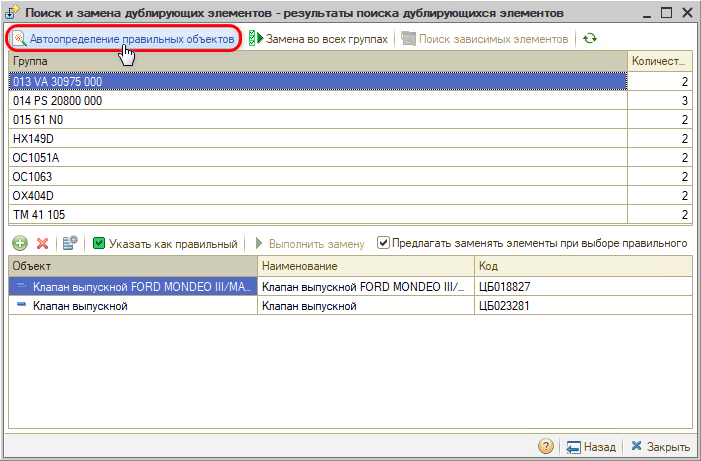
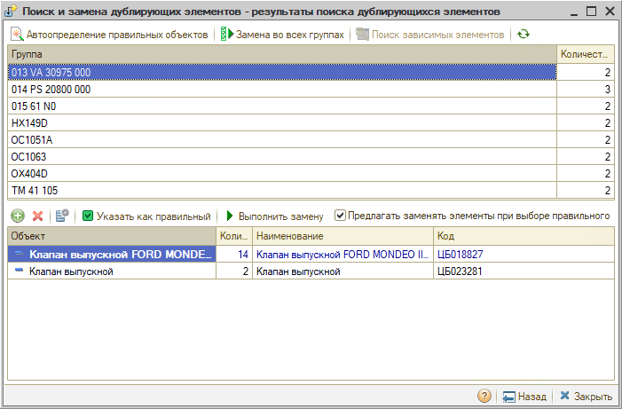
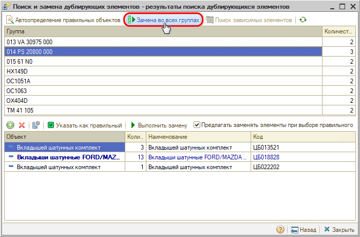

# Поиск и замена дублирующихся записей

<table><tr><td><b>Время чтения:</b> 14 мин.</td><td><b>Обновлено:</b> 29.10.2026</td></tr></table>

Источник: https://www.5systems.ru/help/poisk-i-zamena-dubliruyuschikhsya-zapisey

###### *Опубликовано 08.09.2026: [https://kb.5systems.ru/articles/5s-auto/administrirovanie-i-nastroyka-sistemy/poisk-i-zamena-dubliruyuschikhsya-zapisey](https://kb.5systems.ru/articles/5s-auto/administrirovanie-i-nastroyka-sistemy/poisk-i-zamena-dubliruyuschikhsya-zapisey)*

>  **Статья для опытных пользователей!**

## Содержание

1. [Введение](#введение)
2. [Работа с обработкой «Поиск и объединение дублей»](#работа-с-обработкой-поиск-и-объединение-дублей)
   - [Переход к обработке](#переход-к-обработке)
   - [Пример работы](#пример-работы)
   - [Вариант 1. Объединение одной группы дублей](#вариант-1-объединение-одной-группы-дублей)
   - [Вариант 2. Групповая обработка всего справочника](#вариант-2-групповая-обработка-всего-справочника)
3. [Что нельзя объединять](#что-нельзя-объединять)

## Введение

Рано или поздно в любом справочнике программы могут появиться дублирующиеся записи (элементы). Для того, чтобы ***объединить дублирующиеся записи***, предусмотрена служебная обработка «Поиск и объединение дублей». Она заменяет ссылки на элемент-дубль во всех документах, регистрах и других объектах программы ссылкой на правильный элемент, а дубль удаляет.

> [!CAUTION]
> *Объединение дублирующихся записей является необратимым действием! Перед запуском обработки рекомендуем предварительно потренироваться в объединении дублей на тестовой базе. Если нужно объединить много дублей, сначала объедините два элемента и проверьте результат.*

## Работа с обработкой «Поиск и объединение дублей»

### Переход к обработке

Обработка открывается из меню *Администрирование → Обслуживание → Инструменты администратора → Поиск и объединение дублей*:

### Пример работы

Рассмотрим пример поиска дублей в справочнике «Номенклатура» по номеру по каталогу.

Если искать дубли только по реквизиту «№ по кат.» во всем справочнике, список групп получится слишком большим, и в нем трудно понять, что является дублями, а что нет: одинаковые номера по каталогу встречаются у разных производителей. Поэтому поиск удобно ограничить производителем.

На форме обработки:

1. в поле *Справочник* выбираем значение «Номенклатура»;

2. в поле *Реквизит поиска* выбираем значение «№ по кат.» (можно искать по любому из реквизитов справочника);

3. в поле *Режим поиска* выбираем значение «По равному значению реквизита» (поиск дублей по точному совпадению);

   Режим «По похожим словам» находит значения, которые похожи, но не совпадают точно, например наименования с опечаткой. Ползунок «Настройка уровня сходства слов» задает, насколько сильно могут различаться значения: чем ближе он к «Значительно отличаются», тем больше элементов попадет в одну группу.

   > [!NOTE]
   > Не рекомендуем искать в этом режиме, особенно с ползунком, сдвинутым к «Значительно отличаются»: в одну группу попадают разные элементы с похожими значениями.

4. в табличной части «Дополнительный отбор для поиска» кнопкой «Добавить» задаем условия, которые исключают из поиска группы и предопределенные элементы:

   - «Элемент.Это группа» – «Равно» – «Нет» – чтобы в поиск не попали группы;
   - «Элемент.Предопределенный» – «Равно» – «Нет» – чтобы в поиск не попали предопределенные элементы.

   > [!WARNING]
   > Нельзя объединять группу с элементом (например, папку номенклатуры с карточкой товара) и предопределенные элементы – они нужны для работы программы. Такое объединение может нарушить целостность данных, и программа перестанет корректно работать во всей базе. Условия отбора «Элемент.Это группа» и «Элемент.Предопределенный» необязательны, но рекомендуем их добавлять, чтобы такие элементы случайно не попали в поиск.

5. в той же табличной части добавляем условие отбора по производителю: «Элемент.Производитель.Наименование» – «Содержит» – «<наименование производителя>» (в примере – «MAHLE»), чтобы искать дубли только среди товаров этого производителя.

   Производитель одной и той же детали может быть заведен по-разному: например, «MAHLE», «MAHLE ORIGINAL», «Mahle/Knecht». Условие «Содержит» находит все такие варианты. Если производитель записан по-русски, такие карточки в поиск не попадут. В этом случае выбираем тип сравнения «В списке», нажимаем кнопку выбора в поле «Значение» и в окне «Редактирование списка значений» добавляем все варианты написания. Чтобы найти все карточки детали независимо от написания производителя, вместо отбора по производителю задаем отбор по номеру по каталогу этой детали.

   > [!NOTE]
   > Не рекомендуем искать без дополнительного отбора: обработка проверяет весь справочник, поэтому в большой базе поиск идет долго (программа на это время перестает отвечать). Чтобы поиск прошел быстрее, ограничьте его отбором, например по производителю.

6. нажимаем кнопку «Найти дубли»:

   

Если дубли не найдены, проверяем, что значения реквизита поиска у элементов совпадают полностью и в отборе указаны так же, как в элементах.

В результате отображаются дублирующиеся записи, сгруппированные по реквизиту поиска. При клике на группу дублей в нижней табличной части детально отображаются записи справочника, совпадающие по реквизиту поиска (в данном случае по «№ по кат.»). В примере в группе «014 PS 20800 000» четыре карточки. Три из них – одна и та же деталь, вкладыши шатунные: наименования и производители («Mahle/Knecht», «MAHLE ORIGINAL», «MAHLE») заведены по-разному, но номер по каталогу один. Четвертая карточка – кольца поршневые: это другая деталь, номер по каталогу у нее введен с ошибкой:

Состав колонок нижней таблицы можно настроить: на панели над таблицей нажимаем кнопку «Настройка списка» и отмечаем нужные колонки – в примере выведена колонка «Производитель». Колонки можно переставлять местами, перетаскивая их заголовки мышью:

Внимательно просматриваем карточки номенклатуры дублей: чтобы открыть карточку, дважды щелкаем по строке в колонке «Объект» и нажимаем кнопку «Открыть». Совпадение реквизита поиска еще не означает, что это дубль: под одним номером по каталогу может оказаться другая деталь, например если номер введен с ошибкой. Такие записи убираем из списка: выделяем строку и нажимаем кнопку «Удалить». В примере удаляем кольца поршневые и оставляем три дубля вкладышей:

Если в элементе-дубле есть данные, которых нет в правильном элементе, переносим их в правильный элемент до объединения.

Дальше дубли можно объединять по одной группе (вариант 1) или сразу во всем справочнике (вариант 2).

### Вариант 1. Объединение одной группы дублей

Устанавливаем курсор на правильную запись (в примере – вторая карточка: у нее самое полное наименование) и нажимаем кнопку «Указать как правильный»:

Правильный элемент выделяется в списке жирным шрифтом. Если на панели над таблицей включен флажок «Предлагать заменять элементы при выборе правильного», программа сразу спрашивает, выполнить ли замену ссылок для оставшихся элементов. Соглашаемся заменить ссылки с неправильного на правильный элемент справочника в документах, регистрах и прочих объектах программы:

Если флажок «Предлагать заменять элементы при выборе правильного» снять, окно с вопросом не откроется: программа только отметит правильный элемент. Чтобы перейти к замене, нажимаем кнопку «Выполнить замену». Флажок удобно снять, когда правильные элементы нужно указать в нескольких группах, а замену выполнить позже (см. [вариант 2](#вариант-2-групповая-обработка-всего-справочника)).

В результате отображаются ссылки на данные, в которых произойдет замена, и настройки замены. По умолчанию все флажки включены: например, при включенном флажке «Удалять элементы после замены» элемент-дубль будет удален. При необходимости настройки замены можно изменить. Для замены нажимаем кнопку «Выполнить замену элементов»:

Подтверждаем замену и удаление элементов справочника.

ГОТОВО! Дублирующиеся элементы удалены, и ссылки на них заменены на правильный элемент.

### Вариант 2. Групповая обработка всего справочника

Если нужно привести в порядок весь справочник, объединять дубли по одной группе долго. Для этого на панели над списком групп есть кнопки групповой обработки: «Автоопределение правильных объектов» и «Замена во всех группах».

1. Нажимаем кнопку «Автоопределение правильных объектов»:

   

   Программа подсчитывает, сколько ссылок на каждый элемент есть в документах, регистрах и других объектах, и в каждой группе указывает правильным элемент с наибольшим количеством ссылок. Он выделяется жирным шрифтом, а в таблице появляется колонка «Количество ссылок». В примере в группе «013 VA 30975 000» правильной стала карточка ЦБ018827: на нее 14 ссылок, на дубль – 2:

   

2. Просматриваем каждую группу. Больше всего ссылок не всегда у правильного элемента: например, полное наименование может быть у карточки, которую завели позже. Если правильный элемент выбран неверно, устанавливаем курсор на нужную запись и нажимаем кнопку «Указать как правильный». Чтобы при этом не открывалось окно с вопросом о замене, заранее снимаем флажок «Предлагать заменять элементы при выборе правильного». Записи, которые не являются дублями, убираем из групп кнопкой «Удалить».

   > [!WARNING]
   > Групповая замена объединяет дубли сразу во всех группах, и отменить ее нельзя. Если в группе остался элемент, который только похож на дубль, он тоже будет объединен с правильным. Поэтому перед заменой обязательно просмотрите все группы.

3. Нажимаем кнопку «Замена во всех группах»:

   

   Программа предупреждает, что во всех группах, где определен правильный элемент, ссылки на дубли будут заменены автоматически, и спрашивает, удалить ли дубли сразу после замены:

   - **«Да»** – ссылки заменяются, дубли удаляются;
   - **«Нет»** – ссылки заменяются, дубли не удаляются;
   - **«Отмена»** – замена не выполняется.

   Группы, в которых правильный элемент не определен, программа пропускает.

> 🛠 Комментарий для черновика: *уточнить на тестовой базе: что происходит с дублями при ответе «Нет» – остаются как есть или помечаются на удаление; выводит ли программа сообщение об окончании замены.*

## Что нельзя объединять

Обработка работает с любым справочником, поэтому выбирайте элементы для объединения очень внимательно. Не объединяйте:

- **предопределенные элементы** – например, организацию «-» в справочнике «Организации» или головное подразделение в справочнике «Подразделения компании». Они нужны для работы программы;
- **группу с элементом** – например, папку номенклатуры с карточкой товара;
- **элементы, которые только похожи**: однофамильцев с разными телефонами и автомобилями, товары с одинаковым номером по каталогу, но разных производителей (а не разных написаний одного производителя) или разного назначения. Совпадение реквизита поиска еще не означает, что это дубль.

> [!NOTE]
> Если задвоилась не карточка клиента, а сделка, используйте обработку «Объединение процессов» – см. статью «[Объединение сделок](https://kb.5systems.ru/articles/5s-auto/crm/obedinenie-sdelok)».

Пример объединения дублирующихся карточек клиентов – в совете «[Как объединить дублирующиеся карточки контрагентов](https://kb.5systems.ru/tips/5s-auto/administrirovanie/kak-obedinit-dubliruyushchiesya-kartochki-kontragentov)».

---

**Теги:** администрирование, дубли, справочники, поиск и замена, обработка, поиск и объединение дублей, объединение дублей, групповая замена
