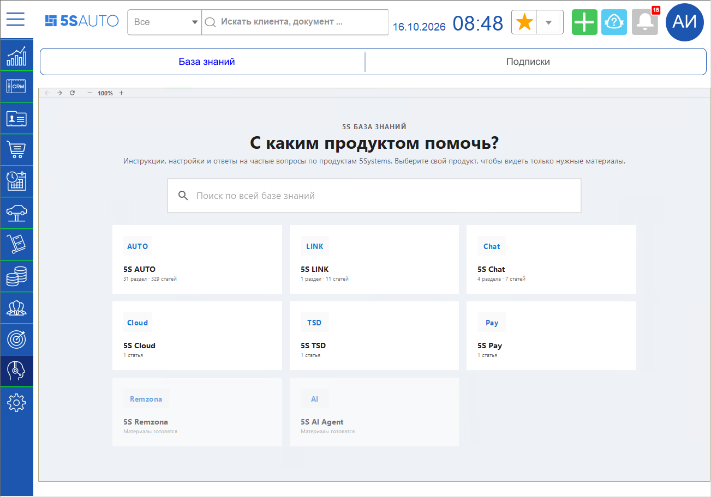
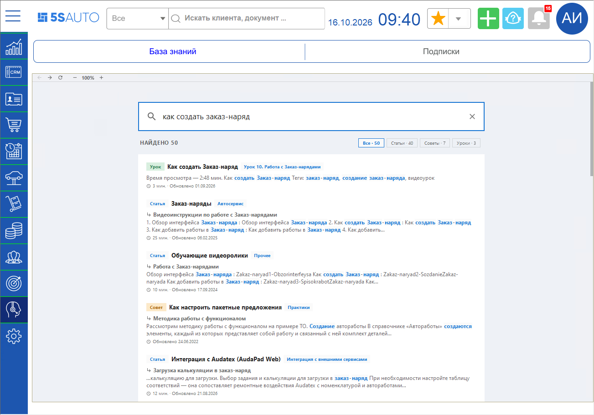
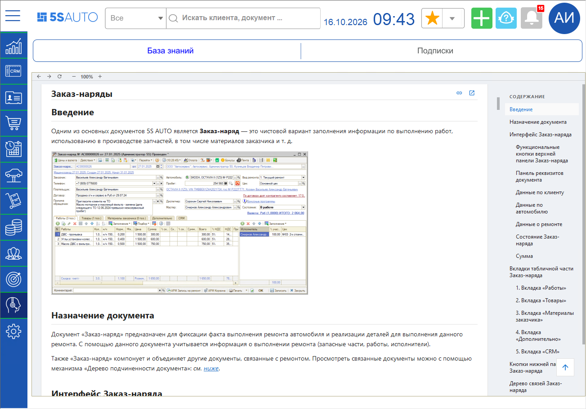
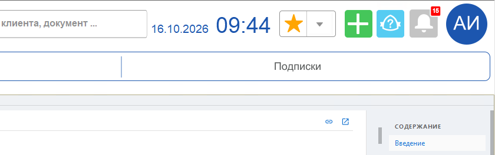
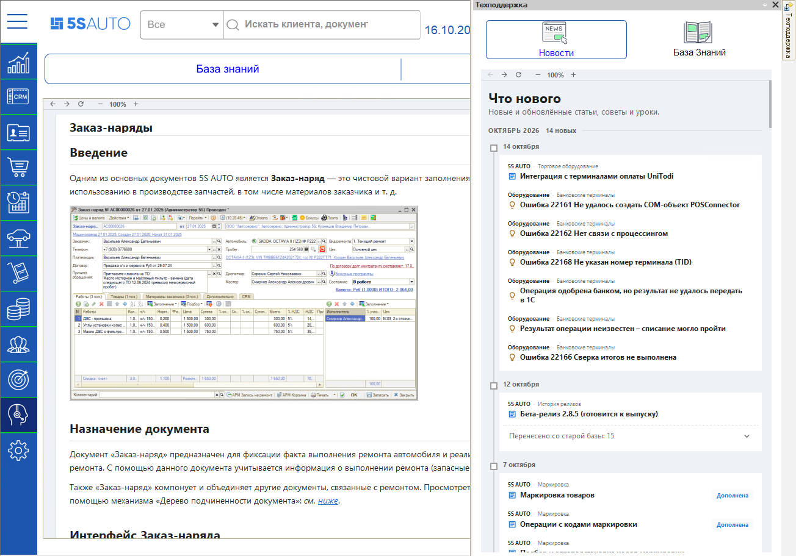
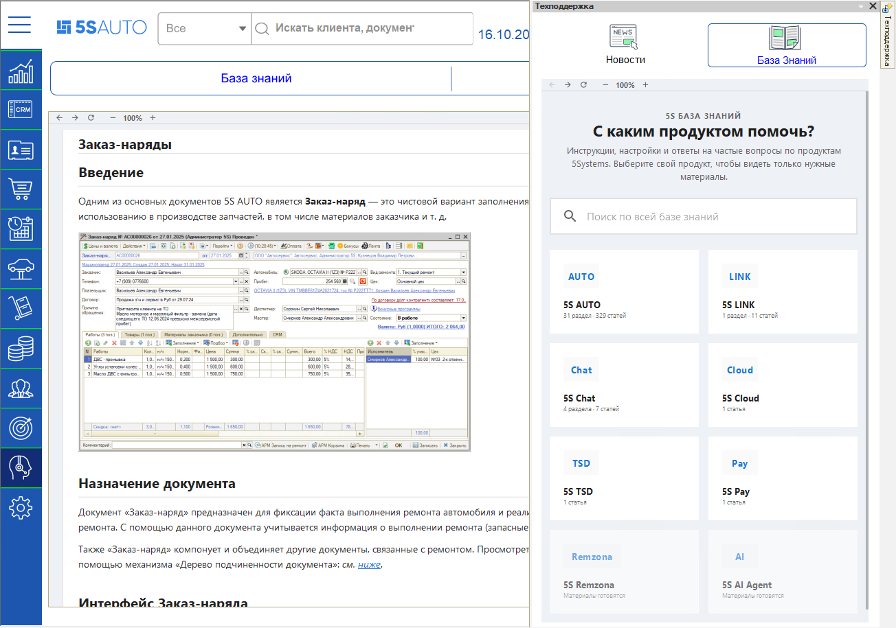
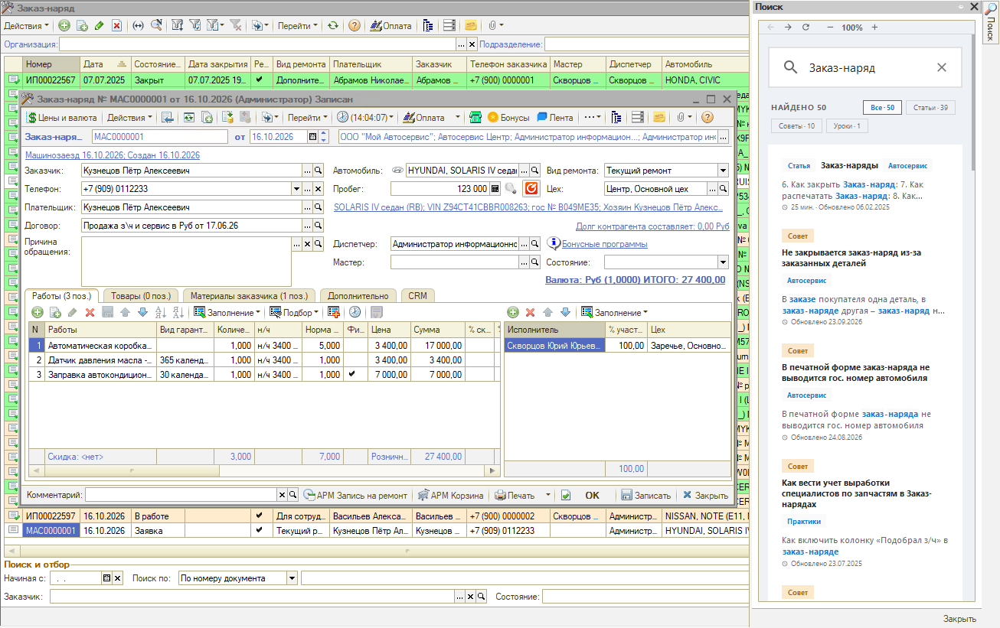

# Переход к Базе знаний из программы

<table><tr><td><b>Время чтения:</b> 3 мин.</td><td><b>Обновлено:</b> 06.10.2026</td></tr></table>

> *Актуально начиная с версии релиза 5S AUTO **2.8.5**.*

> 🛠 Комментарий для черновика: *Реализовано в конфигурации версии 2.8.4.57.*

## Содержание

- [Введение](#введение)
- [База знаний на рабочем столе](#база-знаний-на-рабочем-столе)
- [Панель «Техподдержка»](#панель-техподдержка)
- [Поиск по Базе знаний из документа](#поиск-по-базе-знаний-из-документа)

## Введение

Базу знаний 5SYSTEMS можно открыть прямо в программе 5S AUTO, не переходя в браузер. В программе доступны те же статьи, советы и уроки, что и на сайте [kb.5systems.ru](https://kb.5systems.ru), – с выбором продукта, разделами и поиском.

Открыть Базу знаний можно тремя способами:

- в разделе ***«Техподдержка»*** рабочего стола – на всю рабочую область;
- в панели ***«Техподдержка»*** – справа, не уходя из текущего раздела;
- кнопкой со знаком вопроса в форме или списке основных документов – сразу с результатами поиска по этому виду документа.

> [!NOTE]
> Для работы с Базой знаний нужен доступ в интернет к сайту kb.5systems.ru. Без доступа область Базы знаний останется пустой или покажет ошибку браузера.

## База знаний на рабочем столе

В боковом меню выберите раздел ***«Техподдержка»*** и подвкладку ***«База знаний»*** – откроется главная страница Базы знаний. При первом открытии она может загружаться дольше обычного. На соседней подвкладке ***«Подписки»*** – подписки компании (см. статью «[Подписки компании в программе](../Подписки%20компании%20в%20программе/podpiski-kompanii-v-programme.md)»).

Подробнее о разделах бокового меню и верхней панели – в статье «[Структура интерфейса 5S AUTO](https://kb.5systems.ru/articles/5s-auto/crm/struktura-interfeysa-5s-auto)».

Выберите свой продукт, например *5S AUTO*, – после этого в разделах будут видны только материалы по выбранному продукту.

Над Базой знаний расположена панель с кнопками ***«Назад»***, ***«Вперед»*** и ***«Обновить»*** и масштабом страницы (кнопки ***«−»*** и ***«+»***).

> 🛠 Комментарий для черновика: *Предложение по доработке: добавить на панель над Базой знаний кнопку «Домой» – переход на главную страницу Базы знаний.*

Чтобы найти нужный материал, начните вводить запрос в строку ***«Поиск по всей базе знаний»*** на странице: результаты появляются сразу во время ввода. Их можно отфильтровать по статьям, советам и урокам.

> [!NOTE]
> Строка поиска в шапке рабочего стола по Базе знаний не ищет – она ищет клиентов и документы, как и в остальных разделах (см. статью «[Работа с полнотекстовым поиском](https://kb.5systems.ru/articles/5s-auto/crm/rabota-s-polnotekstovym-poiskom)»).

Статья открывается здесь же, на подвкладке ***«База знаний»***: справа – содержание статьи. Ссылки из статей на другие сайты открываются в браузере.

Если перейти в другой раздел бокового меню интерфейса, например ***«CRM»***, а потом вернуться в ***«Техподдержку»***, страница не перезагружается – на подвкладке ***«База знаний»*** останется открытой та же статья. Главная страница Базы знаний откроется заново после перезапуска рабочего стола. Также к главной странице раздела *5S AUTO* можно вернуться по ссылке ***«5S AUTO»*** в начале строки пути над статьей.

О работе с сайтом Базы знаний – в советах «[Как перейти в Базу знаний](https://kb.5systems.ru/tips/tekhpodderzhka/kak-pereyti-v-bazu-znaniy)» и «[Как быстро найти нужную статью на Базе знаний](https://kb.5systems.ru/tips/tekhpodderzhka/kak-bystro-nayti-nuzhnuyu-statyu-na-baze-znaniy)».

## Панель «Техподдержка»

Панель ***«Техподдержка»*** открывается голубой кнопкой со знаком вопроса в шапке рабочего стола (подсказка ***«Техподдержка»***) – между зеленой кнопкой ***«+»*** и кнопкой уведомлений.

Панель появляется у правого края окна, в ней две вкладки:

- ***«Новости»*** – страница *«Что нового»* Базы знаний: новые и обновленные материалы. На этой вкладке панель открывается;
- ***«База Знаний»*** – главная страница Базы знаний.

> 🛠 Комментарий для черновика: *Вкладка «Тикеты» временно удалена: позже на ней будет автоматическая авторизация через 5S Cloud и сразу будут подгружаться тикеты портала техподдержки – тогда описать.*

Панель узкая, поэтому сайт в ней показывается в компактном виде. Если панель не закреплена, она сворачивается в кнопку ***«Техподдержка»*** у правого края окна. Чтобы панель оставалась открытой, закрепите ее кнопкой в заголовке панели. Ширину панели можно изменить мышью, потянув за ее левый край.

## Поиск по Базе знаний из документа

В формах и списках основных документов Базу знаний открывает кнопка со знаком вопроса на командной панели. Раньше она открывала типовую справку программы, теперь – поиск по Базе знаний. Так работают документы:

- *«Заказ-наряд»*, *«Заказ покупателя»*, *«Реализация товаров»*, *«Чек на оплату»*;
- *«Заказ поставщику»*, *«Поступление товаров»*;
- *«Перемещение товаров»*, *«Перемещение товаров в производство»*;
- *«Банковская выписка»*, *«Приходный кассовый ордер»*, *«Расходный кассовый ордер»*.

В остальных документах кнопка со знаком вопроса по-прежнему открывает типовую справку программы. Клавиша ***F1*** тоже открывает типовую справку.

**1.** Нажмите кнопку со знаком вопроса – у правого края окна откроется панель ***«Поиск»***. В строку поиска автоматически подставляется название вида документа, например *«Заказ-наряд»*. 
**2.** Откройте нужную статью из результатов поиска или измените запрос в строке поиска на странице. 
**3.** Закройте панель кнопкой ***«Закрыть»***.

Поиск идет по всей Базе знаний, а не только по материалам 5S AUTO. Номер документа, клиент и другие данные документа в запрос не передаются.

Панель ***«Поиск»*** в программе одна: если она уже открыта, при нажатии кнопки в другом документе в ней выполняется новый поиск по этому документу. Если панель не закреплена, она сворачивается в кнопку ***«Поиск»*** у правого края окна – чтобы панель оставалась открытой, закрепите ее кнопкой в заголовке панели. Ширину панели можно изменить мышью, потянув за ее левый край.

> 🛠 Комментарий для черновика: *Техническая информация из описания разработчика:*
> - *Подвкладка «Помощь» раздела «Техподдержка» переименована в «База знаний», подвкладки «Список вопросов» и «Техподдержка» удалены; сохраненные настройки рабочего стола обновляются автоматически.*
> - *Старые источники справки (wiki.5-systems.ru, раздел помощи на 5systems.ru, поиск по форуму) больше не вызываются.*

---

**Теги:** База знаний, справка, помощь, техподдержка, поиск в справке, поиск в базе знаний, статьи, советы, уроки, панель Техподдержка
