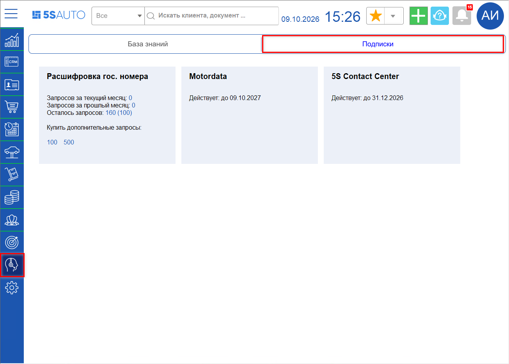
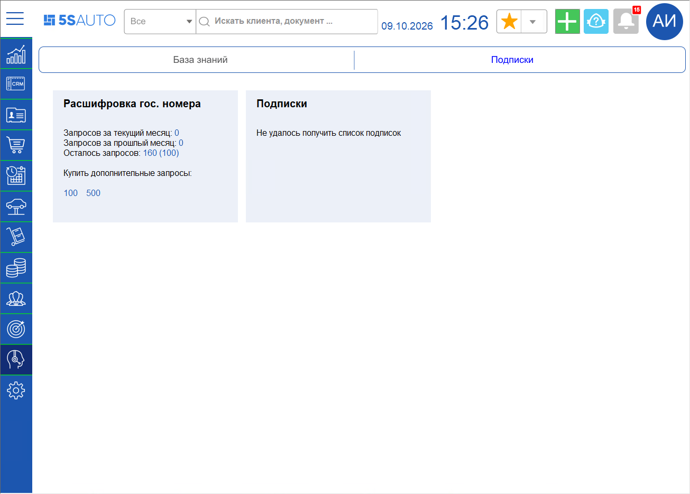

# Подписки компании в программе

<table><tr><td><b>Время чтения:</b> 2 мин.</td><td><b>Создано:</b> 16.10.2026</td></tr></table>

> *Актуально начиная с версии релиза 5S AUTO **2.8.5**.*

## Содержание

- [Введение](#введение)
- [Где посмотреть подписки](#где-посмотреть-подписки)
- [Карточка подписки](#карточка-подписки)
- [Если подписки не отображаются](#если-подписки-не-отображаются)

## Введение

В программе 5S AUTO можно посмотреть, какие подписки 5SYSTEMS подключены у компании и до какого числа они действуют. Это помогает следить за сроками и вовремя продлевать подписки, чтобы подключенные сервисы не перестали работать. Данные о подписках программа получает от сервиса 5SYSTEMS при каждом открытии.

## Где посмотреть подписки

**1.** В боковом меню выберите раздел ***«Техподдержка»***. 
**2.** Откройте подвкладку ***«Подписки»***.

Справа от карточки ***«Расшифровка гос. номера»*** появятся карточки подписок компании – по одной на каждую подписку.

Список подписок запрашивается заново при каждом открытии подвкладки и в программе не сохраняется, поэтому для его просмотра нужен доступ в интернет.

Карточки раскладываются в ряд по ширине окна и при нехватке места переносятся на следующую строку.

## Карточка подписки

В карточке подписки указаны:

- ***название подписки*** (тарифа) – например, *«5S Contact Center»* или *«Motordata»*;
- ***срок действия*** – строка *«Действует: до ДД.ММ.ГГГГ»* с датой окончания подписки или *«Действует: бессрочно».*

Других данных в карточке нет, по нажатию на карточку ничего не открывается.

Карточка ***«Расшифровка гос. номера»*** не изменилась: в ней по-прежнему количество запросов за текущий и прошлый месяц, остаток запросов и кнопки покупки дополнительных запросов.

## Если подписки не отображаются

Если получить подписки не удалось, вместо карточек подписок выводится одна карточка ***«Подписки»*** с сообщением:

| Сообщение | Когда появляется |
| --- | --- |
| Интеграция с API 5S AUTO не настроена | В программе нет настроенной интеграции с API 5S AUTO (см. статью «[API 5S AUTO](../../../Администрирование%20и%20настройка%20системы/API%205S%20AUTO/api-5s-auto.md)») |
| Активных подписок нет | Сервис ответил, но действующих подписок у компании нет |
| Не удалось получить список подписок | Сервис не ответил или вернул ошибку – например, нет доступа в интернет |

Если сообщение «Не удалось получить список подписок» появляется постоянно, обратитесь в техническую поддержку (см. статью «[Как обратиться в техническую поддержку](../Как%20обратиться%20в%20техническую%20поддержку/kak-obratitsya-v-tekhnicheskuyu-podderzhku.md)»).

---

**Теги:** подписки, тарифы, срок действия подписки, техподдержка, API 5S AUTO, расшифровка гос. номера
