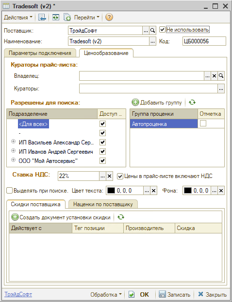
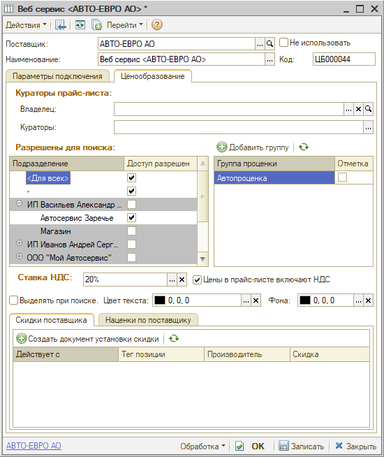

# Создание и настройка Веб прайс-листа

<table><tr><td><b>Время чтения:</b> 5 мин.</td><td><b>Обновлено:</b> 17.11.2026</td></tr></table>

Источник: https://www.5systems.ru/help/sozdanie-i-nastroyka-veb-prays-lista

###### *Опубликовано 02.09.2026: [https://kb.5systems.ru/articles/5s-auto/sklad-i-zapchasti/sozdanie-i-nastroyka-veb-prays-lista](https://kb.5systems.ru/articles/5s-auto/sklad-i-zapchasti/sozdanie-i-nastroyka-veb-prays-lista)*

## Содержание

- [Введение](#введение)
- [Создание Веб прайс-листа](#создание-веб-прайс-листа)
- [Доступ к Веб прайс-листу в Поиске цен](#доступ-к-веб-прайс-листу-в-поиске-цен)
- **Настройка параметров:**
  - [для проценки](#настройка-параметров-для-проценки)
  - [для отправки заказа поставщику](#настройка-параметров-для-отправки-заказа-поставщику)
  - [для формирования заказа поставщику из локальных прайс-листов](#настройка-параметров-для-формирования-заказа-поставщику-из-локальных-прайс-листов)
- [Перечень доступных Веб-сервисов поставщиков](#перечень-доступных-веб-сервисов-поставщиков)

## Введение

В системе предусмотрена работа с Веб-сервисами поставщиков для поиска цен и осуществления заказов. Для подключения Веб-сервиса необходимо создать прайс-лист контрагента вида "Веб-сервис поставщика" и произвести его настройку.

## Создание Веб прайс-листа

Для создания Веб прайс-листа необходимо выполнить следующие действия:

1. Создать прайс-лист (см. *[Создание прайс-листа поставщика](../Создание%20и%20настройка%20прайс-листа%20контрагента/sozdanie-i-nastroyka-prays-lista-kontragenta.md)*).

2. В поле "Вид прайс-листа" выбрать значение "Веб-сервис поставщика".

3. В поле "Обработчик" выбрать веб-сервис поставщика.

4. Произвести настройки подключения к Веб-сервису. Для каждого Веб-сервиса предусмотрены собственные настройки подключения.

5. Сохранить изменения.

6. Произвести настройку Веб-сервиса:

   **1.** указать параметры для проценки, 
   **2.** указать параметры для отправки заказа поставщику, либо размещения заказа в корзине у поставщика, 
   **3.** указать параметры для формирования заказов поставщику из локальных прайс-листов.

## Настройка параметров для проценки

Настройка производится на вкладке "Проценка".

Для настройки проценки используются следующие параметры:

| Параметр | Значения | Описание |
| --- | --- | --- |
| **Способ проценки** | <ul><li>Не использовать</li><li>Веб-сервис</li></ul> | Включает или отключает использование данного прайс-листа в проценке |
| **Переиспользовать получаемые аналоги** | Да/Нет | Использовать или нет аналоги, получаемые от поставщика, для поиска наличия на складах и в загруженных локально прайс-листах |
| **Установить срок поставки от поставщика до компании** | Форма ввода срока поставки | Добавляется к сроку поставки из Веб-сервиса |
| **Кэш проценки** | Поля ввода дней, часов или минут | Позволяет запоминать результат поиска цен из Веб-сервиса на указанное время. После чего снова обращается к Веб-сервису за актуальными данными. Значительно ускоряет проценку.  При установленном кэшировании проценки есть возможность просмотреть детали, запомненные в кэше и очистить кэш, используя опцию "Статистика кэш" |

## Настройка параметров для отправки заказа поставщику

В Системе предусмотрена возможность либо отправить заказ поставщику, либо разместить заказ в корзине поставщика. Настройка производится на вкладке "Заказ".

Для настройки отправки заказа поставщику используются следующие параметры:

| Параметр | Значения | Описание |
| --- | --- | --- |
| **Положить в корзину** | Да/Нет | Включает или отключает возможность размещения заказа в корзине поставщика |
| **Разместить заказ** | Да/Нет | Включает или отключает возможность непосредственного размещения заказ у поставщика |
| **Помечать новые позиции заказов** | <ul><li>Не помечать</li><li>Отправка вручную</li><li>Отправка автоматически (при проведении)</li></ul> | Служит для заполнения по умолчанию поля "Веб заказ" в табличной части заказа поставщику |

## Настройка параметров для формирования заказа поставщику из локальных прайс-листов

Настройка производится на вкладке "Заказ".

Для настройки необходимо добавить локальный прайс-лист в табличную часть "Локальные прайс-листы доступные для веб-заказа" и задать реквизиты предложения, если они необходимы для конкретного обработчика Веб-сервиса.

## Доступ к Веб прайс-листу в Поиске цен

Чтобы убрать прайс-лист с панели прайс-листов в Поиске цен, установите галочку "Не использовать" в шапке карточки.

Доступ задается на вкладке "Ценообразование" карточки прайс-листа, в разделе "Разрешены для поиска". Галочка "Доступ разрешен" ставится по организациям и подразделениям компании. Галочка у организации проставляется и снимается на все ее подразделения.

## Перечень доступных Веб-сервисов поставщиков

См. по *[ссылке](../Доступные%20Веб-сервисы%20поставщиков/dostupnye-veb-servisy-postavschikov.md)*.

---

**Теги:** веб прайс-лист, веб-сервис поставщика, проценка, заказ поставщику, локальные прайс-листы
