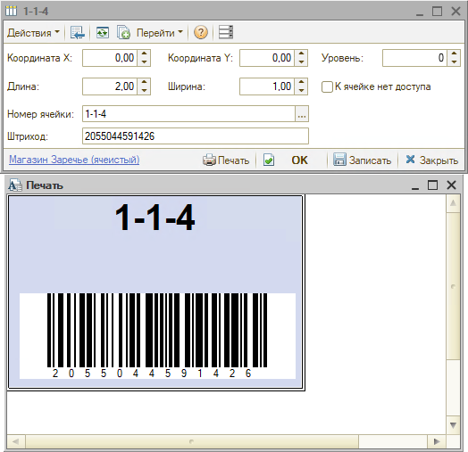

# Штрихкодирование ячеек хранения

<table><tr><td><b>Время чтения:</b> 6 мин.</td><td><b>Создано:</b> 12.10.2026</td></tr></table>

> *Актуально начиная с версии релиза 5S AUTO **2.8.5**.*

> 🛠 Комментарий для черновика: *Реализовано в конфигурации версии 2.8.4.58.*

## Содержание

- [Введение](#введение)
- [Присвоение штрихкода ячейке](#присвоение-штрихкода-ячейке)
- [Печать этикеток ячеек](#печать-этикеток-ячеек)
- [Указание ячейки при сканировании](#указание-ячейки-при-сканировании)
- [Настройки](#настройки)

## Введение

В программе штрихкоды можно присваивать не только [номенклатуре](https://kb.5systems.ru/articles/5s-auto/sklad-i-zapchasti/naznachenie-shtrikhkodov-tovaram#присвоение-штрихкода-номенклатуре) и [документам](https://kb.5systems.ru/articles/5s-auto/sklad-i-zapchasti/interfeys-dlya-tsd), но и *ячейкам хранения* склада. Это нужно, чтобы автоматизировать заполнение ячеек хранения при приемке товаров: достаточно последовательно отсканировать штрихкод на товаре и штрихкод ячейки – и ячейка подставится в документ. Так сокращается время, которое складской персонал тратит на рутинную работу.

Порядок работы такой:

**1.** Присвойте ячейкам склада штрихкоды – вручную или автоматически (см. [ниже](#присвоение-штрихкода-ячейке)). 
**2.** Напечатайте этикетки со штрихкодами и наклейте их на ячейки (см. [ниже](#печать-этикеток-ячеек)). 
**3.** При приемке товаров сканируйте штрихкод товара, а затем штрихкод ячейки (см. [ниже](#указание-ячейки-при-сканировании)).

О видах склада и ячеистом хранении – в статье «[Виды склада](../../Виды%20склада/vidy-sklada.md)», о создании ячеек – в статье «[Инвентаризация → Создание ячеек хранения для склада](https://kb.5systems.ru/articles/5s-auto/sklad-i-zapchasti/inventarizaciya#создание-ячеек-хранения-для-склада)».

## Присвоение штрихкода ячейке

Штрихкод ячейки указывается в карточке ячейки хранения в поле ***«Штрихкод»*** и сохраняется при записи карточки. Карточка ячейки открывается из карточки склада на вкладке ***«Ячейки»*** – там же в колонке ***«Штрихкод»*** видны штрихкоды всех ячеек склада.

- Штрихкод можно ввести *вручную* или *сгенерировать:* кнопка ***«Заполнить штрихкоды»*** на вкладке ***«Ячейки»*** карточки склада присваивает штрихкоды формата EAN-13 всем ячейкам и группам ячеек склада, у которых штрихкода еще нет. Уже присвоенные штрихкоды не меняются. Сгенерированные штрихкоды записываются сразу, без нажатия ***«Записать»***.
- У ячейки может быть только *один* штрихкод: при записи нового значения прежнее заменяется.
- Формат штрихкода при вводе не проверяется. Для ячеек рекомендуется использовать штрихкоды формата *EAN-13* – такие штрихкоды создает кнопка ***«Заполнить штрихкоды»***.
- При копировании ячейки штрихкод не копируется.

> [!WARNING]
> Уникальность штрихкода, введенного вручную, не проверяется: ячейке можно записать штрихкод, который уже присвоен товару или другой ячейке. Проверка есть только в обратную сторону – присвоить товару штрихкод, который уже есть у ячейки, программа не даст: появится сообщение *«Штрихкод не уникален!»*. Штрихкод ячейки, помеченной на удаление, тоже считается занятым. Следите за уникальностью штрихкодов ячеек самостоятельно – при совпадении сканер может найти не тот товар или не ту ячейку.

## Печать этикеток ячеек

Печать этикеток ячеек доступна только для ордерно-ячеистого склада. Чтобы напечатать этикетки со штрихкодами ячеек:

**1.** Откройте форму ***«Печать ячеек склада»*** одним из способов:

- в списке складов выделите склад и нажмите ***«Печать» → «Печать ячеек склада»***;
- в карточке склада нажмите ***«Печать» → «Все ячейки склада»***.

В форме – список ячеек склада с размерами и штрихкодами. По умолчанию отмечены все ячейки. 
**2.** Снимите отметки с ячеек, этикетки для которых не нужны. Отметить все ячейки или снять все отметки можно кнопками на панели формы. 
**3.** Нажмите ***«Печать»*** – отмеченные ячейки передадутся в обработку *«Печать этикеток и ценников»*: номер ячейки – в колонку *«Номенклатура»*, штрихкод – в колонку *«Штрих код»*. 
**4.** Напечатайте этикетки (см. статью «[Печать этикеток](https://kb.5systems.ru/articles/5s-auto/sklad-i-zapchasti/pechat-etiketok)»).

Если не отметить ни одной ячейки, при нажатии ***«Печать»*** появится сообщение *«Не отмечено ни одной ячейки для печати»*.

Ячейку можно добавить и прямо в обработке *«Печать этикеток и ценников»*: в колонке *«Номенклатура»* выберите тип *«Ячейки хранения»* и нужную ячейку.

Этикетку одной ячейки можно напечатать и сразу из ее карточки: нажмите кнопку ***«Печать»*** – откроется форма с этикеткой этой ячейки. Из списка ячеек – пункт ***«Печать» → «Текущая ячейка»***.

Для каждой ячейки печатается отдельная этикетка с номером ячейки и штрихкодом.

> [!NOTE]
> Если у ячейки нет штрихкода, на ее этикетке печатается только номер ячейки, без штрихкода. Снимите отметки с ячеек без штрихкода или сначала присвойте им штрихкоды.

> 🛠 Комментарий для черновика: *Ограничение печати только видом склада «Ячеистый» не задумано – по ответу разработчика (14.10.2026), его просто не учли; изменений пока не планируется. Если печать откроют для складов других видов – исправить фразу «Печать этикеток ячеек доступна только для ордерно-ячеистого склада» в начале раздела.*

## Указание ячейки при сканировании

В документах *«Поступление товаров»*, *«Реализация товаров»*, *«Инвентаризация товаров»*, *«Приходный складской ордер»* и *«Расходный складской ордер»* ячейку товара можно указать сканером: отсканируйте штрихкод или код маркировки товара, а затем – штрихкод ячейки. Ячейка подставится в колонку ***«Ячейка»*** строки товара.

Штрихкод ячейки нужно отсканировать в течение времени, заданного в настройках (см. [ниже](#настройки)), по умолчанию – 30 секунд. Штрихкод ячейки, отсканированный без товара или после истечения этого времени, не обрабатывается.

> [!WARNING]
> Ячейка ищется по штрихкоду среди ячеек всех складов. Если отсканировать штрихкод ячейки другого склада, она подставится в строку без предупреждения. Проверяйте ячейку в колонке ***«Ячейка»*** после сканирования.

> 🛠 Комментарий для черновика: *Описано по коду и описанию настройки в программе; без сканера не проверено.*

> 🛠 Комментарий для черновика: *Что делает приложение 5S TSD со штрихкодом ячейки после ответа сервиса (выбирает ячейку, показывает ее)? Сейчас в статье не описано. (ОТВЕТ НЕ ПОЛУЧЕН, 01.10.2026)*

## Настройки

Время, в течение которого после сканирования товара можно отсканировать штрихкод ячейки, задается настройкой ***«Таймаут сканирования штрихкода ячейки (сек.)»*** (по умолчанию – 30 секунд). Настройка находится в группе *«Документы → Общие параметры документов → Редактирование документов»* и задается для пользователя (см. статью «[Установка прав и настроек пользователя](https://kb.5systems.ru/articles/5s-auto/polzovateli-i-prava/ustanovka-prav-i-nastroek-polzovatelya)»).

> 🛠 Комментарий для черновика: *Ошибки проверены в программе 14.10.2026 – исправлены все, кроме перечисленных:*
> - *уникальность штрихкода не проверяется: один и тот же штрихкод можно задать ячейкам разных складов, ячейке можно присвоить штрихкод номенклатуры; номенклатуре штрихкод ячейки присвоить нельзя;*
> - *печать текущей ячейки на вкладке «Ячейки» карточки склада («Печать → Текущая ячейка») неактивна, в списке ячеек и в карточке ячейки работает;*
> - *сканирование не проверено (нет сканера): склад документа не проверяется – по разбору кода подставляется первая ячейка с таким штрихкодом по всем складам, без сообщения; неизвестный штрихкод обрабатывается как штрихкод товара, сообщения нет (строка «Штрихкод … не найден!» в коде отключена); сообщения об успешной подстановке тоже нет; сервис для 5S TSD (GET /warehouse/cell): параметр склада в поиске не участвует, в ответе только номер ячейки; при изменении документа приложением ячейка ищется по номеру без учета склада – в документ может попасть ячейка другого склада. После проверки убрать или оставить предупреждение в разделе «Указание ячейки при сканировании».*

> 🛠 Комментарий для черновика: *Техническая информация из описания разработчика (для справки, на сайт не выводится):*
> - *Хранение: штрихкод хранится в общем регистре сведений «Штрих-коды» (там же, где штрихкоды номенклатуры).*
> - *Печать: макет «Ячейки»; сообщение «У склада "…" нет ячеек хранения» при проверке не появлялось – у склада без доступной печати пункты меню неактивны.*
> - *Сканирование: обрабатывается в документах и в API для 5S TSD (GET /warehouse/cell); в «Интерфейсе ТСД» и в карточке номенклатуры сканирование ячеек не обрабатывается.*

---

**Теги:** штрихкоды ячеек, ячейки хранения, штрихкодирование, этикетки ячеек, ордерно-ячеистый склад, сканирование, приемка товаров, складской учет
