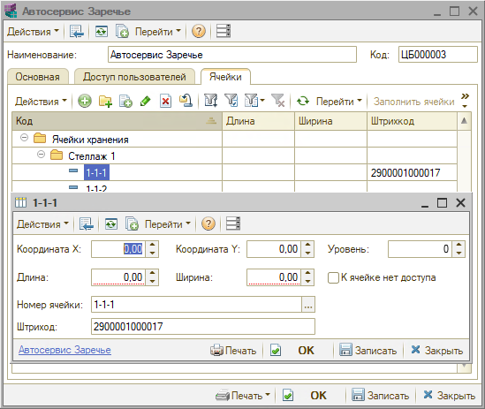
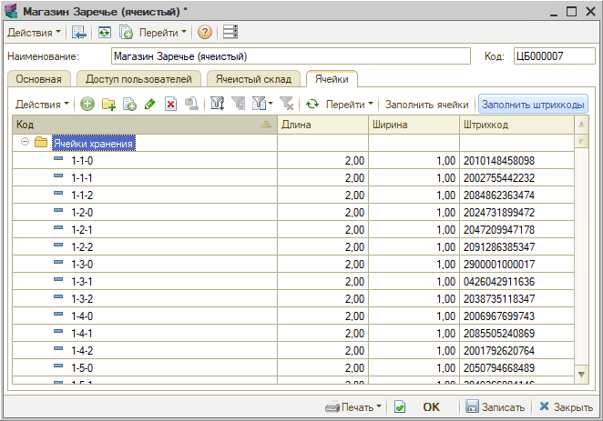
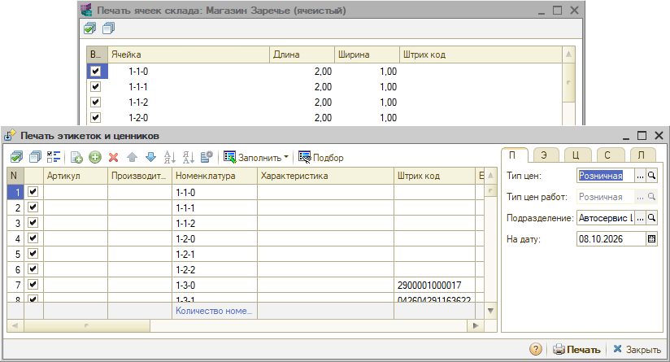
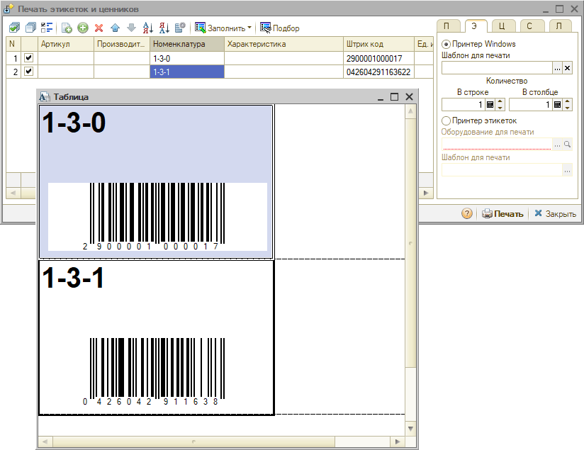
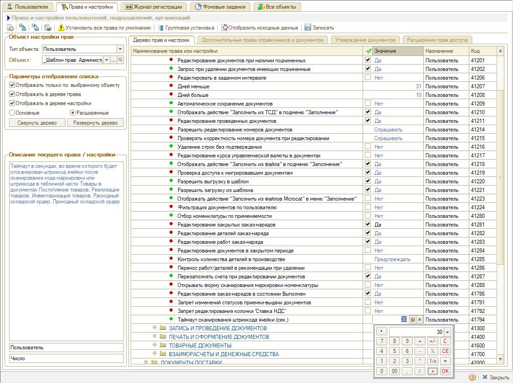

# Штрихкодирование ячеек хранения

<table><tr><td><b>Время чтения:</b> 6 мин.</td><td><b>Создано:</b> 12.10.2026</td></tr></table>

> *Актуально начиная с версии релиза 5S AUTO **2.8.5**.*

> 🛠 Комментарий для черновика: *Реализовано в конфигурации версии 2.8.4.58.*

## Содержание

- [Введение](#введение)
- [Присвоение штрихкода ячейке](#присвоение-штрихкода-ячейке)
- [Печать этикеток ячеек](#печать-этикеток-ячеек)
- [Указание ячейки при сканировании](#указание-ячейки-при-сканировании)
- [Настройки](#настройки)

## Введение

В программе штрихкоды можно присваивать не только [номенклатуре](https://kb.5systems.ru/articles/5s-auto/sklad-i-zapchasti/naznachenie-shtrikhkodov-tovaram#присвоение-штрихкода-номенклатуре) и [документам](https://kb.5systems.ru/articles/5s-auto/sklad-i-zapchasti/interfeys-dlya-tsd), но и *ячейкам хранения* склада. Это нужно, чтобы автоматизировать заполнение ячеек хранения при приемке товаров: достаточно последовательно отсканировать штрихкод на товаре и штрихкод ячейки – и ячейка подставится в документ. Так сокращается время, которое складской персонал тратит на рутинную работу.

Порядок работы такой:

**1.** Присвойте ячейкам склада штрихкоды – вручную или автоматически (см. [ниже](#присвоение-штрихкода-ячейке)). 
**2.** Напечатайте этикетки со штрихкодами и наклейте их на ячейки (см. [ниже](#печать-этикеток-ячеек)). 
**3.** При приемке товаров сканируйте штрихкод товара, а затем штрихкод ячейки (см. [ниже](#указание-ячейки-при-сканировании)).

О видах склада и ячеистом хранении – в статье «[Виды склада](../../Виды%20склада/vidy-sklada.md)», о создании ячеек – в статье «[Инвентаризация → Создание ячеек хранения для склада](https://kb.5systems.ru/articles/5s-auto/sklad-i-zapchasti/inventarizaciya#создание-ячеек-хранения-для-склада)».

## Присвоение штрихкода ячейке

Штрихкод ячейки указывается в карточке ячейки хранения в поле ***«Штрихкод»*** и сохраняется при записи карточки. Карточка ячейки открывается из карточки склада на вкладке ***«Ячейки»*** – там же в колонке ***«Штрихкод»*** видны штрихкоды всех ячеек склада.

- Штрихкод можно ввести *вручную* или *сгенерировать:* кнопка ***«Заполнить штрихкоды»*** на вкладке ***«Ячейки»*** карточки склада присваивает штрихкоды формата EAN-13 всем ячейкам и группам ячеек склада, у которых штрихкода еще нет. Уже присвоенные штрихкоды не меняются. Сгенерированные штрихкоды записываются сразу, без нажатия ***«Записать»***.
- У ячейки может быть только *один* штрихкод: при записи нового значения прежнее заменяется.
- Формат штрихкода при вводе не проверяется, но на этикетке штрихкод печатается в формате EAN-13 (или EAN-8, если в штрихкоде ровно 8 символов). Поэтому штрихкод ячейки должен быть корректным *EAN-13* – 13 цифр с верной контрольной цифрой – или *EAN-8*. Иначе на этикетке напечатается другой код, и по нему ячейка не найдется.
- При копировании ячейки штрихкод не копируется.

> [!WARNING]
> Уникальность штрихкода, введенного вручную, не проверяется: ячейке можно записать штрихкод, который уже присвоен товару или другой ячейке. Проверка есть только в обратную сторону – присвоить товару штрихкод, который уже есть у ячейки, программа не даст: появится сообщение *«Штрихкод не уникален!»*. Штрихкод ячейки, помеченной на удаление, тоже считается занятым. Следите за уникальностью штрихкодов ячеек самостоятельно – при совпадении сканер может найти не тот товар или не ту ячейку.

## Печать этикеток ячеек

Печать этикеток ячеек доступна только для ордерно-ячеистого склада. Чтобы напечатать этикетки со штрихкодами ячеек:

**1.** Откройте форму ***«Печать ячеек склада»*** одним из способов:

- в списке складов выделите склад и нажмите ***«Печать» → «Печать ячеек склада»***;
- в карточке склада нажмите ***«Печать» → «Все ячейки склада»***.

В форме – список ячеек склада с размерами и штрихкодами. По умолчанию отмечены все ячейки. 
**2.** Снимите отметки с ячеек, этикетки для которых не нужны. Отметить все ячейки или снять все отметки можно кнопками на панели формы. 
**3.** Нажмите ***«Печать»*** – отмеченные ячейки передадутся в обработку *«Печать этикеток и ценников»*: номер ячейки – в колонку *«Номенклатура»*, штрихкод – в колонку *«Штрих код»*. 
**4.** Напечатайте этикетки (см. статью «[Печать этикеток](https://kb.5systems.ru/articles/5s-auto/sklad-i-zapchasti/pechat-etiketok)»).

Если не отметить ни одной ячейки, при нажатии ***«Печать»*** появится сообщение *«Не отмечено ни одной ячейки для печати»*.

Ячейку можно добавить и прямо в обработке *«Печать этикеток и ценников»*: в колонке *«Номенклатура»* выберите тип *«Ячейки хранения»* и нужную ячейку.

Для каждой ячейки печатается отдельная этикетка с номером ячейки и штрихкодом.

> [!NOTE]
> Этикетки ячеек печатаются по встроенному макету. Перед печатью очистите поле ***«Шаблон для печати»*** на вкладке ***«Этикетки»*** обработки *«Печать этикеток и ценников»*: если в нем выбран файл шаблона, печать завершится ошибкой.

> [!WARNING]
> Если у ячейки нет штрихкода, на ее этикетке печатается штрихкод-образец *1234567890128* – одинаковый для всех таких ячеек. Снимите отметки с ячеек без штрихкода или сначала присвойте им штрихкоды.

> 🛠 Комментарий для черновика: *Вопрос (вопрос еще не задан): печать ячеек в коде разрешена только для склада вида «Ячеистый» (у обычного склада с ячейками пункты печати недоступны), хотя присвоить штрихкод можно ячейке склада любого вида. Так задумано? По разбору кода замысел не виден – похоже, ограничение осталось от старой печати ячеек.*

## Указание ячейки при сканировании

В документах *«Поступление товаров»*, *«Реализация товаров»*, *«Инвентаризация товаров»*, *«Приходный складской ордер»* и *«Расходный складской ордер»* ячейку товара можно указать сканером: отсканируйте штрихкод или код маркировки товара, а затем – штрихкод ячейки. Ячейка подставится в колонку ***«Ячейка»*** строки товара.

Штрихкод ячейки нужно отсканировать в течение времени, заданного в настройках (см. [ниже](#настройки)), по умолчанию – 30 секунд. Штрихкод ячейки, отсканированный без товара или после истечения этого времени, не обрабатывается.

> [!WARNING]
> Ячейка ищется по штрихкоду среди ячеек всех складов. Если отсканировать штрихкод ячейки другого склада, она подставится в строку без предупреждения. Проверяйте ячейку в колонке ***«Ячейка»*** после сканирования.

> 🛠 Комментарий для черновика: *Описано по коду и описанию настройки в программе; без сканера не проверено.*

> 🛠 Комментарий для черновика: *Что делает приложение 5S TSD со штрихкодом ячейки после ответа сервиса (выбирает ячейку, показывает ее)? Сейчас в статье не описано. (ОТВЕТ НЕ ПОЛУЧЕН, 01.10.2026)*

## Настройки

Время, в течение которого после сканирования товара можно отсканировать штрихкод ячейки, задается настройкой ***«Таймаут сканирования штрихкода ячейки (сек.)»*** (по умолчанию – 30 секунд). Настройка находится в группе *«Документы → Общие параметры документов → Редактирование документов»* и задается для пользователя (см. статью «[Установка прав и настроек пользователя](https://kb.5systems.ru/articles/5s-auto/polzovateli-i-prava/ustanovka-prav-i-nastroek-polzovatelya)»).

> 🛠 Комментарий для черновика: *Ошибки – подтверждены разбором по коду (ответы от 09.10, на вопросы 4–8 и от 12.10) или проверкой в программе. По словам разработчика (14.10.2026), ошибки поправлены – все или нет, неизвестно; нужна проверка в программе по каждому пункту. Исправленное убрать отсюда, а примечания в разделе «Печать этикеток ячеек» и предупреждение в разделе «Указание ячейки при сканировании» – из текста статьи:*
> - ***Присвоение штрихкода:***
>   - *колонка «Штрихкод» на вкладке «Ячейки» в карточке склада показывает штрихкод по номеру ячейки, а не по самой ячейке: у ячеек с одинаковыми номерами на разных складах в колонке оказывается штрихкод ячейки другого склада, а в карточке ячейки – свой, верный. Пример: у 1-1-2 «Автосервиса Заречье» записан 2054959362373 – в колонке «Магазина Заречье» у 1-1-2 тоже 2054959362373, хотя в карточке ячейки 2084862363474. Сами штрихкоды не перезаписываются, в форме «Печать ячеек склада» и в «Печати этикеток и ценников» штрихкоды верные. По коду: форма склада, процедура ЯчейкиПриПолученииДанных, ищет ячейку через Справочники.ЯчейкиХранения.НайтиПоКоду(Код) без указания склада-владельца. До исправления фраза «в колонке «Штрихкод» видны штрихкоды всех ячеек склада» верна только для складов без совпадающих номеров ячеек;*
>   - *колонка «Штрихкод» после записи ячейки не обновляется – новое значение видно только после повторного открытия карточки склада;*
>   - *при очистке поля «Штрихкод» и записи ячейки – ошибка «Запись не верна! Значение поля "Штрих-Код" не может быть пустым! (Регистр сведений: Штрих-коды)», но штрихкод при этом удаляется. Удаление штрихкода в статье не описано;*
>   - *уникальность штрихкода, введенного вручную, не проверяется: ячейке можно записать штрихкод товара или другой ячейки (обратная проверка – товару нельзя присвоить штрихкод ячейки – есть). Проверено в программе, по коду не разбиралось;*
> - ***Печать этикеток:***
>   - *печать одной ячейки старой обработкой «Печать ячеек» – кнопка «Печать» в карточке ячейки (по коду так же «Печать / Текущая ячейка» в списке ячеек и печать текущей ячейки на вкладке «Ячейки» карточки склада) – ошибка «Обработка.ПечатьЯчеек.МодульОбъекта(17): Поле объекта не обнаружено (Штрихкод)»: в режиме одной ячейки в таблице обработки нет колонки «Штрихкод». Эти кнопки в статье не описываем;*
>   - *если на вкладке «Этикетки» «Печати этикеток и ценников» выбран файл шаблона, печать ячеек завершается ошибкой «Область не найдена: Строка» (Обработка.ПечатьЭтикетокИЦенников.МодульОбъекта(876), Макет.ПолучитьОбласть("Строка|Колонка")): программа берет для ячеек товарный шаблон из файла. С пустым полем печать по встроенному макету «Ячейки» работает; после исправления убрать примечание в разделе «Печать этикеток ячеек»;*
>   - *у ячейки без штрихкода на этикетке печатается штрихкод-образец 1234567890128 – одинаковый для всех таких ячеек; после исправления убрать предупреждение в разделе «Печать этикеток ячеек»;*
>   - *штрихкод, не являющийся корректным EAN-13, на этикетке искажается: программа берет первые 12 цифр (короткий код дополняет нулями справа) и заново рассчитывает контрольную – у 042604291163622 напечатано 0 426042 911638. При вводе формат не проверяется и программа не предупреждает;*
> - ***Сканирование:***
>   - *склад документа не проверяется – подставляется первая ячейка с таким штрихкодом по всем складам, без сообщения; неизвестный штрихкод обрабатывается как штрихкод товара, сообщения нет (строка «Штрихкод … не найден!» в коде отключена); об успешной подстановке сообщения тоже нет;*
>   - *сервис для 5S TSD (GET /warehouse/cell): параметр склада в поиске не участвует, в ответе только номер ячейки (без склада и идентификатора); при изменении документа приложением ячейка ищется по номеру без учета склада – в документ может попасть ячейка другого склада*

> 🛠 Комментарий для черновика: *Техническая информация из описания разработчика (для справки, на сайт не выводится):*
> - *Хранение: штрихкод хранится в общем регистре сведений «Штрих-коды» (там же, где штрихкоды номенклатуры).*
> - *Печать: макет «Ячейки»; сообщение «У склада "…" нет ячеек хранения» при проверке не появлялось – у склада без доступной печати пункты меню неактивны.*
> - *Сканирование: обрабатывается в документах и в API для 5S TSD (GET /warehouse/cell); в «Интерфейсе ТСД» и в карточке номенклатуры сканирование ячеек не обрабатывается.*

---

**Теги:** штрихкоды ячеек, ячейки хранения, штрихкодирование, этикетки ячеек, ордерно-ячеистый склад, сканирование, приемка товаров, складской учет
