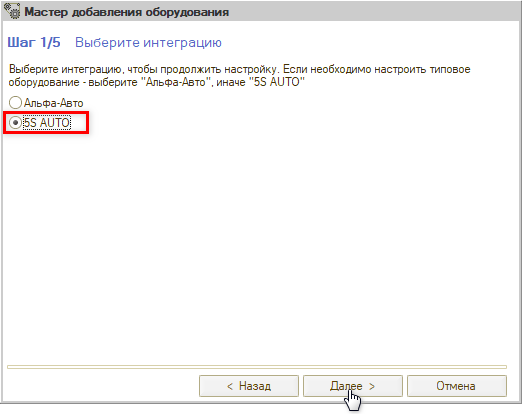
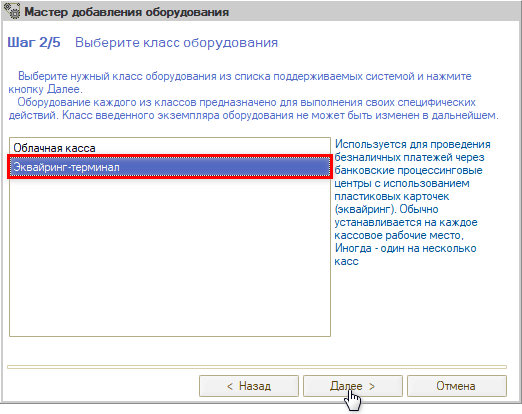
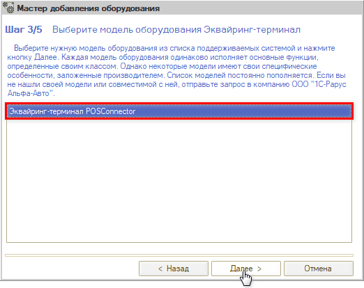
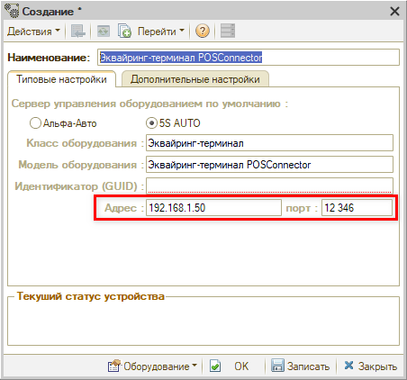
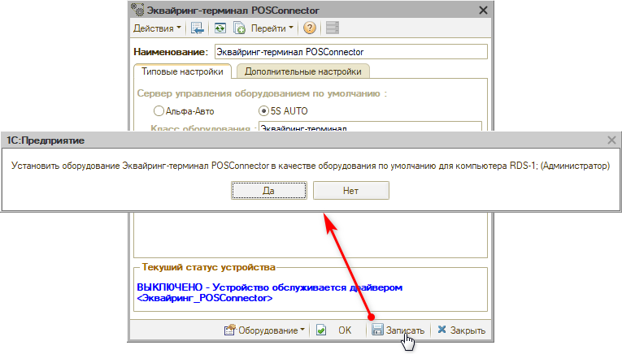
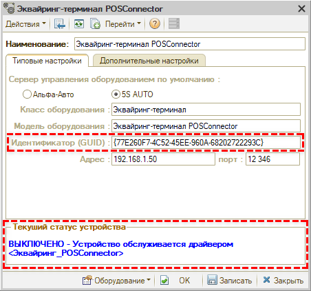
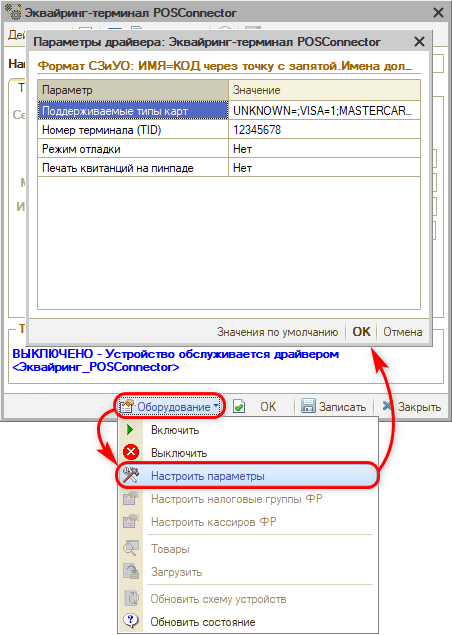
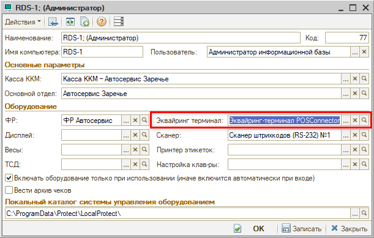
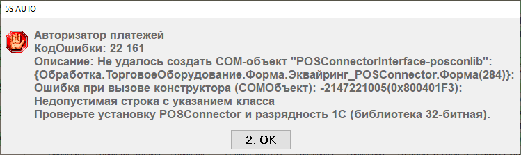

# Интеграция с терминалами оплаты UniTodi

<table><tr><td><b>Время чтения:</b> 10 мин.</td><td><b>Создано:</b> 14.10.2026</td></tr></table>

> *Актуально начиная с версии релиза 5S AUTO **2.8.5**.*

>  **Статья для опытных пользователей!**

> [!NOTE]
> Описание настройки уточняется, могут быть изменения в статье.

## Содержание

- [Введение](#введение)
- [Подготовка к настройке](#подготовка-к-настройке)
  - [Подключение терминала к сети](#подключение-терминала-к-сети)
  - [Библиотека POSConnector](#библиотека-posconnector)
- [Подключение терминала](#подключение-терминала)
  - [Параметры драйвера](#параметры-драйвера)
  - [Настройка терминала в рабочем месте](#настройка-терминала-в-рабочем-месте)
- [Работа кассира](#работа-кассира)
- [Ограничения](#ограничения)
- [Возможные ошибки](#возможные-ошибки)

## Введение

В программе поддерживается подключение платежных терминалов ***UniTodi*** (платформа PBF, например модель UniTodi P8 Bio с оплатой по биометрии). Такие терминалы выдают клиентам банки-эквайеры – Альфа-Банк, ВТБ, ПСБ, Газпромбанк и другие. Программа обменивается с терминалом через библиотеку ***POSConnector***, в программе модель терминала называется ***«Эквайринг-терминал POSConnector»***.

Оплата картой принимается во Фронте кассира в обычном порядке: программа передает терминалу сумму и тип операции, терминал проводит операцию в банке и возвращает код авторизации, номер ссылки (RRN), номер чека терминала и текст слипа. Фронт кассира печатает слип и пробивает фискальный чек.

В отличие от терминалов, которые подключаются через интеграцию «Альфа-Авто» (см. статью «[Подключение банковского терминала](https://kb.5systems.ru/articles/5s-auto/torgovoe-oborudovanie/podklyuchenie-bankovskogo-terminala)»), терминал POSConnector подключается через интеграцию «5S AUTO»: внешняя компонента для него не нужна, схему устройств обновлять не требуется.

Поддерживаемые операции: *оплата, возврат, отмена платежа,* проверка связи с процессингом при включении терминала и *сверка итогов* (закрытие смены терминала).

## Подготовка к настройке

### Подключение терминала к сети

Терминал рекомендуется подключать к сети через ***Ethernet*** (кабелем).

**1.** Специалисты банка настраивают терминал и предоставляют ***IP-адрес и порт*** для его настроек. 
**2.** Системный администратор закрепляет за терминалом постоянный (статический) IP-адрес на роутере и при необходимости настраивает ***проброс порта*** (см. ниже). 
**3.** Системный администратор сообщает IP-адрес и порт, по которым программа будет обращаться к терминалу, – их нужно указать в карточке оборудования в программе, в полях ***«Адрес»*** и ***«порт»*** (см. [ниже](#подключение-терминала)).

Как настраивается доступ к терминалу, зависит от того, где работает программа:

- ***облачная версия программы*** – настройки выполняют специалисты 5SYSTEMS: подключаются к компьютеру клиента, находят терминал в сети, настраивают роутер и доступ сервера к адресу и порту терминала;
- ***свой сервер в одной сети с терминалом*** – указывается адрес терминала в локальной сети, проброс порта не нужен;
- ***свой сервер в другой сети*** – системный администратор настраивает проброс порта (маршрутизацию) так, чтобы сервер видел терминал.

### Библиотека POSConnector

На компьютере, где работает программа, должна быть установлена ***библиотека POSConnector*** и зарегистрированы ее COM-объекты. Библиотека 32-разрядная, поэтому программа 1С на этом компьютере тоже должна быть *32-разрядной.*

Файлы библиотеки POSConnector:

[posconnector.zip](attachments/posconnector.zip) (.zip, 2909 КБ)

Также для работы терминала:

- банк должен выдать ***номер терминала (TID)*** – он указывается в параметрах драйвера;
- должен быть заполнен справочник ***«Типы платежных карт»:*** по нему Фронт кассира сверяет тип карты, выбранный кассиром.

## Подключение терминала

Настройку выполняет администратор на каждом кассовом рабочем месте.

Откройте справочник ***«Оборудование»*** (*Администрирование → Сервис → Оборудование* или через типовое меню *Справочники → Розница и оборудование → Оборудование*, подробнее см. статью «[Справочник «Оборудование»](https://kb.5systems.ru/articles/5s-auto/torgovoe-oborudovanie/spravochnik-oborudovanie)») и добавьте новый элемент – откроется *мастер добавления оборудования.*

**1.** На *шаге 1* выберите интеграцию ***«5S AUTO»*** и нажмите *«Далее».*

**2.** На *шаге 2* выберите класс оборудования ***«Эквайринг-терминал»*** и нажмите *«Далее».*

**3.** На *шаге 3* выберите модель ***«Эквайринг-терминал POSConnector»*** и нажмите *«Далее»* – откроется карточка нового оборудования.

**4.** Наименование оборудования заполняется автоматически (*«Эквайринг-терминал POSConnector»*) – при необходимости задайте свое. На вкладке ***«Типовые настройки»*** в полях ***«Адрес»*** и ***«порт»*** укажите IP-адрес и порт терминала, которые сообщил системный администратор (см. [выше](#подключение-терминала-к-сети)). При необходимости измените *таймаут ожидания результатов выполнения команды* (если значение не заполнено или меньше 5 секунд, используется 90 секунд).

> [!NOTE]
> На скриншоте указаны тестовые значения адреса и порта. Укажите адрес и порт терминала, которые вам сообщил системный администратор.

Запишите карточку. Программа предложит установить терминал как оборудование по умолчанию для текущего компьютера – нажмите ***«Да»***: терминал запишется в поле *«Эквайринг терминал»* рабочего места этого компьютера (см. [ниже](#настройка-терминала-в-рабочем-месте)).

После записи автоматически заполнится *идентификатор устройства (GUID)* и поле *«Текущий статус устройства»* (*«ВЫКЛЮЧЕНО»*).

**5.** Нажмите ***«Оборудование → Настроить параметры»***, заполните *«Номер терминала (TID)»* и при необходимости другие параметры (см. [ниже](#параметры-драйвера)), нажмите *«ОК»* и запишите карточку.

> [!NOTE]
> На скриншоте указан тестовый номер терминала. Укажите номер (TID) вашего терминала.

**6.** Нажмите ***«Оборудование → Включить».*** Программа проверит связь с процессингом – если связь есть, терминал перейдет в состояние *«Включено».*

В меню «Оборудование» для терминала работают команды *«Включить», «Выключить», «Настроить параметры»* и *«Обновить состояние».* Остальные команды («Товары», «Загрузить», «Обновить схему устройств») для терминала не используются.

### Параметры драйвера

Форма ***«Параметры драйвера»*** открывается командой *«Оборудование → Настроить параметры»* в карточке или в списке оборудования:

- ***Номер терминала (TID)*** – идентификатор терминала, выданный банком. Обязательный параметр – без него терминал не включится;
- ***Печать квитанций на пинпаде*** – если *«Да»*, слип печатает сам пинпад, а не фискальный регистратор или принтер чеков. По умолчанию *«Нет»*;
- ***Поддерживаемые типы карт*** – строка вида *ИМЯ=КОД;ИМЯ=КОД;...*, заполняется автоматически по справочнику «Типы платежных карт». Имена должны совпадать с наименованиями в этом справочнике. Если значение пустое, оплата картой во Фронте кассира будет недоступна;
- ***Режим отладки*** – если *«Да»*, весь обмен с терминалом записывается в журнал регистрации. По умолчанию *«Нет».*

Кнопка *«Значения по умолчанию»* заполняет все параметры значениями по умолчанию. Незаполненные параметры при записи карточки дополняются значениями по умолчанию автоматически.

### Настройка терминала в рабочем месте

Терминал должен быть указан в рабочем месте кассового компьютера – Фронт кассира берет терминал именно оттуда. Если при записи карточки оборудования вы ответили ***«Да»***, терминал уже указан в рабочем месте текущего компьютера.

Для других кассовых компьютеров (или если вы ответили ***«Нет»***) укажите терминал вручную: в справочнике ***«Рабочие места (компьютеры)»*** (*Администрирование → Сервис → Оборудование → Рабочие места* или через типовое меню *Справочники → Розница и оборудование → Рабочие места (компьютеры)*) откройте рабочее место кассы, в группе *«Оборудование»* выберите созданный терминал в поле ***«Эквайринг терминал»*** и запишите карточку. Подробнее о рабочих местах см. статью «[Рабочие места](https://kb.5systems.ru/articles/5s-auto/torgovoe-oborudovanie/rabochie-mesta)».

## Работа кассира

**1.** При запуске Фронта кассира терминал включается автоматически.

**2.** ***Оплата картой:*** выберите безналичную оплату и тип карты – программа передаст терминалу сумму, покупатель прикладывает карту к пинпаду.

**3.** После одобрения банком печатается слип (на фискальном регистраторе, принтере чеков или на пинпаде – в зависимости от параметра *«Печать квитанций на пинпаде»*), затем пробивается фискальный чек.

**4.** ***Возврат:*** чек возврата вводится на основании чека на оплату. Номер ссылки (RRN) исходной операции запрашивает сам пинпад.

**5.** ***Сверка итогов (закрытие смены терминала):*** выполняется во Фронте кассира, в форме управления кассой, командой сверки итогов (гашения авторизатора). Отчет о сверке печатается на фискальном регистраторе или принтере чеков (либо на пинпаде). Терминал должен быть включен – иначе выводится сообщение *«Авторизатор платежей не готов! Операция закрытия смены авторизатора прервана!»*. При Z-отчете сверка итогов автоматически не выполняется.

Для закрытия смены терминала у пользователя должно быть включено право ***«Разрешить гашение авторизаторов»*** – без него выводится сообщение *«Вам запрещено выполнять эту операцию».* Если у пользователя включено право ***«Разрешить ручную авторизацию безналичных платежей»***, закрытие смены терминала не требуется – выводится сообщение *«Авторизация платежей производится вручную. Закрытие смены не требуется.»*

Права настраиваются в карточке пользователя по кнопке ***«Права и настройки»***, в дереве прав – ветка ***«АРМ → АРМ кассира»***. Права можно задать также для подразделения или организации.

> [!WARNING]
> Если терминал не подключен (например, при открытии Фронта кассира была ошибка связи), при закрытии кассовой смены сверка итогов на нем не выполняется, и предупреждения об этом нет. Выполните сверку итогов во Фронте кассира, когда связь с терминалом восстановится.

## Ограничения

- Поддерживаются только оплата, возврат и отмена платежа. *Отмена возврата* (Фронт кассира выводит сообщение *«Отмена возврата платежа невозможна»*) и *offline-операции* (без связи с банком) не поддерживаются.
- Отменить операцию, результат которой неизвестен, из программы нельзя – только на самом терминале (см. совет «[Результат операции неизвестен – списание могло пройти](../../../../tips/Оборудование/Банковские%20терминалы/%D0%A0%D0%B5%D0%B7%D1%83%D0%BB%D1%8C%D1%82%D0%B0%D1%82%20%D0%BE%D0%BF%D0%B5%D1%80%D0%B0%D1%86%D0%B8%D0%B8%20%D0%BD%D0%B5%D0%B8%D0%B7%D0%B2%D0%B5%D1%81%D1%82%D0%B5%D0%BD%20%E2%80%93%20%D1%81%D0%BF%D0%B8%D1%81%D0%B0%D0%BD%D0%B8%D0%B5%20%D0%BC%D0%BE%D0%B3%D0%BB%D0%BE%20%D0%BF%D1%80%D0%BE%D0%B9%D1%82%D0%B8/rezultat-operacii-neizvesten-spisanie-moglo-proyti.md)»).
- Валюта операций – только рубли.
- Если при открытии Фронта кассира связь с процессингом не подтвердилась, после нажатия *«ОК»* в окне ошибки Фронт кассира откроется. Прием карт при этом не отключается: связь проверяется заново при каждой операции.

> [!WARNING]
> Если банк одобрил оплату, но программа не смогла принять результат, операция по возможности отменяется на терминале автоматически, и выводится сообщение *«Операция автоматически отменена, повторите оплату»*. Если автоматическая отмена невозможна, программа сообщит, что операцию нужно ***отменить вручную на терминале.***

## Возможные ошибки

Код ошибки выводится во Фронте кассира вместе с текстом сообщения – например, при открытии Фронта кассира, если библиотека POSConnector не установлена:

Все ошибки также записываются в журнал регистрации (событие «Оборудование.Эквайринг_POSConnector») – это первое, что стоит проверить при диагностике. Если включить в параметрах драйвера *«Режим отладки»*, в журнал регистрации будет записываться и весь обмен с терминалом.

<table><tr><td><b>Код</b></td><td><b>Сообщение</b></td><td><b>Что делать</b></td></tr><tr><td>22161</td><td>Не удалось создать COM-объект "POSConnectorInterface-posconlib"… Проверьте установку POSConnector и разрядность 1С (библиотека 32-битная).</td><td>Проверьте, что библиотека POSConnector установлена и программа 1С на компьютере 32-разрядная. Если ошибка повторяется, обратитесь к специалисту, который устанавливал библиотеку</td></tr><tr><td>22162</td><td>Нет связи с процессингом / Процессинг отклонил проверку связи (код …)</td><td>Проверьте подключение терминала к сети, IP-адрес и порт терминала в карточке оборудования (поля «Адрес» и «порт») и номер терминала (TID). Если ошибка повторяется, обратитесь к системному администратору или в банк</td></tr><tr><td>22166</td><td>Сверка итогов не выполнена (код …) / Сверка итогов отклонена (код …) / Исключение при сверке итогов</td><td>Проверьте, что терминал включен и связь с ним есть. Если сверку отклонил банк (в сообщении указан код ответа), обратитесь в банк</td></tr><tr><td>22165</td><td>Операция отклонена (код …)</td><td>Банк отказал в операции – повторите оплату или выберите другой способ оплаты</td></tr><tr><td>22168</td><td>Не указан номер терминала (TID) в параметрах драйвера устройства</td><td>Заполните «Номер терминала (TID)» в параметрах драйвера (см. <a href="#параметры-драйвера">выше</a>)</td></tr><tr><td>22168</td><td>Операция одобрена банком (RRN …), но результат не удалось передать в 1С</td><td>Если выведено «Операция автоматически отменена, повторите оплату» – повторите оплату; иначе отмените операцию вручную на терминале</td></tr><tr><td>22164</td><td>Ошибка обмена с терминалом + «ВНИМАНИЕ! Результат операции неизвестен - списание могло пройти.»</td><td>Прежде чем повторять оплату, проверьте экран пинпада и выданный слип или уточните у покупателя SMS банка</td></tr></table>

***Подробнее о решении ошибок см. советы:***

- [Ошибка 22161 Не удалось создать COM-объект POSConnector](../../../../tips/Оборудование/Банковские%20терминалы/%D0%9E%D1%88%D0%B8%D0%B1%D0%BA%D0%B0%2022161%20%D0%9D%D0%B5%20%D1%83%D0%B4%D0%B0%D0%BB%D0%BE%D1%81%D1%8C%20%D1%81%D0%BE%D0%B7%D0%B4%D0%B0%D1%82%D1%8C%20COM-%D0%BE%D0%B1%D1%8A%D0%B5%D0%BA%D1%82%20POSConnector/oshibka-22161-ne-udalos-sozdat-com-obekt-posconnector.md)
- [Ошибка 22162 Нет связи с процессингом](../../../../tips/Оборудование/Банковские%20терминалы/%D0%9E%D1%88%D0%B8%D0%B1%D0%BA%D0%B0%2022162%20%D0%9D%D0%B5%D1%82%20%D1%81%D0%B2%D1%8F%D0%B7%D0%B8%20%D1%81%20%D0%BF%D1%80%D0%BE%D1%86%D0%B5%D1%81%D1%81%D0%B8%D0%BD%D0%B3%D0%BE%D0%BC/oshibka-22162-net-svyazi-s-processingom.md)
- [Ошибка 22168 Не указан номер терминала (TID)](../../../../tips/Оборудование/Банковские%20терминалы/%D0%9E%D1%88%D0%B8%D0%B1%D0%BA%D0%B0%2022168%20%D0%9D%D0%B5%20%D1%83%D0%BA%D0%B0%D0%B7%D0%B0%D0%BD%20%D0%BD%D0%BE%D0%BC%D0%B5%D1%80%20%D1%82%D0%B5%D1%80%D0%BC%D0%B8%D0%BD%D0%B0%D0%BB%D0%B0%20%28TID%29/oshibka-22168-ne-ukazan-nomer-terminala-tid.md)
- [Операция одобрена банком, но результат не удалось передать в 1С](../../../../tips/Оборудование/Банковские%20терминалы/%D0%9E%D0%BF%D0%B5%D1%80%D0%B0%D1%86%D0%B8%D1%8F%20%D0%BE%D0%B4%D0%BE%D0%B1%D1%80%D0%B5%D0%BD%D0%B0%20%D0%B1%D0%B0%D0%BD%D0%BA%D0%BE%D0%BC%2C%20%D0%BD%D0%BE%20%D1%80%D0%B5%D0%B7%D1%83%D0%BB%D1%8C%D1%82%D0%B0%D1%82%20%D0%BD%D0%B5%20%D1%83%D0%B4%D0%B0%D0%BB%D0%BE%D1%81%D1%8C%20%D0%BF%D0%B5%D1%80%D0%B5%D0%B4%D0%B0%D1%82%D1%8C%20%D0%B2%201%D0%A1/operaciya-odobrena-bankom-no-rezultat-ne-udalos-peredat-v-1s.md)
- [Результат операции неизвестен – списание могло пройти](../../../../tips/Оборудование/Банковские%20терминалы/%D0%A0%D0%B5%D0%B7%D1%83%D0%BB%D1%8C%D1%82%D0%B0%D1%82%20%D0%BE%D0%BF%D0%B5%D1%80%D0%B0%D1%86%D0%B8%D0%B8%20%D0%BD%D0%B5%D0%B8%D0%B7%D0%B2%D0%B5%D1%81%D1%82%D0%B5%D0%BD%20%E2%80%93%20%D1%81%D0%BF%D0%B8%D1%81%D0%B0%D0%BD%D0%B8%D0%B5%20%D0%BC%D0%BE%D0%B3%D0%BB%D0%BE%20%D0%BF%D1%80%D0%BE%D0%B9%D1%82%D0%B8/rezultat-operacii-neizvesten-spisanie-moglo-proyti.md)
- [Ошибка 22166 Сверка итогов не выполнена](../../../../tips/Оборудование/Банковские%20терминалы/%D0%9E%D1%88%D0%B8%D0%B1%D0%BA%D0%B0%2022166%20%D0%A1%D0%B2%D0%B5%D1%80%D0%BA%D0%B0%20%D0%B8%D1%82%D0%BE%D0%B3%D0%BE%D0%B2%20%D0%BD%D0%B5%20%D0%B2%D1%8B%D0%BF%D0%BE%D0%BB%D0%BD%D0%B5%D0%BD%D0%B0/oshibka-22166-sverka-itogov-ne-vypolnena.md)

## Файл для скачивания

- [posconnector.zip](attachments/posconnector.zip) (.zip, 2909 КБ)

---

**Теги:** торговое оборудование, эквайринг, банковский терминал, платежный терминал, UniTodi, PBF, POSConnector, Альфа-Банк, ВТБ, фронт кассира, рабочее место
