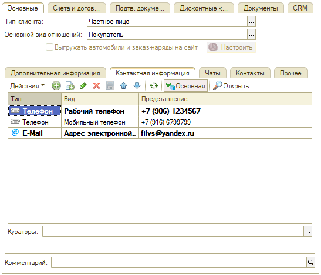

# Где указать куратора контрагента

<table><tr><td><b>Создано:</b> 02.11.2026</td></tr></table>

## Вопрос

В статье «[Умная маршрутизация входящего звонка](https://kb.5systems.ru/articles/5s-auto/rabota-s-klientami/umnaya-marshrutizaciya-vkhodyaschego-zvonka)» сказано, что звонок клиента может адресоваться куратору. Где в карточке контрагента указать куратора?

## Ответ

Куратор указывается в карточке контрагента на вкладке **«Основные»**, на внутренней вкладке **«Контактная информация»**, в поле **«Кураторы»** под списком телефонов и адресов. Нажмите кнопку **«...»** в поле, выберите куратора и запишите карточку.

Если куратор задан, то при умной маршрутизации входящий звонок с номера этого контрагента будет адресован на номер телефона куратора. Для этого у куратора должен быть настроен внутренний номер телефона — см. статью «[Настройка внутренних телефонов сотрудников](https://kb.5systems.ru/articles/5s-auto/telefoniya/nastroyka-vnutrennikh-telefonov-sotrudnikov)».

## См. также

- [Не открываются карточки лидов и сделок при поднятии трубки](https://kb.5systems.ru/tips/5s-auto/crm/ne-otkryvayutsya-kartochki-pri-podnyatii-trubki)

## Материалы для изучения

- «[Умная маршрутизация входящего звонка](https://kb.5systems.ru/articles/5s-auto/rabota-s-klientami/umnaya-marshrutizaciya-vkhodyaschego-zvonka)» — порядок, в котором программа выбирает, кому адресовать входящий звонок, в том числе маршрутизация по куратору.
- «[Контрагенты и контакты → Карточка контрагента](https://kb.5systems.ru/articles/5s-auto/rabota-s-klientami/kontragenty-i-kontakty#vkl_kont_inf)» — вкладки карточки контрагента, в том числе «Контактная информация».
- «[Настройка внутренних телефонов сотрудников](https://kb.5systems.ru/articles/5s-auto/telefoniya/nastroyka-vnutrennikh-telefonov-sotrudnikov)» — постоянные и меняющиеся внутренние номера.

## Похожие вопросы

- Где указать куратора контрагента
- Нет поля «Куратор» в карточке контрагента
- Как назначить куратора клиенту

## Теги

куратор, кураторы, контрагент, карточка контрагента, контактная информация, умная маршрутизация, входящий звонок, телефония
