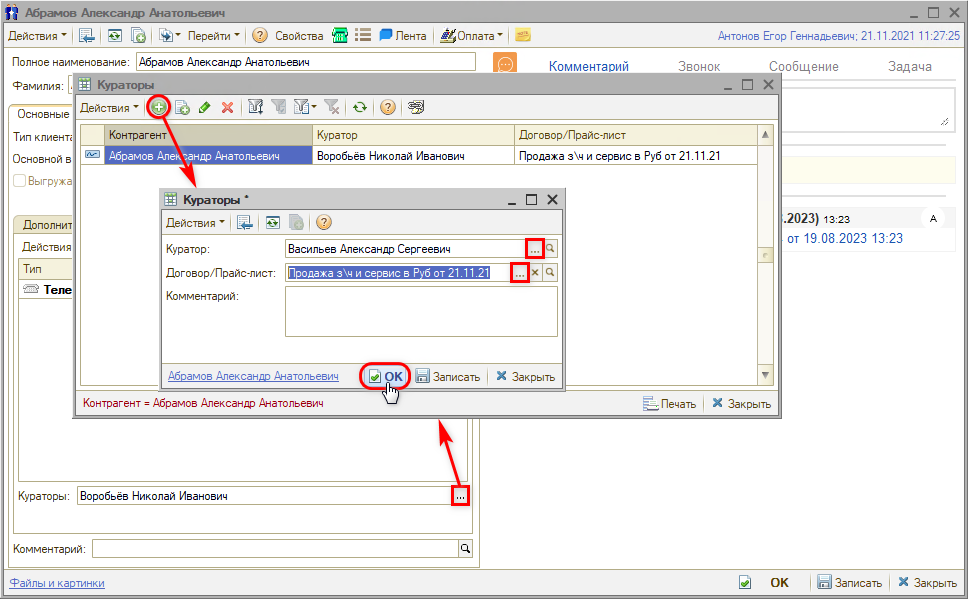
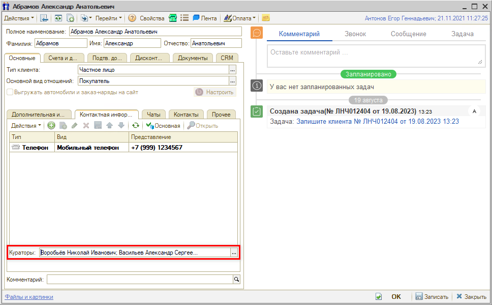
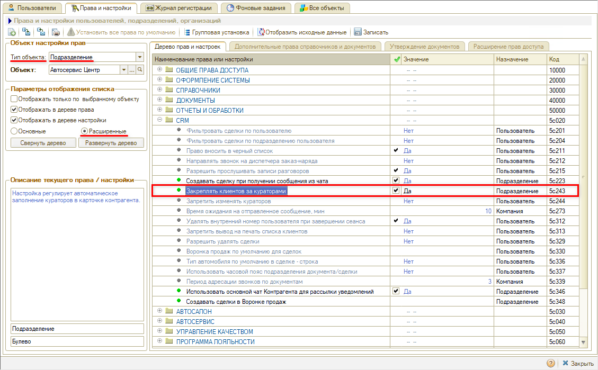
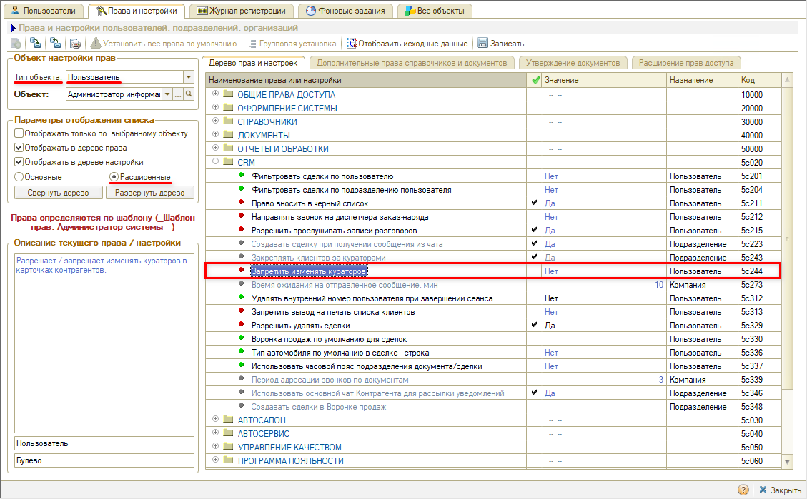

# Где указать куратора контрагента

<table><tr><td><b>Обновлено:</b> 13.11.2026</td></tr></table>

Тикет: https://support.5systems.ru/ru/ticket/list/filter/id/96/ticket/23154 (UNG-95360)

###### *Опубликовано 02.11.2026: [https://kb.5systems.ru/tips/5s-auto/crm/gde-ukazat-kuratora-kontragenta](https://kb.5systems.ru/tips/5s-auto/crm/gde-ukazat-kuratora-kontragenta)*

## Вопрос

В статье «[Умная маршрутизация входящего звонка](../../../../articles/5S%20AUTO/Работа%20с%20клиентами/Умная%20маршрутизация%20входящего%20звонка/umnaya-marshrutizaciya-vkhodyaschego-zvonka.md)» сказано, что звонок клиента может адресоваться куратору. Где в карточке контрагента указать куратора?

## Ответ

Куратор — это сотрудник (менеджер), закрепленный за контрагентом. Если куратор задан, то при умной маршрутизации входящий звонок с номера этого контрагента будет адресован на номер телефона куратора.

Куратор указывается в карточке контрагента на вкладке **«Основные»**, на внутренней вкладке **«Контактная информация»**, в поле **«Кураторы»** под списком телефонов и адресов:

1. Нажмите кнопку **«...»** в поле **«Кураторы»** — откроется список кураторов этого контрагента.
2. Нажмите **«Создать»** и заполните:
   - **«Куратор»** — сотрудник из справочника «Сотрудники», обязательное поле;
   - **«Договор/Прайс-лист»** — договор с контрагентом, по которому работает куратор. Если куратор отвечает за контрагента в целом, поле не заполняется. При маршрутизации звонка договор не учитывается;
   - **«Комментарий»** — произвольное пояснение, например за что отвечает куратор.

   

3. Нажмите **«ОК»** и запишите карточку контрагента.

Кураторов может быть несколько — в поле они перечисляются через точку с запятой. В этом случае звонок адресуется первому найденному куратору, у которого указан номер телефона:

Чтобы звонок дошел до куратора, у него должен быть настроен внутренний номер телефона — см. статью «[Настройка внутренних телефонов сотрудников](../../../../articles/5S%20AUTO/Телефония/Настройка%20внутренних%20телефонов%20сотрудников/nastroyka-vnutrennikh-telefonov-sotrudnikov.md)».

### Настройки

Работу с кураторами регулируют две настройки в группе **«CRM»**. Чтобы пользователь мог указывать кураторов в карточке контрагента, нужны обе: **«Закреплять клиентов за кураторами» = «Да»** и **«Запретить изменять кураторов» = «Нет»**. Настройки устанавливает администратор в «Правах и настройках» — как перейти, см. в статье «[Установка прав и настроек пользователя → Переход к установке Прав и настроек](../../../../articles/5S%20AUTO/Пользователи%20и%20права/Установка%20прав%20и%20настроек%20пользователя/ustanovka-prav-i-nastroek-polzovatelya.md#переход-к-установке-прав-и-настроек)».

- **«Закреплять клиентов за кураторами»** (назначается для подразделения) — регулирует автоматическое заполнение кураторов в карточке контрагента: если настройка включена, а у контрагента нет кураторов, куратором становится мастер документа. Если настройка выключена, поле **«Кураторы»** в карточке неактивно, даже если изменять кураторов пользователю не запрещено.

  

- **«Запретить изменять кураторов»** (назначается для пользователя) — разрешает или запрещает изменять кураторов в карточках контрагентов. Если у пользователя установлено значение **«Да»**, изменить кураторов в карточке он не сможет. Чтобы пользователь мог указывать кураторов, установите значение **«Нет»**.

  

## См. также

- [Не открываются карточки лидов и сделок при поднятии трубки](../Не%20открываются%20карточки%20лидов%20и%20сделок%20при%20поднятии%20трубки/ne-otkryvayutsya-kartochki-pri-podnyatii-trubki.md)

## Материалы для изучения

- «[Умная маршрутизация входящего звонка](../../../../articles/5S%20AUTO/Работа%20с%20клиентами/Умная%20маршрутизация%20входящего%20звонка/umnaya-marshrutizaciya-vkhodyaschego-zvonka.md)» — порядок, в котором программа выбирает, кому адресовать входящий звонок, в том числе маршрутизация по куратору.
- «[Контрагенты и контакты → Карточка контрагента](../../../../articles/5S%20AUTO/Работа%20с%20клиентами/Контрагенты%20и%20контакты/kontragenty-i-kontakty.md#vkl_kont_inf)» — вкладки карточки контрагента, в том числе «Контактная информация».
- «[Настройка внутренних телефонов сотрудников](../../../../articles/5S%20AUTO/Телефония/Настройка%20внутренних%20телефонов%20сотрудников/nastroyka-vnutrennikh-telefonov-sotrudnikov.md)» — постоянные и меняющиеся внутренние номера.
- «[Установка прав и настроек пользователя](../../../../articles/5S%20AUTO/Пользователи%20и%20права/Установка%20прав%20и%20настроек%20пользователя/ustanovka-prav-i-nastroek-polzovatelya.md)» — как найти и изменить настройку.

## Похожие вопросы

- Где указать куратора контрагента
- Нет поля «Куратор» в карточке контрагента
- Как назначить куратора клиенту
- Не редактируется поле «Кураторы» в карточке контрагента

## Теги

куратор, кураторы, контрагент, карточка контрагента, контактная информация, договор, умная маршрутизация, входящий звонок, телефония, закреплять клиентов за кураторами, запретить изменять кураторов
