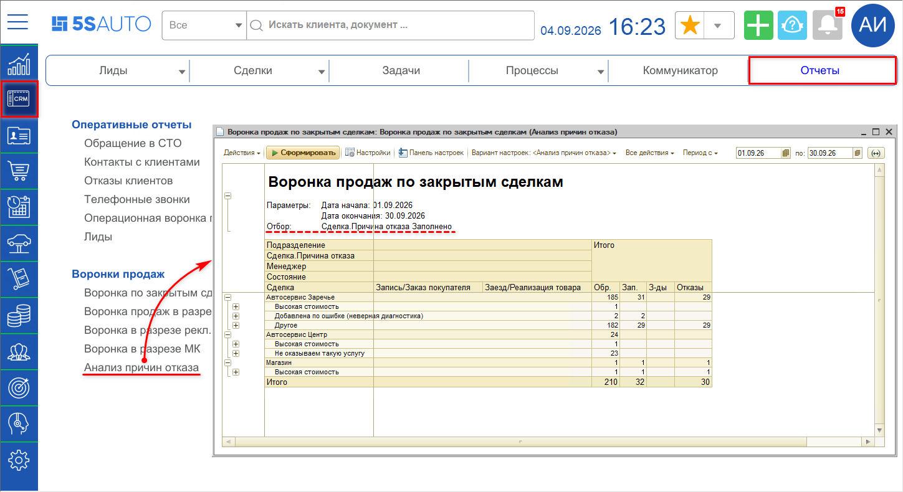
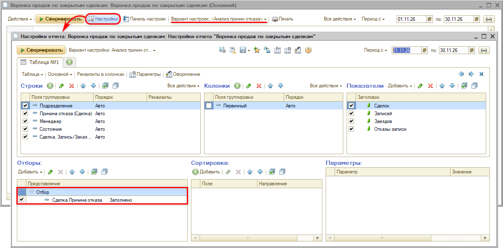

# Как посмотреть несостоявшиеся сделки и причины отказов клиентов

<table><tr><td><b>Создано:</b> 16.11.2026</td></tr></table>

## Проблема

Нужен отчет о потерянном спросе: несостоявшиеся сделки и отказы покупателей. Отчет «Анализ потерянных клиентов» показывает все заказ-наряды клиента, а не несостоявшиеся сделки.

## Решение

Используйте отчет «Воронка продаж по закрытым сделкам» с вариантом настроек «Анализ причин отказа»:

**CRM → Отчеты → Воронки продаж → Анализ причин отказа**

Если в меню нет пункта «Анализ причин отказа», откройте отчет [«Воронка продаж по закрытым сделкам»](https://kb.5systems.ru/articles/5s-auto/otchety/otchet-voronka-prodazh-po-zakrytym-sdelkam) и выберите вариант настроек «Анализ причин отказа». В настройках отчета должен быть отбор **Сделка.Причина отказа** с видом сравнения **Заполнено**.

> [!NOTE]
> Пункт «Анализ причин отказа» можно вывести в меню рабочего стола. Это делает пользователь с правами администратора, см. статью «[Настройка рабочего стола → Пункты меню в разделах](https://kb.5systems.ru/articles/5s-auto/administrirovanie-i-nastroyka-sistemy/nastroyka-rabochego-stola#пункты-меню-в-разделах)».

В отчете показаны сделки с заполненным полем «Причина отказа». Строки группируются по подразделению, причине отказа, менеджеру и состоянию. Для каждой причины выводятся количество обращений, записей, заездов и отказов.

> [!IMPORTANT]
> В отчет попадают только сделки, в которых заполнено поле «Причина отказа». Если менеджеры не заполняют его, такие сделки в отчете не появятся.

## Похожие вопросы

- Есть ли отчет о потерянном спросе
- Как посмотреть несостоявшиеся сделки
- Где найти отказы клиентов
- Как посмотреть причины отказов

## Теги

CRM, отчеты, воронка продаж, сделки, причина отказа, отказы клиентов, потерянный спрос
