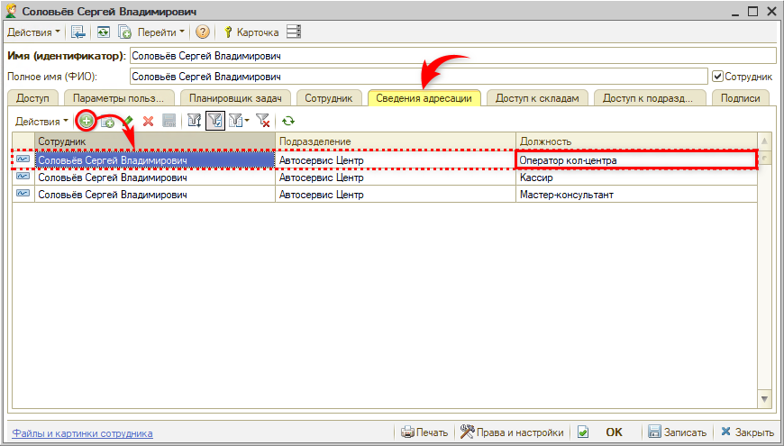

# Не появляются уведомления о пропущенных звонках

<table><tr><td><b>Создано:</b> 16.11.2026</td></tr></table>

Тикет: https://support.5systems.ru/ru/ticket/list/filter/id/1/ticket/23216/ (BUY-38990)

###### *Опубликовано 16.11.2026: [https://kb.5systems.ru/tips/5s-auto/crm/ne-poyavlyayutsya-uvedomleniya-o-propushchennyh-zvonkah](https://kb.5systems.ru/tips/5s-auto/crm/ne-poyavlyayutsya-uvedomleniya-o-propushchennyh-zvonkah)*

## Проблема

В программе не появляются всплывающие уведомления о пропущенных входящих звонках либо пропущенные звонки не отображаются в списке уведомлений CRM. При этом телефония подключена и работает, входящие вызовы поступают.

## Причина

В карточке пользователя на вкладке **«Сведения адресации»** (в [регистре «Сведения адресации»](../../../../articles/5S%20AUTO/Пользователи%20и%20права/Пользователи/polzovateli.md#регистр-сведения-адресации)) отсутствует запись с должностью **«Оператор кол-центра»**.

В 5S AUTO [уведомления](../../../../articles/5S%20AUTO/CRM/Работа%20с%20уведомлениями/rabota-s-uvedomleniyami.md#телефонные-звонки) о входящих обращениях без назначенного исполнителя (пропущенный звонок, входящий звонок, заявка с сайта, сообщение из чата) адресуются только тем сотрудникам, которым назначена роль **«Оператор кол-центра»** — подробнее см. в статье «[Адресация задач в CRM по исполнителям](../../../../articles/5S%20AUTO/Задачи/Адресация%20задач%20в%20CRM%20по%20исполнителям/adresaciya-zadach-v-crm-po-ispolnitelyam.md)». Если у пользователя нет такой записи, программа не направляет ему уведомления о пропущенных звонках.

## Решение

1. Откройте карточку пользователя (*Администрирование → Пользователи и права → Пользователи*) и перейдите на вкладку **«Сведения адресации»**.
2. Нажмите **«Добавить»** и заполните строку: укажите сотрудника, подразделение и выберите должность **«Оператор кол-центра»**.
3. Нажмите **«Записать»** (или **«ОК»**).

> [!TIP]
> Запись также можно добавить напрямую в регистре сведений: *Администрирование → Компания → CRM → Сведения адресации*.

После сохранения изменений сотруднику необходимо перезайти в программу.

## См. также

- [Не открываются карточки лидов и сделок при поднятии трубки](../Не%20открываются%20карточки%20лидов%20и%20сделок%20при%20поднятии%20трубки/ne-otkryvayutsya-kartochki-pri-podnyatii-trubki.md)

## Материалы для изучения

- «[Пользователи](../../../../articles/5S%20AUTO/Пользователи%20и%20права/Пользователи/polzovateli.md#регистр-сведения-адресации)» — регистр «Сведения адресации», настройка ролей и прав пользователей.
- «[Адресация задач в CRM по исполнителям](../../../../articles/5S%20AUTO/Задачи/Адресация%20задач%20в%20CRM%20по%20исполнителям/adresaciya-zadach-v-crm-po-ispolnitelyam.md)» — назначение должностей CRM, распределение задач и входящих обращений по ролям.
- «[Работа с уведомлениями](../../../../articles/5S%20AUTO/CRM/Работа%20с%20уведомлениями/rabota-s-uvedomleniyami.md)» — настройка и получение уведомлений в программе.

## Похожие вопросы

- Не появляются уведомления о пропущенных звонках
- Не отображаются пропущенные звонки в уведомлениях
- Не приходят уведомления о пропущенных звонках
- Почему не приходят пропущенные звонки
- Пропущенные звонки не попадают в уведомления
- Как настроить получение уведомлений о пропущенных вызовах
- Кому приходят уведомления о пропущенных звонках

## Теги

телефония, пропущенный звонок, пропущенные звонки, входящий звонок, уведомления, сведения адресации, оператор кол-центра, адресация задач, пользователи, CRM
