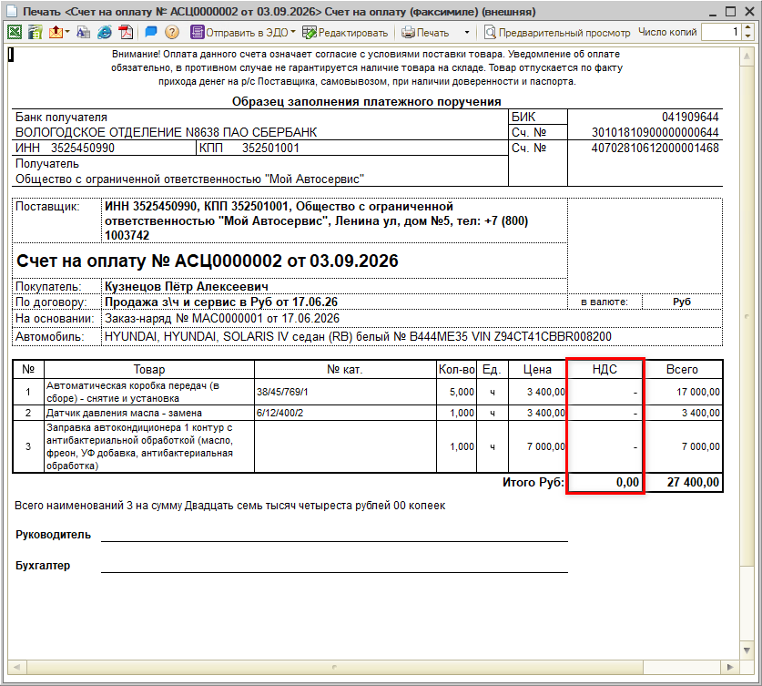
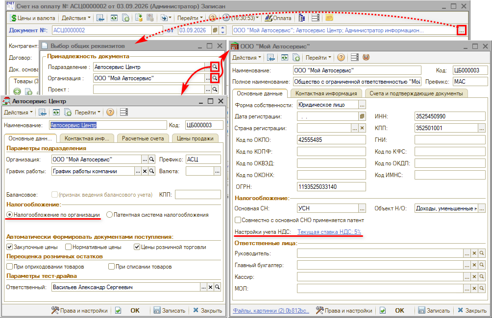
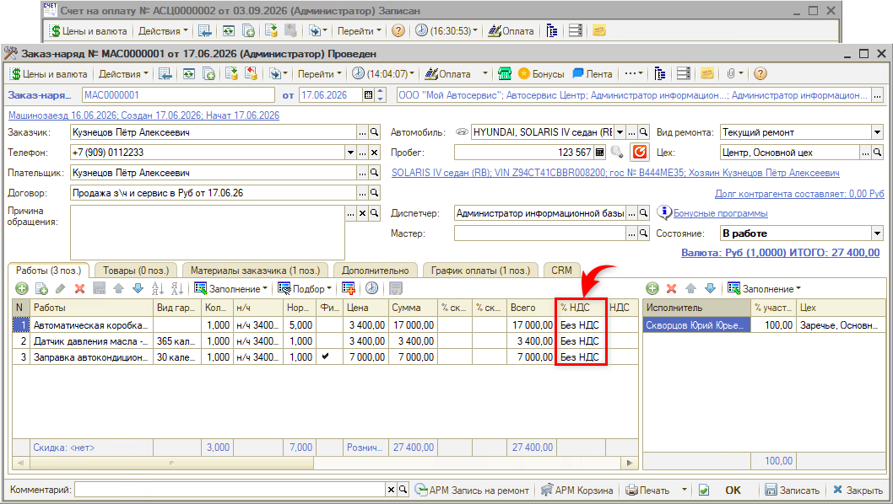
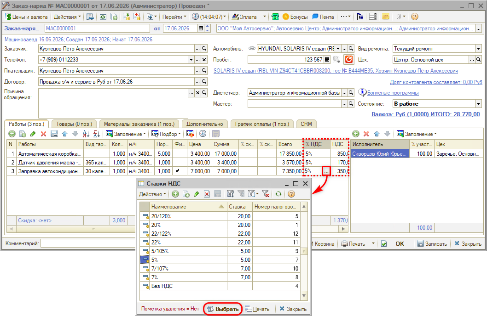
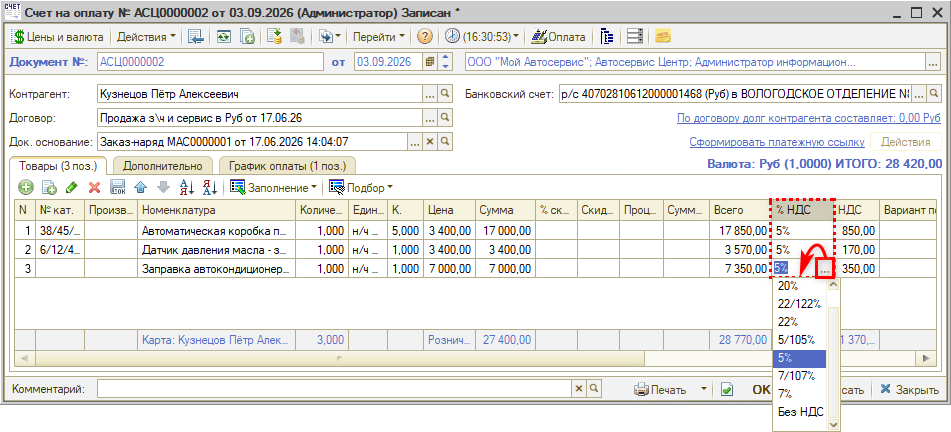

# В счете на оплату не отображается НДС в табличной части

<table><tr><td><b>Обновлено:</b> 24.11.2026</td></tr></table>

Тикет: https://support.5systems.ru/ru/ticket/list/filter/id/1/ticket/23389 (IOW-36298)

## Проблема

При формировании документов **«Счет на оплату»** и **«Заказ-наряд»**, а также в их печатных формах в строках табличной части в колонке **«% НДС»** (в счете на оплату — **«НДС»**) стоит **«Без НДС»** или прочерк.

При этом в реквизитах организации и подразделения все настроено верно: выбрана упрощенная система налогообложения и текущая ставка НДС 5%, в подразделении — налогообложение по организации.

В подвале документов, в зависимости от печатной формы, в итоговой строке сумма НДС может рассчитываться корректно — например, *«в т.ч. НДС 5%»*.

## Причина

Такая ситуация часто возникает, если организация перешла на уплату НДС (например, сменила систему налогообложения с начала месяца или года), а в ранее созданных документах изменили дату на текущую, ожидая, что ставки обновятся автоматически.

Возможные причины:

1. **Подстановка ставки в момент создания документа-основания.** Ставка НДС подставляется в строки документа из параметров учетной политики и настроек организации в момент его создания. Если заказ-наряд был создан до даты перехода компании на уплату НДС, в его строках зафиксировалась ставка «Без НДС». При последующем создании счета на оплату или реализации на основании такого заказ-наряда ставка «Без НДС» автоматически наследуется из документа-основания.

   

2. **Изменение даты документа не пересчитывает строки.** При ручном изменении даты в шапке документа на дату после перехода на НДС программа автоматически не перезаполняет ставки налога в существующих строках табличной части.

## Решение

### Способ 1. Изменить ставку НДС вручную в строках документа

Если счет на оплату создается на основании заказ-наряда:

1. Откройте исходный документ **«Заказ-наряд»**.
2. На вкладках **«Работы»** и **«Товары»** в колонке **«% НДС»** вручную выберите нужную ставку налога (например, **5%**, **7%** или **22%**).

   

3. Запишите и проведите документ.
4. Откройте документ **«Счет на оплату»** и также скорректируйте ставку в колонке **«НДС»** в строках табличной части — либо сформируйте счет на оплату заново на основании исправленного заказ-наряда. После выбора ставки в строках появятся ее значение и рассчитанная сумма налога.

   

### Способ 2. Перевыбрать подразделение в реквизитах документа

Чтобы программа пересчитала параметры учета и автоматически подтянула актуальные ставки НДС без ручного редактирования каждой строки:

1. В открытом документе откройте окно **«Выбор реквизитов»** — кнопка с многоточием рядом с полем организации в шапке документа (см. [выше](#nastroyka-rekvizitov)).
2. В блоке **«Принадлежность документа»** в поле **«Подразделение»** переключитесь на любое другое подразделение.
3. Снова выберите исходное подразделение компании и сохраните изменения.
4. Программа обновит учетные параметры документа по текущим настройкам, и в строках табличной части автоматически проставится актуальная ставка НДС.

> [!IMPORTANT]
> После смены системы налогообложения контролируйте колонку **«% НДС»** (в счете на оплату — **«НДС»**): в документах, созданных до перехода, и в документах на их основании сохраняется прежняя ставка «Без НДС».

## См. также

- «[Как настроить применение НДС при УСН](../../Практики/Как%20настроить%20применение%20НДС%20при%20УСН/primenenie-nds-pri-usn.md)» — настройка ставок НДС и карточки организации при переходе на уплату налога.
- «[В поступлении подставляется не та ставка НДС](../../Склад%20и%20запчасти/В%20поступлении%20подставляется%20не%20та%20ставка%20НДС/v-postuplenii-ne-ta-stavka-nds.md)» — похожий случай: ставка НДС в документе подставляется неверно.

## Материалы для изучения

- «[Справочник "Организации"](../../../../articles/5S%20AUTO/Структура%20компании/Справочник%20Организации/spravochnik-organizacii.md)» — налогообложение и учетная политика организации.
- «[Справочник "Подразделения компании"](../../../../articles/5S%20AUTO/Структура%20компании/Справочник%20Подразделения%20компании/spravochnik-podrazdeleniya-kompanii.md)» — настройки подразделения, в том числе порядок налогообложения.
- «[Заказ-наряды](../../../../articles/5S%20AUTO/Автосервис/Работа%20с%20Заказ-нарядами/Заказ-наряды/zakaz-naryady.md)» — оформление заказ-нарядов и ввод документов на основании.

## Похожие вопросы

- В печатной форме счета на оплату не отображается НДС в табличной части
- В счете на оплату НДС появляется в строке итога, а в таблице прочерки
- В ЗН поменяли дату на новый период, но счет все равно выводится без НДС
- На основании заказ-наряда счет выставляется без НДС
- Как обновить ставку НДС в строках документа после перехода на новую систему налогообложения

## Теги

счет на оплату, заказ-наряд, ндс, ставка ндс, без ндс, смена налогообложения, табличная часть, печатная форма, подразделение компании, выбор реквизитов
