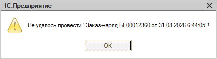
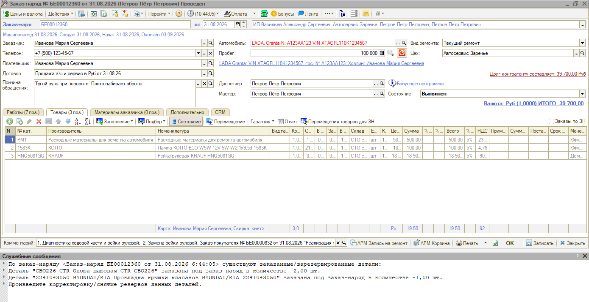
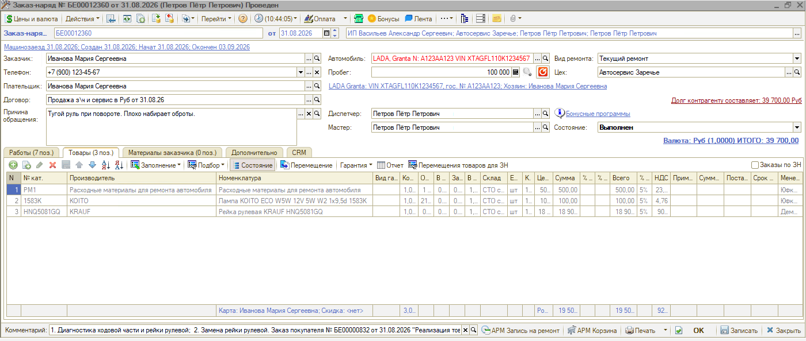
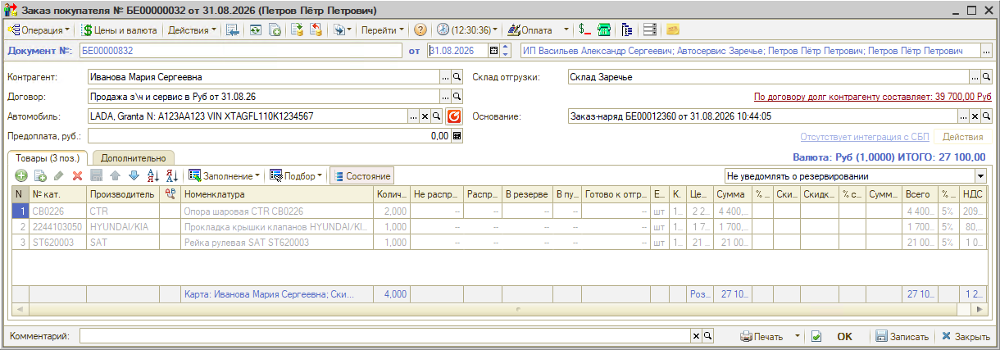
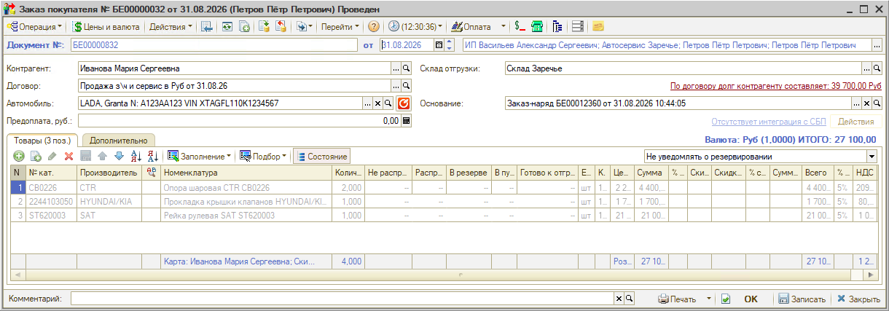

# Не получается закрыть заказ-наряд: отрицательный резерв

<table><tr><td><b>Создано:</b> 27.11.2026</td></tr></table>

Тикет: https://support.5systems.ru/ru/ticket/list/filter/id/1/ticket/23347 (QUA-30217)

> 🛠 Комментарий для черновика: *Скриншоты собраны по снимкам из тикета: данные клиента, автомобиль и сотрудники заменены на вымышленные. Служебные сообщения и текст ошибки – дословно из снимка клиента; окно предупреждения пересобрано по образцу.*

## Проблема

Заказ-наряд не закрывается: при проведении программа выводит «Не удалось провести "Заказ-наряд БЕ00012360 от 31.08.2026 6:44:05"!».

В служебных сообщениях при этом написано, что под заказ-наряд заказаны детали, причем с отрицательным количеством:

> По заказ-наряду <Заказ-наряд БЕ00012360 от 31.08.2026 6:44:05> существуют заказанные/зарезервированные детали:  
> Деталь "CBO226 CTR Опора шаровая CTR CBO226" заказана под заказ-наряд в количестве -2,00 шт.  
> Деталь "2241043050 HYUNDAI/KIA Прокладка крышки клапанов HYUNDAI/KIA 2241043050" заказана под заказ-наряд в количестве -1,00 шт.  
> Произведите корректировку/снятие резервов данных деталей.

Снять резерв тоже не получается: программа сообщает, что в резерве ничего нет – списывать нечего.

При этом в самом заказ-наряде на вкладке «Товары» этих деталей уже нет, в колонке «В резерве» нули. Детали остались в заказе покупателя – в нижней части формы видны связанные документы: заказ покупателя и реализация по нему:

## Причина

Под заказ-наряд оформлен заказ покупателя – он введен на основании заказ-наряда, – но сам документ распроведен. Пометки **«Проведен»** в заголовке окна нет, а у проведенного документа она есть.

При распроведении документа по регистру заказов прошли обратные движения, поэтому заказанные под заказ-наряд детали и получили отрицательное количество. Заказ-наряд видит эти детали как заказанные, но снять с них резерв не может: резерва нет.

Обычно так бывает, если сотрудник по ошибке распровел заказ покупателя или удалил из него строку: движения по заказам и резервам разошлись, а связь заказа покупателя с заказ-нарядом осталась.

## Решение

**1. Проверьте связанные документы заказ-наряда.**

Откройте заказ-наряд и посмотрите, какие документы с ним связаны: заказ покупателя, поступление товаров, реализация товаров (они видны в нижней части формы, см. скриншот в разделе «[Проблема](#проблема)»). Проверьте, не оформлялся ли под этот заказ-наряд заказ покупателя на деталь, которая использована в работе, – именно он и мешает закрытию.

**2. Откройте заказ покупателя и посмотрите его заголовок.**

У проведенного документа в заголовке окна есть пометка **«Проведен»**, у распроведенного ее нет. Если пометки нет, документ распроведен – это и есть причина ошибки.

**3. Проведите документ обратно.**

Нажмите **«Провести и закрыть»** или **«Провести»**. После проведения движения заказа восстановятся: отрицательные количества по деталям уйдут, и заказ-наряд перестанет на них ругаться.

**4. Если строки в заказе покупателя удалены, верните их.**

Восстановите в заказе покупателя те номенклатуру и количество, которые были заказаны под заказ-наряд, и проведите документ. Если часть данных восстановить не удается, приведите заказ покупателя в соответствие с заказ-нарядом документом «Корректировка заказа покупателя» – см. «[Работа с заказами покупателя → Корректировка заказа покупателя](../../../../articles/5S%20AUTO/Работа%20с%20заказами/Работа%20с%20заказами%20покупателя/rabota-s-zakazami-pokupatelya.md#корректировка-заказа-покупателя)».

**5. Переведите заказ-наряд в «Выполнен».**

Если после проведения заказа покупателя резерв остался, снимите его документом «Снятие резервов заказов покупателей» – с флажком «Отменить заказ покупателя», если деталь по заказу больше не нужна, – и повторите перевод заказ-наряда в «Выполнен».

> [!IMPORTANT]
> Распроведение заказа покупателя – не рабочий прием, а нарушение порядка учета. Программа даст распровести документ, даже если по нему уже были движения и с ним связаны другие документы, но после этого резервы и заказы по заказ-наряду разойдутся: заказ-наряд перестанет закрываться, а снять резерв будет нечего. Если заказ покупателя уже распроведен, верните его в проведенные и восстановите удаленные строки.

Если непонятно, откуда взялся распроведенный документ, уточните у сотрудников, кто и зачем его распровел или удалил из него строку, и восстановите данные до первоначального вида.

## См. также

- «[Не получается снять резерв, из-за которого не закрывается заказ-наряд](../Не%20получается%20снять%20резерв,%20из-за%20которого%20не%20закрывается%20заказ-наряд/ne-poluchaetsya-snyat-rezerv-zakaz-naryad-ne-zakryvaetsya.md)» – резерва нет, потому что деталь убрали из заказ-наряда, а заказ покупателя не поправили.
- «[Не закрывается заказ-наряд из-за заказанных деталей](../Не%20закрывается%20заказ-наряд%20из-за%20заказанных%20деталей/ne-zakryvaetsya-zakaz-naryad-iz-za-zakazannyh-detaley.md)» – в заказе покупателя другое количество или другая карточка номенклатуры.

## Материалы для изучения

- «[Работа с заказами покупателя](../../../../articles/5S%20AUTO/Работа%20с%20заказами/Работа%20с%20заказами%20покупателя/rabota-s-zakazami-pokupatelya.md)» – заказ покупателя, корректировка, замена, снятие резерва.
- «[Заказ-наряды](../../../../articles/5S%20AUTO/Автосервис/Работа%20с%20Заказ-нарядами/Заказ-наряды/zakaz-naryady.md)» – работа с заказ-нарядом, состояния документа.

## Похожие вопросы

- Не получается закрыть заказ-наряд: отрицательный резерв
- Не проводится заказ-наряд, отрицательный резерв
- Заказ-наряд не закрывается, в резерве минус
- Отрицательное количество заказанных деталей
- Не удалось провести заказ-наряд
- Деталь заказана под заказ-наряд в количестве -2,00 шт
- По заказ-наряду существуют заказанные/зарезервированные детали
- Не снимается резерв: в резерве ничего нет

## Теги

заказ-наряд, заказ покупателя, распроведен, отрицательное количество, резерв, снятие резервов заказов покупателей, закрытие заказ-наряда, связанные документы, служебные сообщения
