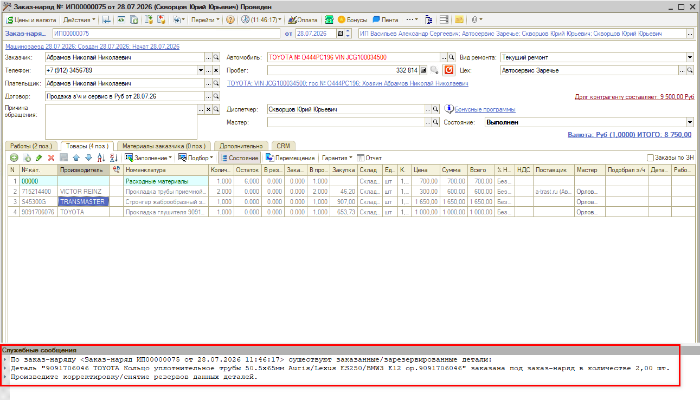
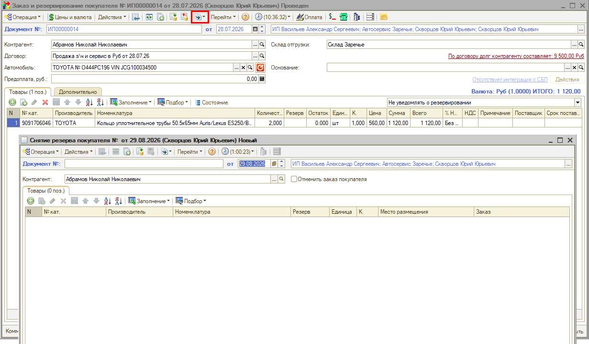
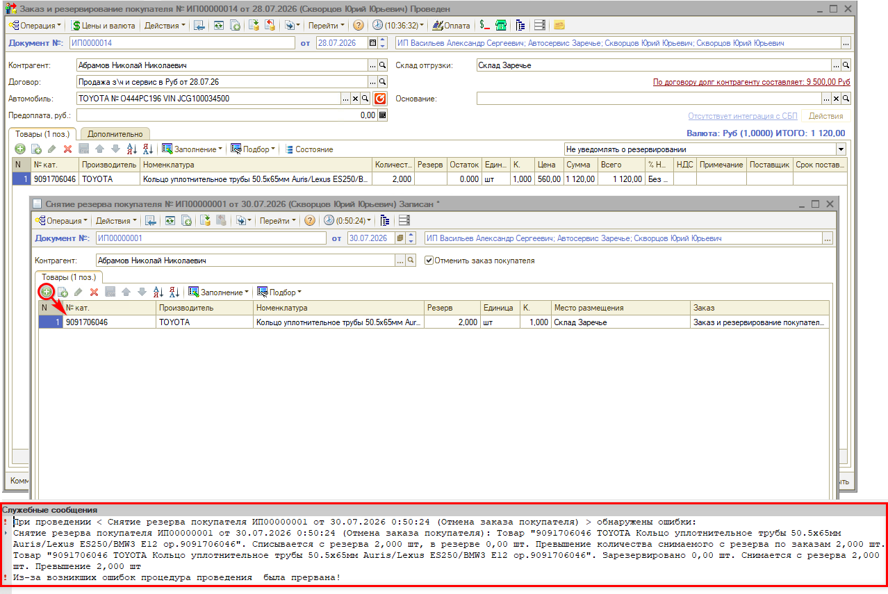
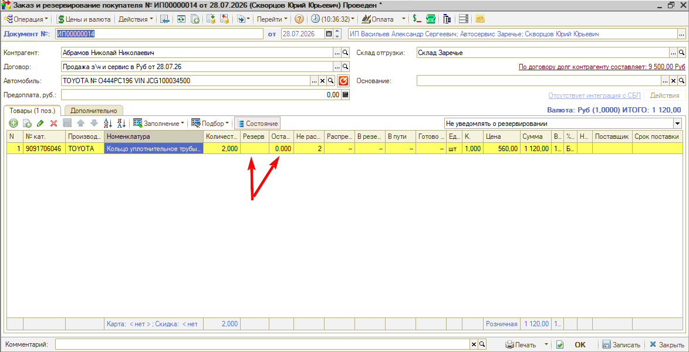
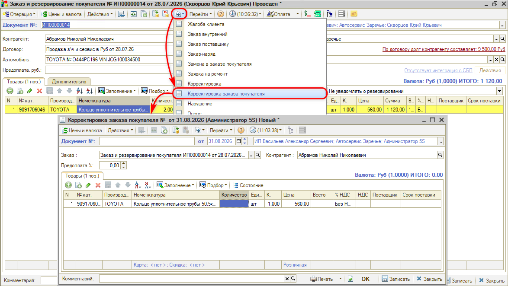
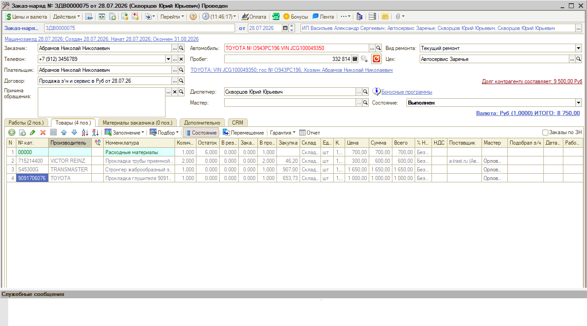

# Не получается снять резерв, из-за которого не закрывается заказ-наряд

<table><tr><td><b>Создано:</b> 10.11.2026</td></tr></table>

###### *Опубликовано 10.11.2026: [https://kb.5systems.ru/tips/5s-auto/avtoservis/ne-poluchaetsya-snyat-rezerv-zakaz-naryad-ne-zakryvaetsya](https://kb.5systems.ru/tips/5s-auto/avtoservis/ne-poluchaetsya-snyat-rezerv-zakaz-naryad-ne-zakryvaetsya)*

## Проблема

Заказ-наряд не переводится в состояние «Выполнен»: проведение прерывается, а в служебных сообщениях программа пишет, что по заказ-наряду существуют заказанные или зарезервированные детали, и просит произвести корректировку или снятие резервов. При этом самой детали в заказ-наряде уже нет – она осталась только в заказе покупателя:

> По заказ-наряду <Заказ-наряд … от …> существуют заказанные/зарезервированные детали:  
> Деталь "…" заказана под заказ-наряд в количестве <…> шт.  
> Произведите корректировку/снятие резервов данных деталей.

Снять резерв при этом не получается:

- в документе «Снятие резерва покупателя» деталь не появляется – таблица «Товары» остается пустой:

  

- если добавить деталь в документ вручную, документ не проводится – программа сообщает, что в резерве ничего нет:

  *Снятие резерва покупателя <номер> от <дата>: Товар "<номенклатура>". Списывается с резерва <…> шт, в резерве 0,00 шт. Превышение количества снимаемого с резерва по заказам <…> шт.* 
  *Из-за возникших ошибок процедура проведения была прервана!*

  

## Причина

В заказе покупателя числится заказанной деталь (в примере – 2 шт.), но резерва по ней нет: колонка «Резерв» пуста, а остаток детали равен нулю. Снимать с резерва нечего, поэтому документ «Снятие резерва покупателя» не подтягивает деталь и не проводится – с резерва нельзя снять больше, чем в нем есть. А заказанное количество в заказе покупателя остается и не дает закрыть заказ-наряд. Так бывает, если деталь убрали из заказ-наряда, а заказ покупателя не изменили:

## Решение

1. Откройте заказ покупателя по этому заказ-наряду и найдите в нем деталь из служебного сообщения.

2. На основании заказа покупателя введите документ «Корректировка заказа покупателя»: нажмите **«Ввести на основании»** и выберите **«Корректировка заказа покупателя»**. В колонке **«Количество»** укажите **0** – деталь по заказу не нужна, заказ по ней отменяется. Корректировка заменяет данные заказа покупателя тем, что указано в ней. Если деталь нужна в другом количестве, укажите фактическое – см. «[Работа с заказами покупателя → Корректировка заказа покупателя](https://kb.5systems.ru/articles/5s-auto/rabota-s-zakazami/rabota-s-zakazami-pokupatelya#корректировка-заказа-покупателя)».

   

3. Проведите документ. Движения по регистрам смотрите в самом документе корректировки – в заказе покупателя они не отображаются.

4. Повторите перевод заказ-наряда в состояние «Выполнен» – теперь он проводится:

   

## См. также

- «[Не закрывается заказ-наряд из-за заказанных деталей](https://kb.5systems.ru/tips/5s-auto/avtoservis/ne-zakryvaetsya-zakaz-naryad-iz-za-zakazannyh-detaley)»

## Материалы для изучения

- «[Работа с заказами покупателя](https://kb.5systems.ru/articles/5s-auto/rabota-s-zakazami/rabota-s-zakazami-pokupatelya)» – заказ покупателя, корректировка, замена, снятие резерва.

## Похожие вопросы

- Не получается снять резерв, из-за которого не закрывается заказ-наряд
- Ошибка в заказ-наряде из-за резервирования
- Не удается перевести заказ-наряд в «Выполнен», ругается на резерв
- Резерва нет, а заказ-наряд не закрывается
- Деталь не попадает в документ «Снятие резерва покупателя»
- Не проводится снятие резерва покупателя: в резерве 0
- Превышение количества снимаемого с резерва по заказам

## Теги

заказ-наряд, заказ покупателя, резерв, снятие резерва покупателя, корректировка заказа покупателя, заказанные детали, закрытие заказ-наряда, служебные сообщения
