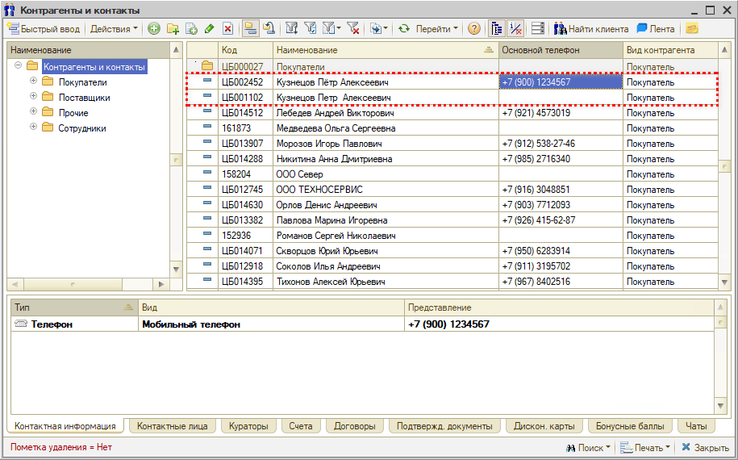
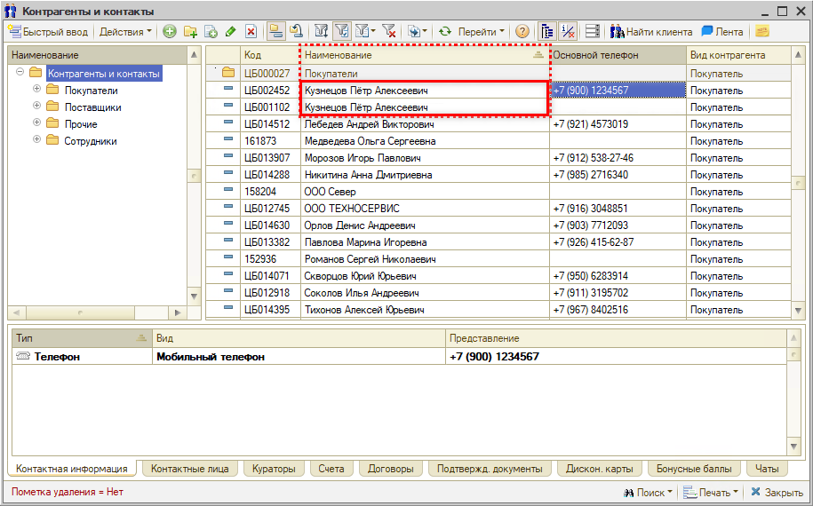
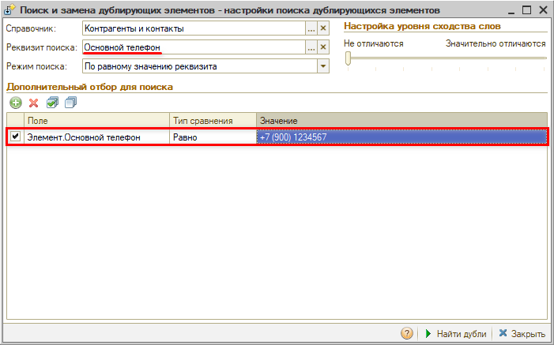
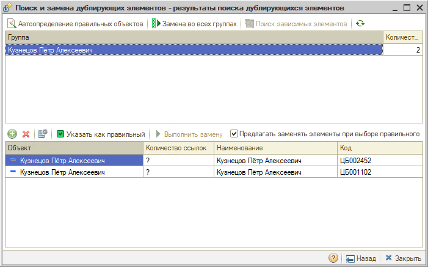
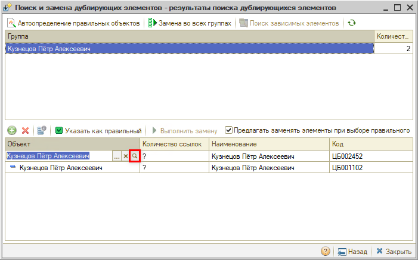
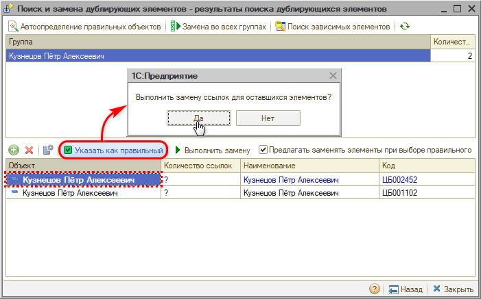
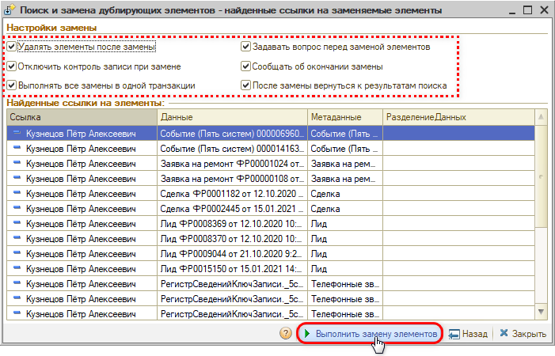

# Как объединить дублирующиеся карточки контрагентов

<table><tr><td><b>Обновлено:</b> 29.10.2026</td></tr></table>

###### *Опубликовано 26.10.2026: [https://kb.5systems.ru/tips/5s-auto/administrirovanie/kak-obedinit-dubliruyushchiesya-kartochki-kontragentov](https://kb.5systems.ru/tips/5s-auto/administrirovanie/kak-obedinit-dubliruyushchiesya-kartochki-kontragentov)*

## Вопрос

Один и тот же клиент заведен в справочнике **«Контрагенты и контакты»** дважды. Карточки могут совпадать по основному телефону или ФИО, а могут и отличаться: например, в одной карточке другой номер телефона, указано только имя без фамилии или ФИО написаны с опечаткой:

Документы, автомобили и взаиморасчеты клиента оказались разнесены по двум карточкам. Как объединить их в одну?

## Ответ

Дублирующиеся карточки объединяют обработкой **«Поиск и объединение дублей»**: ссылки на карточку-дубль во всех документах, регистрах и других объектах программы заменяются ссылкой на правильную карточку, а дубль удаляется.

> [!CAUTION]
> Объединение необратимо: отменить замену ссылок и вернуть удаленную карточку нельзя. Если есть тестовая база, сначала потренируйтесь на ней. Если нужно объединить много дублей, сначала объедините две карточки и проверьте результат.

**1. Приведите наименования карточек к одному виду.**

Убедитесь, что карточки относятся к одному клиенту: например, совпадают телефон и автомобили. Откройте карточку-дубль и исправьте наименование так, чтобы оно полностью совпадало с наименованием правильной карточки. В примере выше наименования различаются буквой «ё» и лишним пробелом – после исправления они совпадают:

**2. Найдите дубли.**

Откройте обработку: *Администрирование → Обслуживание → Инструменты администратора → Поиск и объединение дублей*:

Заполните настройки поиска:

- **«Справочник»** – «Контрагенты и контакты»;
- **«Реквизит поиска»** – «Наименование»;
- **«Режим поиска»** – «По равному значению реквизита».

В таблице **«Дополнительный отбор для поиска»** кнопкой **«Добавить»** добавьте условие «Элемент.Наименование» – «Содержит» – ФИО клиента.

> [!WARNING]
> Нельзя объединять группу с элементом (например, папку контрагентов с карточкой контрагента) и предопределенные элементы – они нужны для работы программы. Такое объединение может нарушить целостность данных, и программа перестанет корректно работать во всей базе. Чтобы такие элементы случайно не попали в поиск, рекомендуем добавить в отбор еще два условия:
>
> - «Элемент.Это группа» – «Равно» – «Нет»;
> - «Элемент.Предопределенный» – «Равно» – «Нет».

Нажмите **«Найти дубли»**:

Другой пример: если основной телефон в карточках одинаковый, искать можно и по нему – тогда наименования исправлять не нужно. Настройки: «Реквизит поиска» – «Основной телефон», в дополнительном отборе вместо наименования – «Элемент.Основной телефон» – «Равно» – номер клиента:

> [!NOTE]
> Не рекомендуем искать без отбора по ФИО или телефону, а также в режиме «По похожим словам», особенно с ползунком «Настройка уровня сходства слов», сдвинутым к «Значительно отличаются». Обработка проверяет весь справочник, поиск в большой базе идет долго, а в одну группу попадают разные клиенты с похожими ФИО.

Если дубли не найдены, проверьте, что наименования (или телефоны) в карточках совпадают полностью и в отборе указаны так же, как в карточках.

**3. Проверьте найденные карточки.**

В верхнем списке – группы дублей, в нижнем – карточки выделенной группы:

Откройте и сравните карточки из нижнего списка: дважды щелкните по строке в колонке **«Объект»** и нажмите кнопку **«Открыть»**:

Если карточка не является дублем, выделите строку и нажмите **«Удалить»** – карточка пропадет из списка.

При объединении контактная информация разных видов переносится в правильную карточку автоматически: например, если в одной карточке указан мобильный телефон, а в другой – рабочий, в итоговой карточке останутся оба. Остальные данные, которых нет в правильной карточке, перенесите в нее вручную до объединения.

**4. Объедините карточки.**

Установите курсор на правильную карточку, нажмите **«Указать как правильный»** и на вопрос о замене ссылок ответьте **«Да»**:

Откроется список ссылок на карточку-дубль – документы, регистры и другие объекты, в которых она будет заменена правильной. Проверьте список и настройки замены. По умолчанию все флажки включены: например, при включенном флажке **«Удалять элементы после замены»** карточка-дубль будет удалена. При необходимости настройки замены можно изменить. Нажмите **«Выполнить замену элементов»** и подтвердите замену:

Если нужно объединить много групп сразу, воспользуйтесь групповой заменой – см. статью «[Поиск и замена дублирующихся записей → Вариант 2. Групповая обработка всего справочника](https://kb.5systems.ru/articles/5s-auto/administrirovanie-i-nastroyka-sistemy/poisk-i-zamena-dubliruyuschikhsya-zapisey#вариант-2-групповая-обработка-всего-справочника)».

### Что нельзя объединять

Обработка работает с любым справочником, поэтому выбирайте элементы для объединения очень внимательно. Не объединяйте:

- **предопределенные элементы** – например, организацию «-» в справочнике «Организации» или головное подразделение в справочнике «Подразделения компании». Они нужны для работы программы;
- **группу с элементом** – например, папку контрагентов с карточкой контрагента;
- **элементы, которые только похожи**: однофамильцев с разными телефонами и автомобилями, товары с одинаковым номером по каталогу, но разных производителей. Совпадение реквизита поиска еще не означает, что это дубль.

> [!NOTE]
> Если задвоилась не карточка клиента, а сделка, используйте обработку «Объединение процессов» – см. статью «[Объединение сделок](https://kb.5systems.ru/articles/5s-auto/crm/obedinenie-sdelok)».

## Материалы для изучения

- «[Поиск и замена дублирующихся записей](https://kb.5systems.ru/articles/5s-auto/administrirovanie-i-nastroyka-sistemy/poisk-i-zamena-dubliruyuschikhsya-zapisey)» – обработка поиска и объединения дублей: поиск дублей, выбор правильного элемента, замена ссылок, групповая замена.
- «[Контрагенты и контакты](https://kb.5systems.ru/articles/5s-auto/rabota-s-klientami/kontragenty-i-kontakty)» – справочник контрагентов и карточка контрагента.
- «[Объединение сделок](https://kb.5systems.ru/articles/5s-auto/crm/obedinenie-sdelok)» – объединение дублирующихся сделок.

## Похожие вопросы

- Как объединить дублирующиеся карточки контрагентов
- Как можно объединить 2 карточки контрагента, задвоили
- Клиент заведен в базе два раза
- Как удалить дубль контрагента
- Как объединить дубли в справочнике
- Задвоилась карточка клиента

## Теги

дубли, объединение дублей, поиск и объединение дублей, контрагенты, карточка контрагента, поиск и замена дублирующихся элементов справочников, справочники, администрирование
