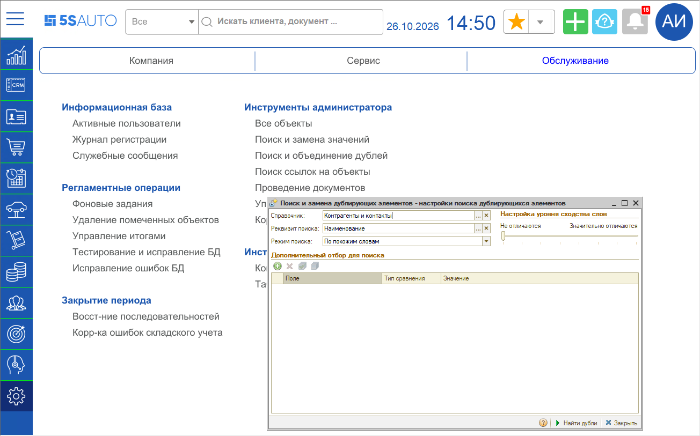
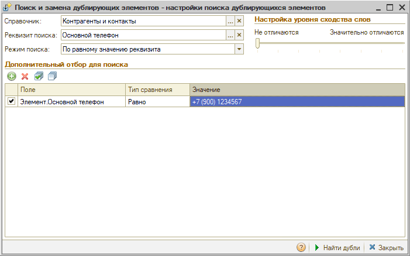
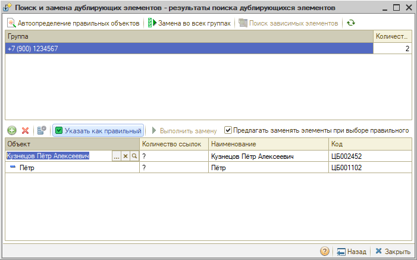
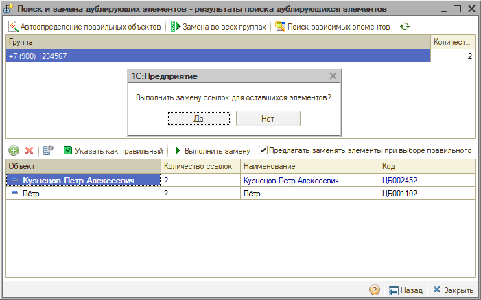
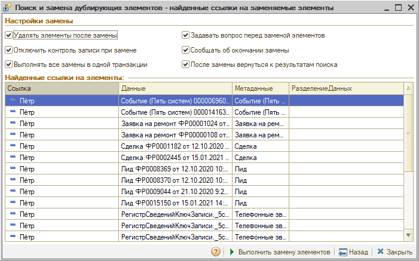
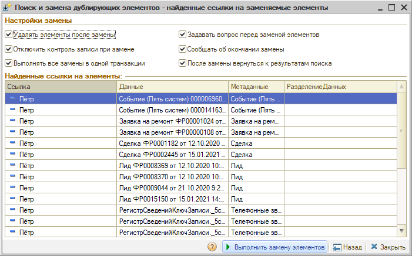

# Как объединить дублирующиеся карточки контрагентов

<table><tr><td><b>Создано:</b> 26.10.2026</td></tr></table>

## Вопрос

Один и тот же клиент заведен в справочнике **«Контрагенты и контакты»** дважды: документы, автомобили и взаиморасчеты оказались разнесены по двум карточкам. Как объединить их в одну?

## Ответ

Дублирующиеся карточки объединяют служебной обработкой **«Поиск и замена дублирующихся элементов справочников»**: ссылки на карточку-дубль во всех документах, регистрах и других объектах программы заменяются ссылкой на правильную карточку, а дубль удаляется.

> [!CAUTION]
> Объединение необратимо: отменить замену ссылок и вернуть удаленную карточку нельзя. Если есть тестовая база, сначала потренируйтесь на ней. Если нужно объединить много дублей, сначала объедините две карточки и проверьте результат.

**1. Найдите дубли.**

Откройте обработку: *Администрирование → Обслуживание → Инструменты администратора → Поиск и объединение дублей*:

В поле **«Справочник»** выберите «Контрагенты и контакты», в поле **«Реквизит поиска»** – реквизит, по которому карточки совпадают, и **«Режим поиска»**:

- «По равному значению реквизита» – реквизит совпадает точно, например одинаковый «Основной телефон»;
- «По похожим словам» – значения похожи, но не совпадают, например «Наименование» с опечаткой или без отчества.

Чтобы найти дубли конкретного клиента, добавьте условие в **«Дополнительный отбор для поиска»**, например «Элемент.Основной телефон» равно номеру клиента. Нажмите **«Найти дубли»**:

**2. Проверьте найденные карточки.**

В верхнем списке – группы дублей, в нижнем – карточки выделенной группы:

Откройте каждую карточку из нижнего списка. Удалите из списка карточки, которые не являются дублями. Если в карточке-дубле есть данные, которых нет в правильной (например, второй телефон или e-mail), перенесите их в правильную карточку до объединения.

**3. Объедините карточки.**

Установите курсор на правильную карточку и нажмите **«Указать как правильный»**:

Согласитесь выполнить замену ссылок:

Откроется список ссылок на карточку-дубль – документы, регистры и другие объекты, в которых она будет заменена правильной. Проверьте список и настройки замены:

Нажмите **«Выполнить замену элементов»**:

Подробнее о работе с обработкой – в статье «[Поиск и замена дублирующихся записей → Пример работы](https://kb.5systems.ru/articles/5s-auto/administrirovanie-i-nastroyka-sistemy/poisk-i-zamena-dubliruyuschikhsya-zapisey#пример-работы)».

### Что нельзя объединять

Обработка работает с любым справочником, поэтому выбирайте карточки для объединения очень внимательно. Не объединяйте:

- **предопределенные элементы** – например, организацию «-» в справочнике «Организации» или головное подразделение в справочнике «Подразделения компании». Они нужны для работы программы;
- **группу с элементом** – например, папку контрагентов с карточкой контрагента. Объединять можно только элемент с элементом;
- **элементы, которые только похожи**: однофамильцев с разными телефонами и автомобилями, товары с одинаковым номером по каталогу, но разных производителей. Совпадение реквизита поиска еще не означает, что это дубль.

> [!NOTE]
> Если задвоилась не карточка клиента, а сделка, используйте обработку «Объединение процессов» – см. статью «[Объединение сделок](https://kb.5systems.ru/articles/5s-auto/crm/obedinenie-sdelok)».

## Материалы для изучения

- «[Поиск и замена дублирующихся записей](https://kb.5systems.ru/articles/5s-auto/administrirovanie-i-nastroyka-sistemy/poisk-i-zamena-dubliruyuschikhsya-zapisey)» – обработка «Поиск и замена дублирующихся элементов справочников»: поиск дублей, выбор правильного элемента, замена ссылок.
- «[Контрагенты и контакты](https://kb.5systems.ru/articles/5s-auto/rabota-s-klientami/kontragenty-i-kontakty)» – справочник контрагентов и карточка контрагента.
- «[Объединение сделок](https://kb.5systems.ru/articles/5s-auto/crm/obedinenie-sdelok)» – объединение дублирующихся сделок.

## Похожие вопросы

- Как объединить дублирующиеся карточки контрагентов
- Как можно объединить 2 карточки контрагента, задвоили
- Клиент заведен в базе два раза
- Как удалить дубль контрагента
- Как объединить дубли в справочнике
- Задвоилась карточка клиента

## Теги

дубли, объединение дублей, контрагенты, карточка контрагента, поиск и замена дублирующихся элементов справочников, справочники, администрирование
