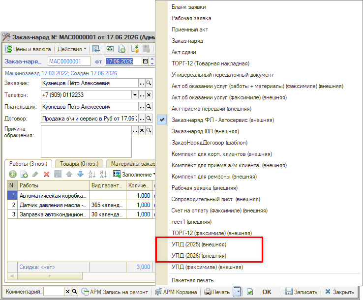
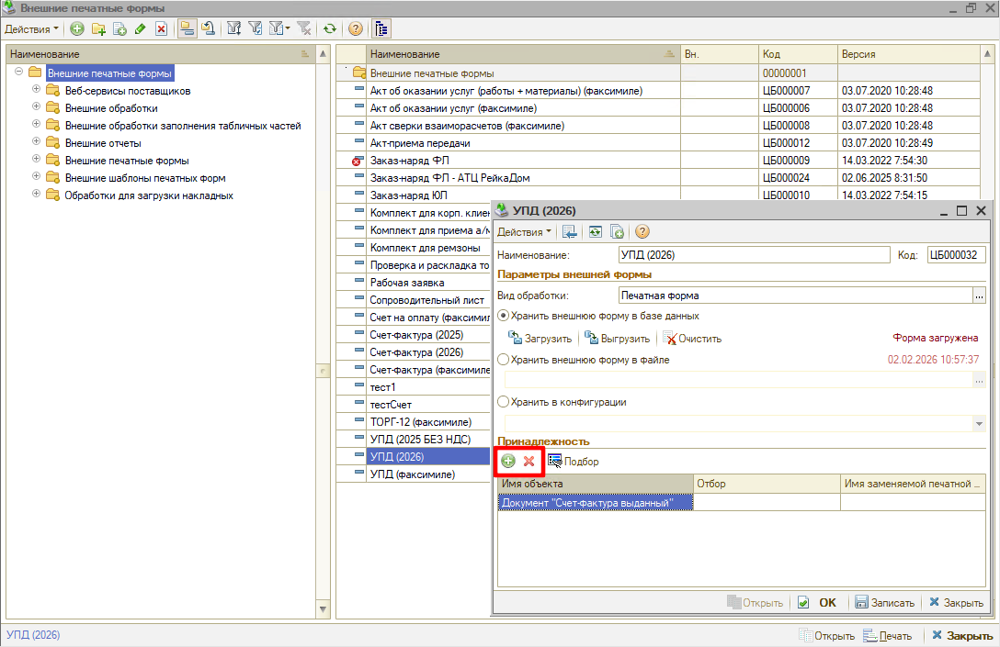
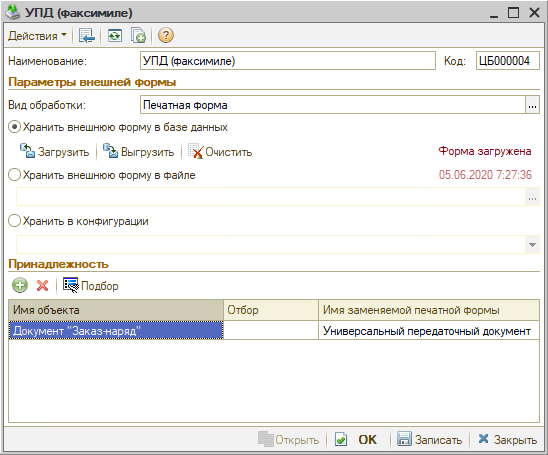

# Как скрыть лишнюю печатную форму в списке

<table><tr><td><b>Обновлено:</b> 30.10.2026</td></tr></table>

## Вопрос

В списке печатных форм документа (стрелка рядом с кнопкой **«Печать»**) выводятся формы, которые в этом документе не нужны, и сотрудники по ошибке печатают не ту форму. Например, в заказ-наряде есть две формы УПД – **«УПД (2025)»** и **«УПД (2026)»**, а форму 2026 года нужно печатать только из документа **«Счет-фактура выданный»**. Как убрать лишнюю печатную форму из списка?

## Ответ

Внешние печатные формы настраиваются в справочнике **«Внешние печатные формы»** (*Администрирование → Сервис → Настройки → Внешние печатные формы*). В зависимости от задачи есть три способа.

### 1. Привязать форму к нужным документам

Откройте печатную форму и в таблице **«Принадлежность»** добавьте документы, в которых форма должна выводиться для печати, – кнопкой **«Добавить»** или **«Подбор»**. Документ указывается в колонке **«Имя объекта»**. После этого форма будет в списке только у этих документов. В примере форма **«УПД (2026)»** привязана к документу **«Счет-фактура выданный»**, поэтому в заказ-наряде ее больше нет. Старая форма, наоборот, оставлена только в заказ-наряде (для документов прошлого года) и переименована в **«УПД (2025 БЕЗ НДС)»**, чтобы сотрудники не выбирали ее по ошибке.

Если таблица «Принадлежность» пустая, форма выводится в списке печати у всех документов.

### 2. Заменить другую печатную форму

Если новая форма должна выводиться вместо уже существующей (например, своя внешняя форма вместо типовой), откройте новую форму и в таблице **«Принадлежность»**, в колонке **«Имя заменяемой печатной формы»**, выберите из списка форму, которую она заменяет. В списке выбора – встроенные печатные формы документа из этой строки. В списке печати останется только новая форма.

Одну внешнюю форму можно привязать к нескольким документам и для каждого указать свою заменяемую форму. Например, форму **«УПД (факсимиле)»** можно привязать к документам **«Реализация товаров»**, **«Счет-фактура выданный»** и **«Заказ-наряд»**, а в заказ-наряде вывести ее вместо встроенного **«Универсального передаточного документа»**.

Заменяемая форма указывается в той же строке, что и документ. В примере форма **«УПД (2025 БЕЗ НДС)»** в заказ-наряде выводится вместо **«УПД (2026)»** – так форму 2026 года тоже можно убрать из заказ-наряда, не привязывая ее к счету-фактуре.

Так можно убрать из списка и типовую форму – заменив ее внешней.

### 3. Пометить форму на удаление

Если внешняя печатная форма совсем не нужна, пометьте ее на удаление в справочнике **«Внешние печатные формы»**. Помеченная форма больше не выводится в списке печати. На скриншоте выше так помечена форма **«Заказ-наряд ФЛ»**.

> [!WARNING]
> Так можно скрыть только внешние печатные формы – в списке печати у них в названии есть пометка **«(внешняя)»**. Формы без этой пометки встроены в программу: в справочнике их нет, и из списка они не пропадут. Чтобы убрать такую форму, замените ее внешней (способ 2).

## Материалы для изучения

- «[Заказ-наряды → Печать Заказ-наряда](../../../../articles/5S%20AUTO/Автосервис/Работа%20с%20Заказ-нарядами/Заказ-наряды/zakaz-naryady.md#печать-заказ-наряда)» – список печатных форм заказ-наряда.
- «[Подключение внешних печатных форм → Печать корзины](../../../../articles/5S%20AUTO/Администрирование%20и%20настройка%20системы/Подключение%20внешних%20печатных%20форм/Печать%20корзины/podklyuchenie-vneshney-pechatnoy-formy-pechat-korziny.md)» – справочник «Внешние печатные формы» и загрузка формы.
- «[Подключение внешней печатной формы «Печать рекомендаций»](../../../../articles/5S%20AUTO/Автосервис/Подключение%20внешней%20печатной%20формы%20Печать%20рекомендаций/podklyuchenie-vneshney-pechatnoy-formy-pechat-rekomendaciy.md)» – пример привязки внешней формы к документу «Заказ-наряд» через принадлежность.

## Похожие вопросы

- Как скрыть лишнюю печатную форму в списке
- Просьба удалить ПФ УПД 2026 из документа Заказ-наряд, либо сделать не активной эту кнопку
- Внешняя ПФ должна печататься только из документа Счет-фактура выданный
- Можно ли сделать так, чтобы у мастеров-приемщиков не было доступа печатать УПД из ЗН
- Как убрать печатную форму из списка печати
- Как сделать, чтобы печатная форма выводилась только в определенном документе
- Как заменить типовую печатную форму своей
- Удалили внешнюю печатную форму, а она все равно есть в списке печати

## Теги

печатная форма, внешние печатные формы, список печатных форм, печать, принадлежность, имя заменяемой печатной формы, пометка на удаление, заказ-наряд
