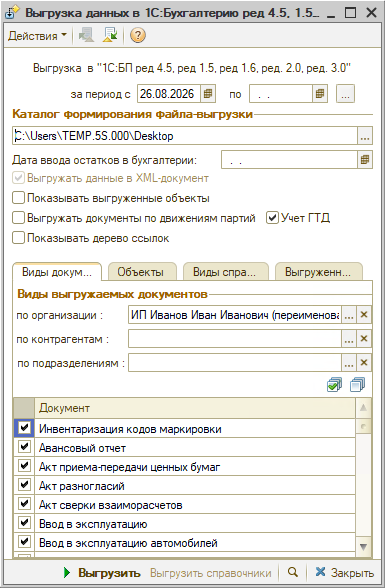
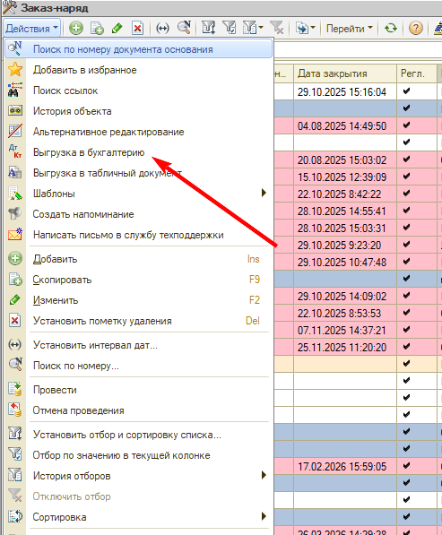
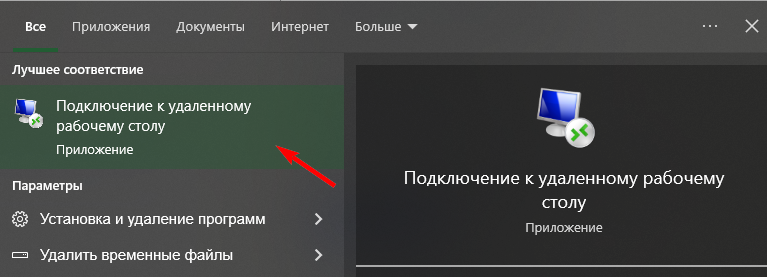

# Как сохранить документ в формате XML

<table><tr><td><b>Создано:</b> 16.11.2026</td></tr></table>

Тикет: https://support.5systems.ru/ru/ticket/list/filter/id/96/ticket/23299 (TZX-92274)

###### *Опубликовано 16.11.2026: [https://kb.5systems.ru/tips/5s-auto/administrirovanie/kak-sohranit-dokument-v-formate-xml](https://kb.5systems.ru/tips/5s-auto/administrirovanie/kak-sohranit-dokument-v-formate-xml)*

> 🛠 Комментарий для черновика: *Обработка сохраняет XML в формате обмена с 1С:Бухгалтерией, а не в формате ФНС (УПД и т. п.). Клиенту из тикета для ЭДО подошло, но примет ли такой файл любой оператор ЭДО – уточнить у коллег.*

## Вопрос

Для работы в ЭДО нужен документ в формате XML. Можно ли сохранить документ из 5S AUTO в XML и как потом забрать файл, если программа работает на удаленном рабочем столе?

## Ответ

Отправлять документы контрагентам удобнее всего прямо из программы – через [интеграцию с ЭДО](../../../../articles/5S%20AUTO/Интеграция%20с%20внешними%20сервисами/Интеграция%20с%20ЭДО/integraciya-s-edo.md) (Контур.Диадок или Saby (СБИС)): тогда сохранять файлы вручную не нужно.

Если такой вариант не подходит, документ можно сохранить в XML-файл обработкой «Выгрузка данных в 1С:Бухгалтерию».

### 1. Сохраните документы в XML

Выгрузить можно сразу документы за период или один нужный документ:

- **Документы за период.** Откройте обработку: *Финансы → Разделы учета → Прочее → Выгрузка данных в бухгалтерию* (в главном меню – *Обработки → Выгрузка данных в бухгалтерию*):

  

  Укажите период, в поле **«Каталог формирования файла-выгрузки»** – папку, в которую сохранится файл, на вкладке **«Виды документов»** отметьте нужные документы и нажмите **«Выгрузить»**. Флажок **«Выгружать данные в XML-документ»** установлен по умолчанию:

  

  Подробнее о параметрах обработки – в статье «[Автоматическая выгрузка данных в 1С:Бухгалтерию](../../../../articles/5S%20AUTO/Администрирование%20и%20настройка%20системы/Автоматическая%20выгрузка%20данных%20в%201С%20Бухгалтерию/avtomaticheskaya-vygruzka-dannykh-v-1s-bukhgalteriyu.md)».

- **Один документ.** В списке документов (например, заказ-нарядов) выделите нужный документ и выберите **«Действия» → «Выгрузка в бухгалтерию»**:

  

### 2. Скопируйте файл на свой компьютер

Если программа работает на удаленном рабочем столе (в облаке), файл сохраняется на сервере. Скопировать его на свой компьютер можно двумя способами:

- **Через программу.** Выберите *Файл → Открыть*:

  

  В открывшемся окне перейдите в папку, указанную в поле «Каталог формирования файла-выгрузки», нажмите на файл правой кнопкой мыши, выберите **«Копировать»** и вставьте файл на рабочий стол своего компьютера.

  Если файл не вставляется, см. совет «[Не копируются данные из 1С и наоборот (буфер обмена всегда пуст)](../../../Техподдержка/Не%20копируются%20данные%20из%201С%20и%20наоборот%20(буфер%20обмена%20всегда%20пуст)/ne-kopiruyutsya-dannye-iz-1s-bufer-obmena-pust.md)».
- **Через подключение к удаленному рабочему столу.** Найдите через поиск Windows на своем компьютере приложение **«Подключение к удаленному рабочему столу»**:

  

  Подключитесь к серверу под своей учетной записью сервера и скопируйте файл из папки выгрузки. Адрес сервера можно узнать у руководителя или в технической поддержке.

## Материалы для изучения

- «[Интеграция с ЭДО](../../../../articles/5S%20AUTO/Интеграция%20с%20внешними%20сервисами/Интеграция%20с%20ЭДО/integraciya-s-edo.md)» – обмен электронными документами с контрагентами прямо из 5S AUTO.
- «[Автоматическая выгрузка данных в 1С:Бухгалтерию](../../../../articles/5S%20AUTO/Администрирование%20и%20настройка%20системы/Автоматическая%20выгрузка%20данных%20в%201С%20Бухгалтерию/avtomaticheskaya-vygruzka-dannykh-v-1s-bukhgalteriyu.md)» – параметры обработки выгрузки и выгрузка по расписанию.

## См. также

- [Не копируются данные из 1С и наоборот (буфер обмена всегда пуст)](../../../Техподдержка/Не%20копируются%20данные%20из%201С%20и%20наоборот%20(буфер%20обмена%20всегда%20пуст)/ne-kopiruyutsya-dannye-iz-1s-bufer-obmena-pust.md)
- [Как передавать данные из облачной базы во внешнюю систему](../Как%20передавать%20данные%20из%20облачной%20базы%20во%20внешнюю%20систему/kak-peredavat-dannye-iz-oblachnoy-bazy-vo-vneshnyuyu-sistemu.md)

## Похожие вопросы

- Как сохранить документ в формате XML
- Есть ли в программе формат документов XML
- Нужен документ в XML для работы в ЭДО
- Как скачать документ в формате XML
- Как выгрузить документ в XML
- Не могу найти папку, куда сохранился файл выгрузки, рабочий стол удаленный
- Как скопировать файл с удаленного рабочего стола на свой компьютер

## Теги

XML, формат XML, ЭДО, электронный документооборот, выгрузка в бухгалтерию, выгрузка данных, сохранить документ, удаленный рабочий стол, облако, скопировать файл
