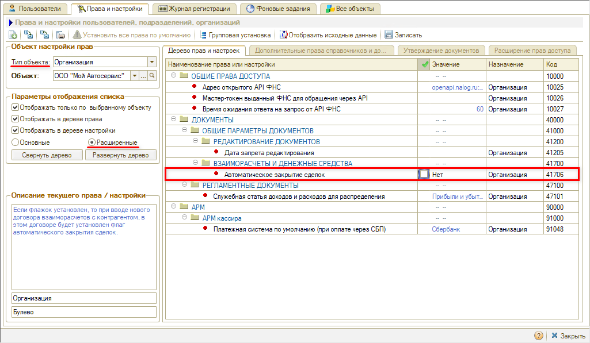
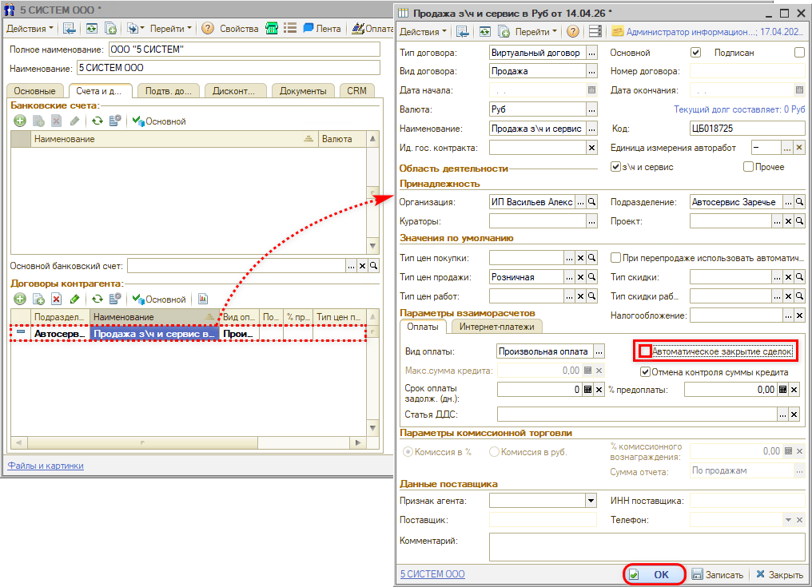

# Новые договоры создаются с флажком «Автоматическое закрытие сделок»

<table><tr><td><b>Обновлено:</b> 23.11.2026</td></tr></table>

Тикет: https://support.5systems.ru/ru/ticket/list/filter/id/1/ticket/24685/ (HDE #AUV-69163)

## Проблема

Каждый новый договор взаиморасчетов с контрагентом — в том числе созданный автоматически — появляется с уже установленным флажком **«Автоматическое закрытие сделок»**. Приходится вручную снимать пометку у уже созданных договоров и следить за каждым новым.

Когда этот флажок установлен, программа при каждой оплате по договору [автоматически закрывает неоплаченные сделки](../../../../articles/5S%20AUTO/Учет%20взаиморасчетов/Автозакрытие%20сделок%20и%20ручная%20привязка/avtozakrytie-sdelok-i-ruchnaya-privyazka.md) — от самой старой к новой. Компаниям, которые контролируют сделки вручную, это мешает: оплаты разносятся на документы без их участия.

## Причина

Включена настройка **«Автоматическое закрытие сделок»** в правах и настройках пользователей: пока она установлена в значение «Да», при вводе каждого нового договора взаиморасчетов программа сразу устанавливает в нем флаг автозакрытия сделок.

## Решение

**1. Отключите настройку «Автоматическое закрытие сделок».**

Откройте *Администрирование → Сервис → Пользователи и права → [Установка прав и настроек](../../../../articles/5S%20AUTO/Пользователи%20и%20права/Установка%20прав%20и%20настроек%20пользователя/ustanovka-prav-i-nastroek-polzovatelya.md)*. Изменять права может только пользователь с включенным правом «Разрешить изменение прав доступа и настроек» (обычно это администратор).

Найдите в дереве прав настройку **«Автоматическое закрытие сделок»** ([«Расширенные»](../../../../articles/5S%20AUTO/Пользователи%20и%20права/Установка%20прав%20и%20настроек%20пользователя/ustanovka-prav-i-nastroek-polzovatelya.md#основные-и-расширенные-права), группа «Взаиморасчеты и денежные средства», настройка устанавливается на организацию).

В описании сказано: «Если флажок установлен, то при вводе нового договора взаиморасчетов с контрагентом, в этом договоре будет установлен флаг автоматического закрытия сделок». Установите значение **«Нет»** и запишите настройки.

**2. Перезайдите в программу и проверьте новый договор.**

**3. Снимите флажок в уже созданных договорах.**

У действующих договоров флажок сам не снимется — откройте карточку договора взаиморасчетов, на закладке **«Основные»** в группе **«Параметры взаиморасчетов»** снимите **«Автоматическое закрытие сделок»**, затем запишите договор:

Учтите, что изменение этого реквизита влияет на алгоритм проведения взаиморасчетов по договору: как флаг участвует в проведении оплат, см. в [статье «Автозакрытие сделок и ручная привязка»](../../../../articles/5S%20AUTO/Учет%20взаиморасчетов/Автозакрытие%20сделок%20и%20ручная%20привязка/avtozakrytie-sdelok-i-ruchnaya-privyazka.md), реквизиты договора — в [статье «Взаиморасчеты с контрагентами»](../../../../articles/5S%20AUTO/Учет%20взаиморасчетов/Взаиморасчеты%20с%20контрагентами/vzaimoraschety-s-kontragentami.md).

## См. также

- [Как настроить автоматическое создание договора с контрагентом](../../Практики/Как%20настроить%20автоматическое%20создание%20договора%20с%20контрагентом/avtomaticheskoe-sozdanie-dogovora-s-kontragentom.md) — настройка автосоздания договоров и контроля организации в договоре.
- [При закрытии кассовой смены создаются новые договоры](../../Касса/При%20закрытии%20кассовой%20смены%20создаются%20новые%20договоры/pri-zakrytii-smeny-sozdayutsya-novye-dogovory.md) — почему договоры создаются при закрытии смены и как это настроить.

## Материалы для изучения

- «[Автозакрытие сделок и ручная привязка](../../../../articles/5S%20AUTO/Учет%20взаиморасчетов/Автозакрытие%20сделок%20и%20ручная%20привязка/avtozakrytie-sdelok-i-ruchnaya-privyazka.md)» — как работает флаг автозакрытия, автоматический и ручной контроль сделок, рекомендации по использованию.
- «[Взаиморасчеты с контрагентами](../../../../articles/5S%20AUTO/Учет%20взаиморасчетов/Взаиморасчеты%20с%20контрагентами/vzaimoraschety-s-kontragentami.md)» — реквизиты договора взаиморасчетов, роль договора в аналитике взаиморасчетов.
- «[Установка прав и настроек пользователя](../../../../articles/5S%20AUTO/Пользователи%20и%20права/Установка%20прав%20и%20настроек%20пользователя/ustanovka-prav-i-nastroek-polzovatelya.md)» — как устроены права и настройки, шаблоны прав, групповая установка.

## Похожие вопросы

- Все договора автоматически создаются с пометкой на «автоматическое закрытие сделок» — как исправить?
- Как отключить автоматическое закрытие сделок в новых договорах?
- Новые договоры взаиморасчетов создаются с флажком автозакрытия сделок
- Как сделать так, чтобы в новых договорах не ставился флаг автоматического закрытия сделок?

## Теги

договор взаиморасчетов, взаиморасчеты, автозакрытие сделок, автоматическое закрытие сделок, флаг, права и настройки, шаблоны прав
