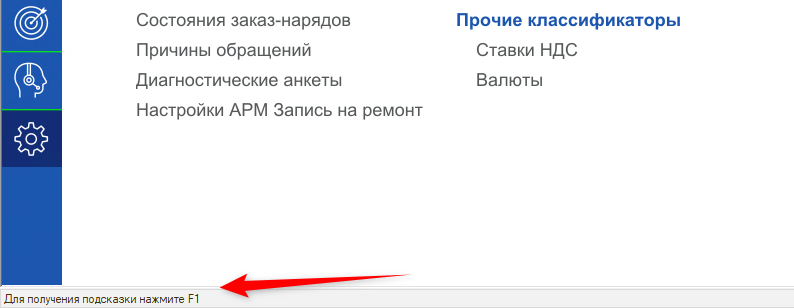
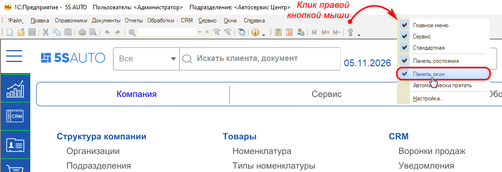
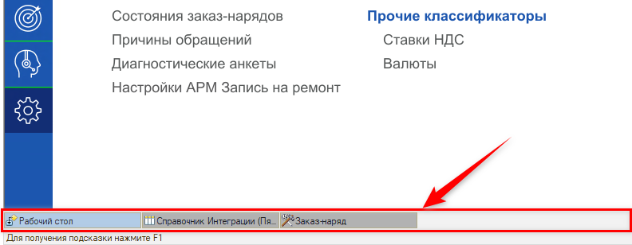

# Пропала панель окон внизу экрана

<table><tr><td><b>Создано:</b> 05.11.2026</td></tr></table>

###### *Опубликовано 05.11.2026: [https://kb.5systems.ru/tips/5s-auto/administrirovanie/propala-panel-okon](https://kb.5systems.ru/tips/5s-auto/administrirovanie/propala-panel-okon)*

## Проблема

Внизу экрана больше не отображаются открытые и свернутые окна – заказ-наряды, отчеты, справочники и т. д. Переключаться между ними и разворачивать свернутые окна стало неудобно (как должно быть – см. [ниже](#rezultat)).

## Причина

Отключена **«Панель окон»** – строка внизу экрана, в которой показываются все открытые окна программы. Обычно ее случайно отключают в контекстном меню панелей вверху экрана.

> [!NOTE]
> Типовые панели программы – главное меню (**«Файл»**, **«Правка»**, **«Справочники»** и т. д.), панель инструментов и панель окон – видны только администратору: у обычных пользователей они скрыты.

## Решение

1. Нажмите правой кнопкой мыши на панель вверху окна программы – например, на свободное место справа от главного меню (**«Файл»**, **«Правка»**, **«Справочники»** и т. д.).
2. В открывшемся меню выберите **«Панель окон»**, чтобы рядом с ней появилась галочка.

   

Панель окон снова появится внизу экрана, а открытые и свернутые окна будут отображаться на ней.

## Материалы для изучения

- «[Структура интерфейса 5S AUTO](../../../../articles/5S%20AUTO/CRM/Структура%20интерфейса%205S%20AUTO/struktura-interfeysa-5s-auto.md)» – из чего состоит интерфейс программы.

## Похожие вопросы

- Пропала панель окон внизу экрана
- Пропали свернутые окна
- Пропали вкладки внизу экрана
- Как вернуть вкладки открытых окон внизу экрана
- Как вернуть свернутые окна внизу экрана
- Не отображаются открытые окна внизу экрана
- Как вернуть панель окон
- Как вернуть нижнюю панель рабочего стола
- Пропала нижняя панель рабочего стола

## Теги

панель окон, вкладки, свернутые окна, открытые окна, интерфейс, панели, контекстное меню
