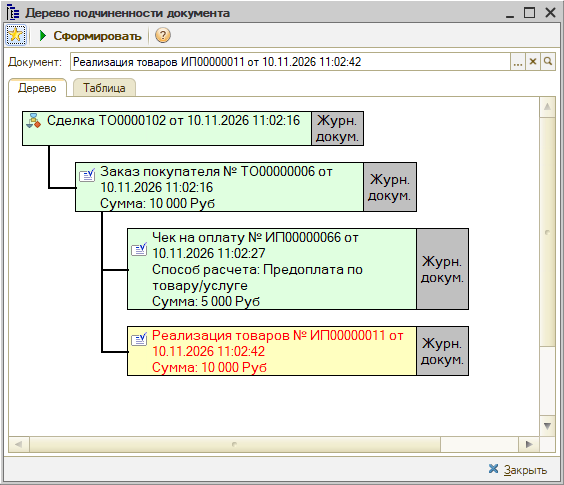
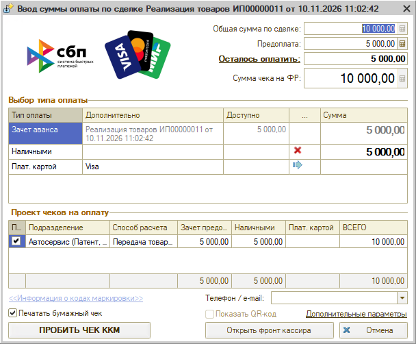

# Как принять предоплату по реализации товаров

<table><tr><td><b>Создано:</b> 10.11.2026</td></tr></table>

Источник: https://support.5systems.ru/ru/ticket/list/filter/id/96/ticket/23299

> 🛠 Комментарий для черновика: *Черновик составлен по тикету https://support.5systems.ru/ru/ticket/list/filter/id/96/ticket/23299 и скриншотам «Проблема_70». Требуется уточнить формулировку проблемы из тикета и при необходимости добавить обводку на скриншоты.*

## Проблема

Клиент вносит предоплату (аванс) за покупку запчастей или товаров, а окончательный расчет и выдача товара производятся позже документом «Реализация товаров». При оформлении документов пользователи сталкиваются со следующими сложностями:

- если сразу создать документ «Реализация товаров», принять частичную оплату в окне ввода суммы оплаты нельзя — поле **«Сумма чека на ФР»** заблокировано для редактирования, так как по реализации принимается только окончательный расчет;
- если принять оплату отдельно без привязки к заказу, при последующей отгрузке внесенная предоплата не зачитывается автоматически, и программа требует оплатить полную стоимость заново.

## Причина

В документе «Реализация товаров» оформляется окончательный расчет с клиентом: в фискальном чеке признак способа расчета жестко установлен как **«Передача товара/услуги»**. Сумма чека равна сумме документа и не может быть уменьшена вручную.

Чтобы сумма внесенного ранее аванса зачлась автоматически, в программе должна быть соблюдена правильная цепочка подчиненности документов:

**1.** Сделка. 
**2.** Заказ покупателя (или Счет на оплату). 
**3.** Документ оплаты предоплаты («Чек на оплату» со способом расчета «Предоплата по товару/услуге» или «Аванс», либо ПКО / оплата картой), введенный строго **на основании заказа покупателя**. 
**4.** Документ «Реализация товаров», введенный также **на основании того же заказа покупателя**.

Если цепочка соблюдена, при открытии окна оплаты по реализации программа автоматически подставляет строку **«Зачет аванса»** на сумму внесенной предоплаты.

## Решение

**Шаг 1. Оформите заказ покупателя**

1. В сделке создайте документ **«Заказ покупателя»** (или **«Счет на оплату»**), укажите список товаров и общую стоимость (в примере — 10 000 руб.).
2. Проведите документ.

**Шаг 2. Примите предоплату на основании заказа**

1. В документе «Заказ покупателя» нажмите кнопку **«Оплата»** (или создайте на основании документ «Чек на оплату»).
2. В окне ввода суммы оплаты укажите фактически вносимую клиентом сумму (в примере — 5 000 руб.) и способ оплаты (наличные, платежная карта, СБП).
3. В чеке ККМ автоматически установится способ расчета **«Предоплата по товару/услуге»** (или «Аванс»).
4. Нажмите **«ПРОБИТЬ ЧЕК ККМ»**.

**Шаг 3. Оформите реализацию товаров на основании заказа**

1. Когда клиент забирает товар, откройте этот же заказ покупателя.
2. Нажмите кнопку **«Ввести на основании»** и выберите **«Реализация товаров»**. Все позиции и суммы перенесутся из заказа.
3. Проведите документ «Реализация товаров».

Правильная структура подчиненности документов отображается в дереве подчиненности (кнопка **«Структура подчиненности»**):

**Шаг 4. Примите окончательный расчет с зачетом аванса**

1. В документе «Реализация товаров» нажмите кнопку **«Оплата»**.
2. В окне ввода суммы оплаты:
   - В верхней информационной части отображаются: **«Общая сумма по сделке»** (10 000,00 руб.), **«Предоплата»** (5 000,00 руб.) и **«Осталось оплатить»** (5 000,00 руб.).
   - Поле **«Сумма чека на ФР»** равно полной сумме реализации (10 000,00 руб.), так как по 54-ФЗ чек при передаче товара оформляется на полную стоимость.
   - В таблице **«Выбор типа оплаты»** первой строкой автоматически подтягивается **«Зачет аванса»** с указанием документа реализации и суммы ранее внесенной предоплаты (5 000,00 руб.).
   - На оставшуюся сумму выберите тип оплаты (наличными или платежной картой) и внесите фактически полученную сумму (5 000,00 руб.).
   - В таблице **«Проект чеков на оплату»** способ расчета установлен как **«Передача товара/услуги»**, при этом сумма 10 000,00 руб. разбивается на зачет предоплаты (5 000,00 руб.) и наличные/карту (5 000,00 руб.).
3. Нажмите кнопку **«ПРОБИТЬ ЧЕК ККМ»**.

## См. также

- «[Не получается принять частичную оплату в реализации](https://kb.5systems.ru/tips/5s-auto/kassa/ne-poluchaetsya-prinyat-chastichnuyu-oplatu-v-realizacii)»

## Материалы для изучения

- «[Упрощенный Фронт кассира](https://kb.5systems.ru/articles/5s-auto/kassa/uproschennyy-front-kassira#1-зачет-предоплаты)» — окно ввода суммы оплаты, зачет предоплаты, способы расчета в чеке ККМ.
- «[Работа с заказами покупателя](https://kb.5systems.ru/articles/5s-auto/rabota-s-zakazami/rabota-s-zakazami-pokupatelya)» — оформление заказов и ввод документов на основании.

## Похожие вопросы

- Как принять предоплату по реализации товаров
- Как оформить предоплату и зачесть ее при продаже
- Как пробить чек с зачетом аванса в реализации товаров
- Почему в реализации товаров не зачитывается предоплата
- Какая цепочка документов нужна для зачета предоплаты
- Как принять частичную оплату за товар

## Теги

предоплата, зачет аванса, частичная оплата, реализация товаров, заказ покупателя, чек на оплату, чек ккм, передача товара, дерево подчиненности, фронт кассира
