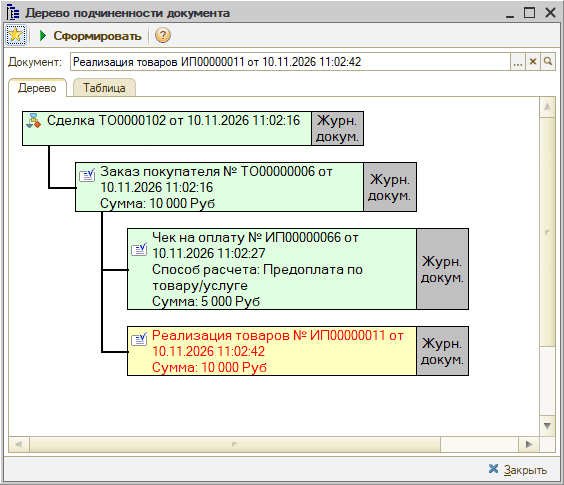
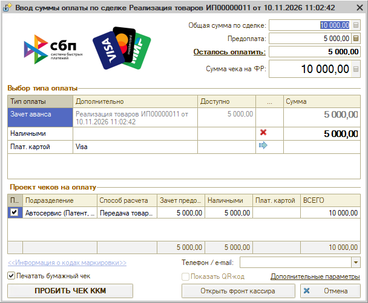

# Не получается принять частичную оплату в реализации

<table><tr><td><b>Обновлено:</b> 10.11.2026</td></tr></table>

Источник: https://support.5systems.ru/ru/ticket/list/filter/id/96/ticket/23299

> 🛠 Комментарий для черновика: *Совет дополнен по тикету 23299 «Рассрочка»: добавлены варианты решения от техподдержки, пошаговая цепочка документов с зачетом аванса и скриншоты «Проблема_70».*

###### *Опубликовано 30.10.2026: [https://kb.5systems.ru/tips/5s-auto/kassa/ne-poluchaetsya-prinyat-chastichnuyu-oplatu-v-realizacii](https://kb.5systems.ru/tips/5s-auto/kassa/ne-poluchaetsya-prinyat-chastichnuyu-oplatu-v-realizacii)*

## Проблема

В документе **«Реализация товаров»** при нажатии кнопки **«Оплата»** в окне ввода суммы оплаты поле **«Сумма чека на ФР»** равно сумме документа и не редактируется — принять у клиента только часть оплаты или оформить продажу в рассрочку нельзя:

> *«Добрый день, как можно оформить в программе рассрочку (частичную оплату) в реализациях»*

При этом в заказ-наряде частичную оплату принять получалось:

## Причина

Если в программе включен **«Упрощенный фронт кассира»**, то принять предоплату (частичную оплату) непосредственно в документе «Реализация товаров» нельзя.

По реализации товаров принимается окончательный расчет по сделке: в фискальном чеке устанавливается способ расчета **«Передача товара/услуги»**. Согласно 54-ФЗ чек при передаче товара должен пробиваться на полную стоимость покупки, поэтому сумма чека на фискальном регистраторе недоступна для редактирования и должна быть внесена полностью.

Изменить сумму чека на произвольную (внести аванс или принять частичную оплату) через упрощенный фронт кассира можно только при приеме предварительной оплаты — по **заказу покупателя**, **счету на оплату** или **заказ-наряду**, пока он не находится в состоянии «Выполнен» или «Закрыт». В выполненном или закрытом заказ-наряде также принимается только окончательный расчет.

## Решение

Специалист техподдержки предложил два варианта оформления в зависимости от используемого способа расчетов:

### Вариант 1. Через заказ покупателя и кассу ККМ (рекомендуемый)

Рекомендуется использовать порядок с соблюдением правильной цепочки документов:

**Шаг 1. Создайте заказ покупателя**

1. В сделке создайте документ **«Заказ покупателя»** (или **«Счет на оплату»**) на полную стоимость покупки (в примере — 10 000 руб.).
2. Проведите документ.

**Шаг 2. Примите предоплату по заказу**

1. В документе «Заказ покупателя» нажмите кнопку **«Оплата»** (или введите на основании документ «Чек на оплату»).
2. В окне ввода суммы оплаты поле **«Сумма чека на ФР»** доступно для редактирования: укажите сумму внесенного клиентом аванса (в примере — 5 000 руб.) и выберите тип оплаты (наличные, банковская карта, СБП).
3. В чеке ККМ автоматически установится способ расчета **«Предоплата по товару/услуге»** (или «Аванс»).
4. Нажмите **«ПРОБИТЬ ЧЕК ККМ»**.

**Шаг 3. Оформите реализацию товаров на основании заказа**

1. Когда клиент забирает товар, откройте заказ покупателя.
2. Нажмите **«Ввести на основании» → «Реализация товаров»**. Все номенклатурные позиции и суммы автоматически перенесутся из заказа.
3. Проведите документ «Реализация товаров».

Правильная цепочка документов отображается в дереве подчиненности (кнопка **«Структура подчиненности»**):

**Шаг 4. Примите итоговую оплату с зачетом аванса**

1. В документе «Реализация товаров» нажмите кнопку **«Оплата»**.
2. В окне ввода суммы оплаты:
   - В верхней строке отображаются: **«Общая сумма по сделке»** (10 000,00 руб.), **«Предоплата»** (5 000,00 руб.) и **«Осталось оплатить»** (5 000,00 руб.).
   - Поле **«Сумма чека на ФР»** равно полной сумме реализации (10 000,00 руб.), так как чек на передачу товара закрывается на полную стоимость покупки.
   - В таблице **«Выбор типа оплаты»** первой строкой автоматически подтягивается **«Зачет аванса»** на сумму 5 000,00 руб., ранее принятую по заказу покупателя в рамках этой же сделки (поле отображается серым цветом и недоступно для изменения).
   - На оставшуюся сумму (5 000,00 руб.) выберите тип оплаты (наличными или платежной картой) и внесите доплату.
   - В таблице **«Проект чеков на оплату»** способ расчета установлен как **«Передача товара/услуги»** (полный расчет), при этом сумма 10 000,00 руб. разбивается на зачет предоплаты (5 000,00 руб.) и внесенную доплату (5 000,00 руб.).
3. Нажмите кнопку **«ПРОБИТЬ ЧЕК ККМ»**.

---

### Вариант 2. Прием оплаты документами ПКО или банковской выпиской

Если оплата принимается без пробития кассового чека через упрощенный фронт кассира (например, при безналичных расчетах между организациями или при оформлении кассовых ордеров):

1. **Приходный кассовый ордер (ПКО)** оформляется при приеме наличных средств в кассу компании. Сумма предоплаты в документе указывается вручную в произвольном размере.
2. **Банковская выписка** оформляется при безналичном поступлении денежных средств на расчетный счет (в том числе частями по выставленному счету).
3. При проведении документа **«Реализация товаров»** и последующих платежей взаиморасчеты и зачет аванса закрываются автоматически по сделке и договору контрагента.

## Материалы для изучения

- «[Упрощенный Фронт кассира](https://kb.5systems.ru/articles/5s-auto/kassa/uproschennyy-front-kassira)» — окно ввода суммы оплаты, [автоматический зачет аванса по текущей сделке](https://kb.5systems.ru/articles/5s-auto/kassa/uproschennyy-front-kassira#a-зачет-аванса-по-текущей-сделке), способы расчета в чеках.
- «[Работа с заказами покупателя](https://kb.5systems.ru/articles/5s-auto/rabota-s-zakazami/rabota-s-zakazami-pokupatelya)» — оформление заказов и ввод документов на основании.
- «[Учет взаиморасчетов с контрагентами](https://kb.5systems.ru/articles/5s-auto/uchet-vzaimoraschetov/vzaimoraschety-s-kontragentami)» — отражение оплат, ПКО, банковские выписки.

## Похожие вопросы

- Не получается принять частичную оплату в реализации
- Рассрочка
- Как оформить рассрочку в реализации товаров
- Как можно оформить в программе рассрочку (частичную оплату) в реализациях
- Как оформить покупку товара в рассрочку
- Пробитие оплаты частично
- До этого можно было принимать частичную оплату в ЗН, а в реализации не дает
- В реализации нельзя изменить сумму чека на ФР
- Как принять предоплату по реализации
- Как принять оплату частями
- Как пробить чек с зачетом аванса при реализации
- Почему в реализации товаров не зачитывается предоплата

## Теги

рассрочка, частичная оплата, предоплата, зачет аванса, реализация товаров, заказ-наряд, заказ покупателя, счет на оплату, пко, банковская выписка, фронт кассира, упрощенный фронт кассира, сумма чека на ФР, передача товара
