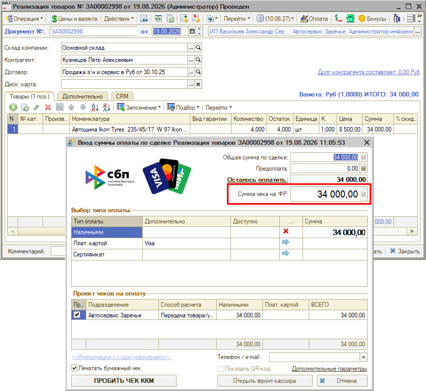
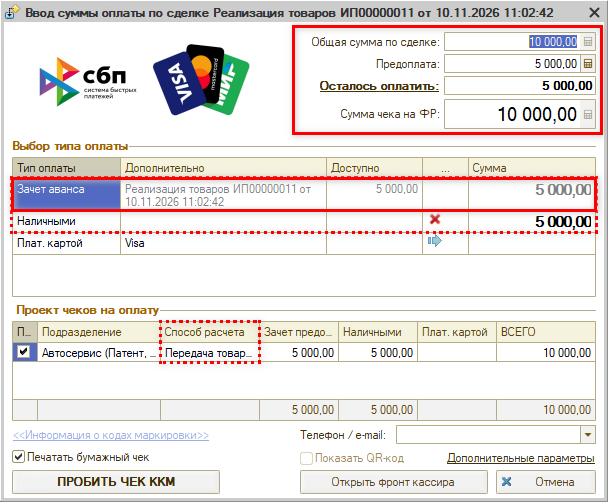

# Не получается принять частичную оплату в реализации

<table><tr><td><b>Обновлено:</b> 10.11.2026</td></tr></table>

Источник: https://support.5systems.ru/ru/ticket/list/filter/id/96/ticket/23244, https://support.5systems.ru/ru/ticket/list/filter/id/96/ticket/23299

> 🛠 Комментарий для черновика: *Совет дополнен по тикетам 23244 и 23299 («Рассрочка», «Частичная оплата»): добавлены 2 варианта решения от техподдержки, цепочка документов с зачетом аванса и скриншоты «Проблема_70».*

###### *Опубликовано 30.10.2026: [https://kb.5systems.ru/tips/5s-auto/kassa/ne-poluchaetsya-prinyat-chastichnuyu-oplatu-v-realizacii](https://kb.5systems.ru/tips/5s-auto/kassa/ne-poluchaetsya-prinyat-chastichnuyu-oplatu-v-realizacii)*

## Проблема

В документе **«Реализация товаров»** при нажатии кнопки **«Оплата»** в окне ввода суммы оплаты поле **«Сумма чека на ФР»** равно сумме документа и не редактируется — принять у клиента только часть оплаты или оформить продажу в рассрочку нельзя:

При этом в заказ-наряде частичную оплату принять получалось.

## Причина

Если в программе включен «[Упрощенный фронт кассира](https://kb.5systems.ru/articles/5s-auto/kassa/uproschennyy-front-kassira)», то принять предоплату / частичную оплату непосредственно в документе «Реализация товаров» нельзя.

По реализации товаров принимается окончательный расчет по сделке: в фискальном чеке устанавливается способ расчета **«Передача товара/услуги»**. Согласно 54-ФЗ чек при передаче товара должен пробиваться на полную стоимость покупки, поэтому сумма чека на фискальном регистраторе недоступна для редактирования и должна быть внесена полностью.

Изменить сумму чека на произвольную (внести аванс или принять частичную оплату) через упрощенный фронт кассира можно только при приеме предварительной оплаты — по **заказу покупателя**, **счету на оплату** или **заказ-наряду**, пока он не находится в состоянии «Выполнен» или «Закрыт». В выполненном или закрытом заказ-наряде также принимается только окончательный расчет.

## Решение

Оформить продажу с частичной оплатой можно двумя способами:

### Вариант 1. Через заказ покупателя и кассу ККМ (рекомендуемый)

Для корректного зачета аванса документы оформляются в следующей последовательности:

1. **Создайте документ «Заказ покупателя»** (или «Счет на оплату») на полную сумму сделки и проведите его.
2. **Примите предоплату по заказу:** нажмите **«Оплата»** в заказе покупателя, укажите сумму аванса (при приеме оплаты через заказ покупателя поле «Сумма чека на ФР» в Упрощенном фронте кассира доступно для редактирования) и пробейте чек со способом расчета **«Предоплата по товару/услуге»**.
3. **Оформите реализацию на основании заказа:** когда клиент забирает товар, откройте заказ покупателя и нажмите **«Ввести на основании» → «Реализация товаров»**. Все позиции и суммы перенесутся автоматически. Проведите документ.

   В дереве документов цепочка должна выглядеть следующим образом:

   

4. **Примите итоговую оплату по реализации:** нажмите **«Оплата»** в реализации товаров. В окне оплаты:
   - сумма внесенной по заказу предоплаты автоматически подтянется в строку **«Зачет аванса»**;
   - на оставшуюся сумму выберите тип оплаты (наличными или картой) и внесите доплату;
   - в чеке установится способ расчета **«Передача товара/услуги»** на полную стоимость с зачетом аванса. Нажмите **«ПРОБИТЬ ЧЕК ККМ»**.

   

---

### Вариант 2. Документами ПКО или банковской выпиской

Если расчеты ведутся без пробития кассового чека через упрощенный фронт кассира (безналичный расчет или оформление через кассовые ордера):

1. Предоплату примите документом **«Приходный кассовый ордер» (ПКО)** (при оплате наличными) или **«Банковская выписка»** (при безналичном переводе на расчетный счет — см. статью «[Загрузка банковской выписки](https://kb.5systems.ru/articles/5s-auto/banki-i-platezhnye-sistemy/zagruzka-bankovskoy-vypiski)»). В этих документах сумма вносится произвольно.
2. На основании заказа покупателя оформите документ **«Реализация товаров»** (см. статью «[Работа с заказами покупателя](https://kb.5systems.ru/articles/5s-auto/rabota-s-zakazami/rabota-s-zakazami-pokupatelya)»).
3. Окончательный расчет оформите вторым ПКО или банковской выпиской — взаиморасчеты и зачет аванса закроются автоматически по сделке (см. статью «[Взаиморасчеты с контрагентами](https://kb.5systems.ru/articles/5s-auto/uchet-vzaimoraschetov/vzaimoraschety-s-kontragentami)»).

## Материалы для изучения

- «[Упрощенный Фронт кассира](https://kb.5systems.ru/articles/5s-auto/kassa/uproschennyy-front-kassira)» — окно ввода суммы оплаты, [автоматический зачет аванса по текущей сделке](https://kb.5systems.ru/articles/5s-auto/kassa/uproschennyy-front-kassira#a-зачет-аванса-по-текущей-сделке), способы расчета в чеках.
- «[Работа с заказами покупателя](https://kb.5systems.ru/articles/5s-auto/rabota-s-zakazami/rabota-s-zakazami-pokupatelya)» — оформление заказов и ввод документов на основании.
- «[Учет взаиморасчетов с контрагентами](https://kb.5systems.ru/articles/5s-auto/uchet-vzaimoraschetov/vzaimoraschety-s-kontragentami)» — отражение оплат, ПКО, банковские выписки.

## Похожие вопросы

- Не получается принять частичную оплату в реализации
- Рассрочка
- Как оформить рассрочку в реализации товаров
- Как можно оформить в программе рассрочку (частичную оплату) в реализациях
- Как оформить покупку товара в рассрочку
- Пробитие оплаты частично
- В заказ-наряде можно принимать частичную оплату, а в реализации не получается
- В реализации нельзя изменить сумму чека на ФР
- Как принять предоплату по реализации
- Как принять оплату частями
- Как пробить чек с зачетом аванса при реализации
- Почему в реализации товаров не зачитывается предоплата

## Теги

рассрочка, частичная оплата, предоплата, зачет аванса, реализация товаров, заказ-наряд, заказ покупателя, счет на оплату, пко, банковская выписка, фронт кассира, упрощенный фронт кассира, сумма чека на ФР, передача товара
