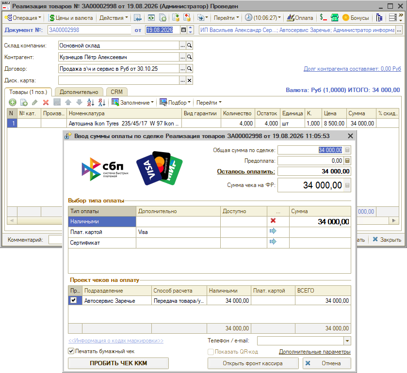

# Не получается принять частичную оплату в реализации

<table><tr><td><b>Обновлено:</b> 29.10.2026</td></tr></table>

## Проблема

В документе **«Реализация товаров»** при нажатии кнопки **«Оплата»** в окне ввода суммы оплаты поле **«Сумма чека на ФР»** равно сумме документа и не редактируется – принять у клиента только часть оплаты нельзя. При этом в заказ-наряде частичную оплату принять получалось.

## Причина

По реализации товаров принимается окончательный расчет: в чеке устанавливается способ расчета «Передача товара/услуги», поэтому сумма чека недоступна для редактирования и должна быть внесена полностью. Изменить сумму можно только при приеме предоплаты – по заказу покупателя, счету на оплату или заказ-наряду, пока он не в состоянии «Выполнен» или «Закрыт». В выполненном или закрытом заказ-наряде тоже принимается только окончательный расчет.

## Решение

Если клиент оплачивает покупку частями, принимайте предоплату заранее – по заказу покупателя или счету на оплату, а при ремонте – по заказ-наряду, пока он в работе. В окне ввода суммы оплаты по этим документам поле «Сумма чека на ФР» можно изменить.

При оплате реализации, введенной на основании этого документа, внесенная предоплата зачтется автоматически, и останется принять только доплату. Подробнее – в статье «[Упрощенный Фронт кассира → Зачет предоплаты](https://kb.5systems.ru/articles/5s-auto/kassa/uproschennyy-front-kassira#1-зачет-предоплаты)».

## Материалы для изучения

- «[Упрощенный Фронт кассира](https://kb.5systems.ru/articles/5s-auto/kassa/uproschennyy-front-kassira)» – окно ввода суммы оплаты, зачет предоплаты, способ расчета в чеке.

## Похожие вопросы

- Не получается принять частичную оплату в реализации
- Пробитие оплаты частично
- До этого можно было принимать частичную оплату в ЗН, а в реализации не дает
- В реализации нельзя изменить сумму чека на ФР
- Как принять предоплату по реализации
- Как принять оплату частями

## Теги

частичная оплата, предоплата, реализация товаров, заказ-наряд, заказ покупателя, счет на оплату, фронт кассира, упрощенный фронт кассира, сумма чека на ФР, зачет аванса
