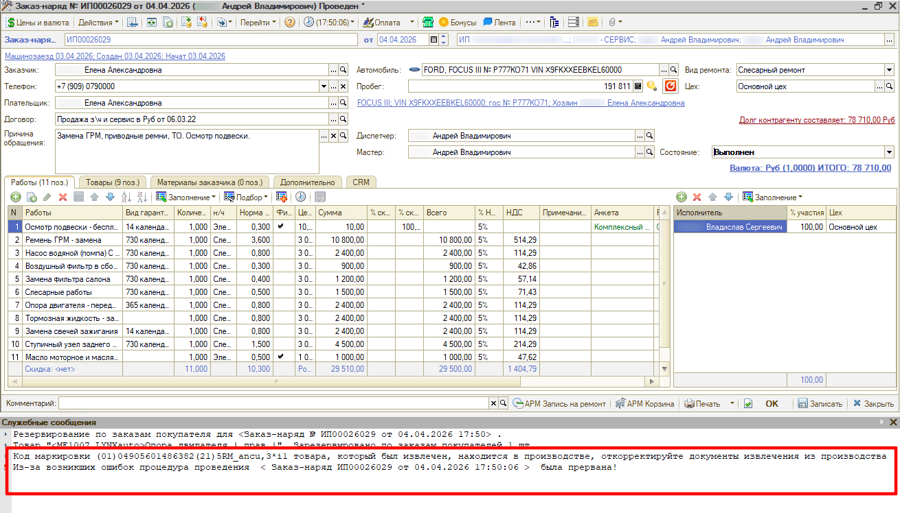
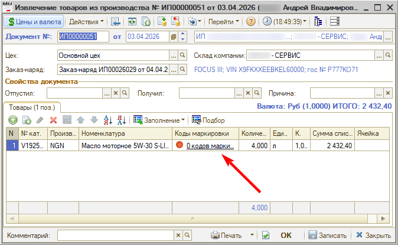

# Заказ-наряд с маркированным товаром не переводится в статус «Выполнен»

<table><tr><td><b>Обновлено:</b> 24.08.2026</td></tr></table>

## Проблема

При переводе заказ-наряда в состояние «Выполнен» проведение прерывается, а в служебных сообщениях выходит ошибка:

> Код маркировки (01)…(21)… товара, который был извлечен, находится в производстве, откорректируйте документы извлечения из производства  
> Из-за возникших ошибок процедура проведения < Заказ-наряд … от … > была прервана!

## Причина

Товар с маркировкой был перемещен в заказ-наряд, то есть передан в производство. Затем по нему создан документ **«Извлечение товаров из производства»**, но коды маркировки в нем не извлечены — в колонке «Коды маркировки» стоит «0 кодов маркировки».

## Решение

Откройте документ извлечения товаров из производства по этому заказ-наряду и отсканируйте коды маркировки в строке товара. После этого проведите документ и повторите перевод заказ-наряда в статус «Выполнен».

## См. также

- [Не проходит проверка кода маркировки в разрешительном режиме](../Не%20проходит%20проверка%20кода%20маркировки%20в%20разрешительном%20режиме/ne-prohodit-proverka-koda-markirovki-v-razreshitelnom-rezhime.md)
- [Маркировка не распознана при сканировании](../../../Оборудование/Сканеры%20штрихкодов/Маркировка%20не%20распознана%20при%20сканировании/markirovka-ne-raspoznana-pri-skanirovanii.md)
- [Не проводится документ с маркированным товаром](../Не%20проводится%20документ%20с%20маркированным%20товаром/ne-provoditsya-dokument-s-markirovannym-tovarom.md)

## Материалы для изучения

- [Маркировка товаров](../../../../articles/5S%20AUTO/Маркировка/Маркировка%20товаров/markirovka-tovarov.md)
- [Операции с кодами маркировки](../../../../articles/5S%20AUTO/Маркировка/Операции%20с%20кодами%20маркировки/operacii-s-kodami-markirovki.md)

## Похожие вопросы

- Заказ-наряд с маркированным товаром не переводится в статус «Выполнен»
- Проблема с закрытием заказ-наряда
- Ошибка при переводе заказ-наряда в статус «Выполнен»

## Теги

маркировка, коды маркировки, заказ-наряд, извлечение из производства, проведение документа, служебные сообщения
