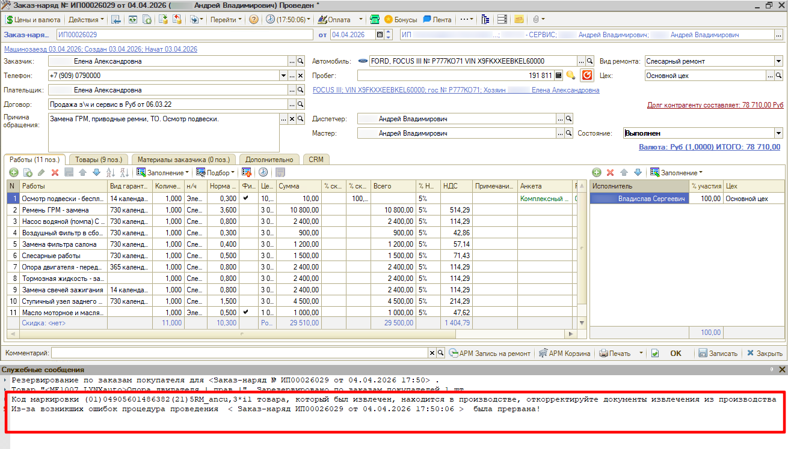
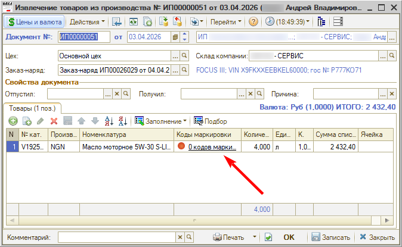

# Заказ-наряд с маркированным товаром не переводится в статус «Выполнен»

<table><tr><td><b>Обновлено:</b> 24.08.2026</td></tr></table>

Тикет: https://support.5systems.ru/ru/ticket/list/filter/id/96/ticket/20834 (PLL-49619)

###### *Опубликовано 13.08.2026: [https://kb.5systems.ru/tips/5s-auto/markirovka/zakaz-naryad-s-markirovkoy-ne-perevoditsya-v-vypolnen](https://kb.5systems.ru/tips/5s-auto/markirovka/zakaz-naryad-s-markirovkoy-ne-perevoditsya-v-vypolnen)*

## Проблема

При переводе заказ-наряда в состояние «Выполнен» проведение прерывается, а в служебных сообщениях выходит ошибка:

> Код маркировки (01)…(21)… товара, который был извлечен, находится в производстве, откорректируйте документы извлечения из производства  
> Из-за возникших ошибок процедура проведения < Заказ-наряд … от … > была прервана!

## Причина

Товар с маркировкой был перемещен в заказ-наряд, то есть передан в производство. Затем по нему создан документ **«Извлечение товаров из производства»**, но коды маркировки в нем не извлечены — в колонке «Коды маркировки» стоит «0 кодов маркировки».

## Решение

Откройте документ извлечения товаров из производства по этому заказ-наряду и отсканируйте коды маркировки в строке товара. После этого проведите документ и повторите перевод заказ-наряда в статус «Выполнен».

## Похожие вопросы

- Заказ-наряд с маркированным товаром не переводится в статус «Выполнен»
- Проблема с закрытием заказ-наряда
- Ошибка при переводе заказ-наряда в статус «Выполнен»

## Теги

маркировка, коды маркировки, заказ-наряд, извлечение из производства, проведение документа, служебные сообщения
