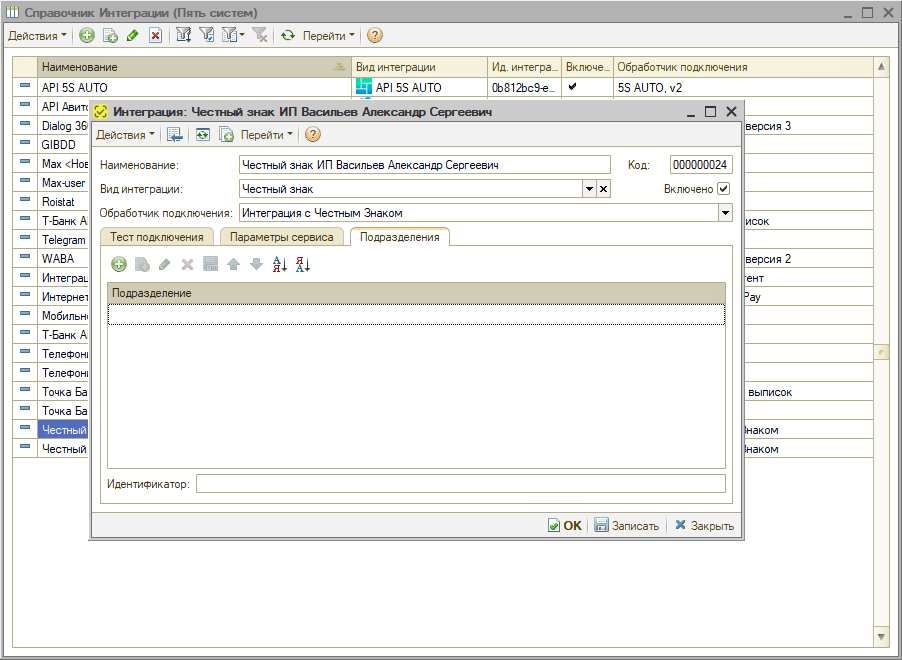
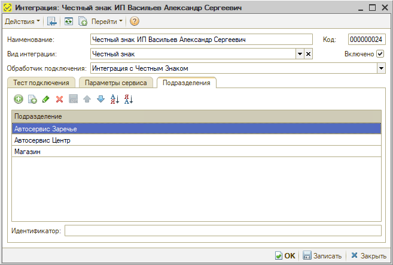

# Не обнаружено доступных интеграций для работы с Честным знаком

<table><tr><td><b>Обновлено:</b> 05.11.2026</td></tr></table>

## Проблема

При работе с кодами маркировки в документе – например, при проверке статуса кодов кнопкой **«Обновить информацию»** в окне **«Коды маркировки»** документа **«Вывод из оборота»** – появляется сообщение программы:

> Не обнаружено доступных интеграций для работы с Честным знаком.

Интеграция с «Честным знаком» при этом настроена, а токен доступа действует.

## Причина

Подразделение, указанное в документе, не добавлено на вкладку **«Подразделения»** в настройках интеграции с «Честным знаком» (или вкладка не заполнена). Программа работает с «Честным знаком» только по тем подразделениям, которые перечислены в интеграции.

## Решение

1. Откройте справочник **«Интеграции»** (*Администрирование → Компания → CRM → Интеграции*) и откройте интеграцию с «Честным знаком».
2. Перейдите на вкладку **«Подразделения»** и добавьте подразделение, указанное в документе.

   

3. Нажмите **«Записать»** и повторите действие в документе.

> [!IMPORTANT]
> Все подразделения в одной интеграции должны принадлежать одной организации. Если подразделение относится к другой организации, для нее нужна отдельная интеграция с «Честным знаком» – см. «[Настройка интеграции с Честным знаком → Создание интеграции с Честным знаком](https://kb.5systems.ru/articles/5s-auto/markirovka/nastroyka-integracii-s-chestnym-znakom#2-создание-интеграции-с-честным-знаком)».

## См. также

- [Не проходит проверка кода маркировки](https://kb.5systems.ru/tips/5s-auto/markirovka/ne-prohodit-proverka-koda-markirovki)
- [Не подписывается токен Честного знака (сертификат не найден в личном хранилище)](https://kb.5systems.ru/tips/5s-auto/markirovka/ne-podpisyvaetsya-token-chestnogo-znaka)

## Материалы для изучения

- «[Настройка интеграции с Честным знаком](https://kb.5systems.ru/articles/5s-auto/markirovka/nastroyka-integracii-s-chestnym-znakom#podr)» – вкладка «Подразделения» в настройках интеграции.
- «[Вывод кодов маркировки из оборота](https://kb.5systems.ru/articles/5s-auto/markirovka/vyvod-kodov-markirovki-iz-oborota)» – документ «Вывод из оборота».

## Похожие вопросы

- Не обнаружено доступных интеграций для работы с Честным знаком
- ЧЗ
- При проверке статуса марки выдает ошибку, токен обновлен
- Не проверяется статус кодов маркировки в выводе из оборота
- Как добавить подразделение в интеграцию с Честным знаком

## Теги

маркировка, Честный знак, интеграция, подразделения, вывод из оборота, коды маркировки, проверка статуса
