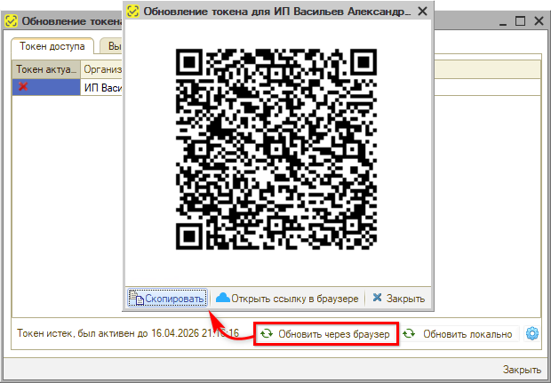
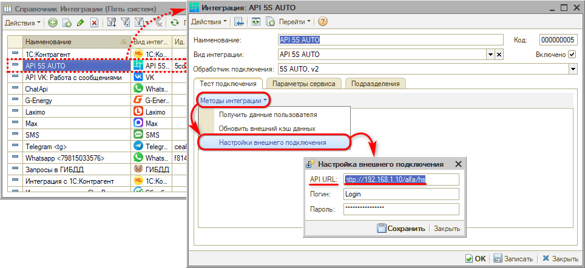

# Не обновляется токен Честного знака после переезда на другой сервер

<table><tr><td><b>Создано:</b> 19.11.2026</td></tr></table>

Тикет: https://support.5systems.ru/ru/ticket/list/filter/id/1/ticket/24510/

## Проблема

После подписания токена Честного знака через браузер статус токена в программе не обновляется. Проблема появилась после переезда на новый сервер.

В обработке **«Обновление токена API Честный знак»** (*Запчасти и склад → Продажи → Обработки → API Честный Знак*) по кнопке **«Обновить через браузер»** открывается ссылка для перехода к сервису 5S Sign – см. в статье «[Получение токена доступа к API Честного знака → Обновление токена API Честный знак](../../../../articles/5S%20AUTO/Маркировка/Получение%20токена%20доступа%20к%20API%20Честного%20знака/poluchenie-tokena-dostupa-k-api-chestnogo-znaka.md#обновление-токена-api-честный-знак)».

После подписания сертификатом статус подписи на странице 5S Sign в браузере успешно изменяется на **«Создана»**, однако в программе ничего не меняется: на нижней панели остаётся прежняя дата окончания действия и статус «Токен истек».

## Причина

При обновлении через браузер сервис 5S Sign отправляет полученный токен обратно в базу 1С по адресу, указанному в настройках интеграции **«API 5S AUTO»** (параметр **API URL**).

После переноса базы на новый сервер в поле **«API URL»** остаётся старый или недоступный извне адрес (например, локальный `http://192.168.1.10/alfa/hs`), поэтому программа не может получить токен от сервиса. Подробнее см. в статье «[API 5S AUTO → 2. Настройка внешнего подключения](../../../../articles/5S%20AUTO/Администрирование%20и%20настройка%20системы/API%205S%20AUTO/api-5s-auto.md#2-настройка-внешнего-подключения)».

## Решение

Необходимо обновить адрес публикации базы (API URL) в настройках интеграции **«API 5S AUTO»**:

1. Откройте карточку интеграции с API 5S AUTO (*Администрирование → Компания → CRM → Интеграции → API 5S AUTO*).
2. На вкладке **«Тест подключения»** нажмите **«Методы интеграции → Настройки внешнего подключения»** и в поле **«API URL»** укажите актуальный адрес веб-сервера, на котором опубликованы HTTP-сервисы базы 1С на новом сервере:
   - для облачной базы 5S AUTO адрес подключения уточните у специалистов [технической поддержки 5SYSTEMS](../../../Техподдержка/Как%20обратиться%20в%20техническую%20поддержку/kak-obratitsya-v-tekhnicheskuyu-podderzhku.md);
   - для локальной (коробочной) версии — у системного администратора компании (веб-сервер должен быть опубликован и доступен для входящих подключений с IP-адресов компании 5SYSTEMS: `178.69.191.141` и `77.93.122.98`).
3. Убедитесь, что в полях **«Логин»** и **«Пароль»** указаны действующие логин и пароль пользователя базы 1С, под которым выполняется внешнее подключение. Нажмите **«Сохранить»** в окне настройки внешнего подключения, затем нажмите **«OK»** или **«Записать»** в карточке интеграции.

   

4. На вкладке **«Тест подключения»** нажмите **«Методы интеграции → Получить данные пользователя»** и проверьте, что связь с базой устанавливается без ошибок.
5. Вернитесь в обработку **«Обновление токена API Честный знак»** (*Запчасти и склад → Продажи → Обработки → API Честный Знак*) и повторите обновление по кнопке **«Обновить через браузер»** — после создания подписи токен поступит в программу и обновится срок его действия (также токен можно [обновить локально](../../../../articles/5S%20AUTO/Маркировка/Получение%20токена%20доступа%20к%20API%20Честного%20знака/poluchenie-tokena-dostupa-k-api-chestnogo-znaka.md#обновление-токена-api-честный-знак)).

> [!TIP]
> Для проверки корректности адреса API URL скопируйте его и откройте в адресной строке браузера — браузер должен запросить логин и пароль пользователя базы 1С.

## См. также

- [Не подписывается токен Честного знака (сертификат не найден в личном хранилище)](../Не%20подписывается%20токен%20Честного%20знака%20%28сертификат%20не%20найден%20в%20личном%20хранилище%29/ne-podpisyvaetsya-token-chestnogo-znaka.md)
- [Не обнаружено доступных интеграций для работы с Честным знаком](../Не%20обнаружено%20доступных%20интеграций%20для%20работы%20с%20Честным%20знаком/ne-obnaruzheno-dostupnyh-integraciy-chestnyy-znak.md)
- [Что требуется для переноса базы 5S AUTO на новый сервер](../../Администрирование/Что%20требуется%20для%20переноса%20базы%205S%20AUTO%20на%20новый%20сервер/chto-trebuetsya-dlya-perenosa-bazy-5s-auto-na-novyy-server.md)

## Материалы для изучения

- «[Получение токена доступа к API Честного знака → Обновление токена API Честный знак](../../../../articles/5S%20AUTO/Маркировка/Получение%20токена%20доступа%20к%20API%20Честного%20знака/poluchenie-tokena-dostupa-k-api-chestnogo-znaka.md#обновление-токена-api-честный-знак)» – обновление токена через браузер и локально, установка отпечатка сертификата.
- «[API 5S AUTO → 2. Настройка внешнего подключения](../../../../articles/5S%20AUTO/Администрирование%20и%20настройка%20системы/API%205S%20AUTO/api-5s-auto.md#2-настройка-внешнего-подключения)» – параметры API URL, авторизация внешнего подключения, IP-адреса серверов 5SYSTEMS.
- «[Настройка интеграции с Честным знаком](../../../../articles/5S%20AUTO/Маркировка/Настройка%20интеграции%20с%20Честным%20знаком/nastroyka-integracii-s-chestnym-znakom.md)» – первоначальная настройка интеграции с «Честным знаком».

## Похожие вопросы

- Не обновляется токен Честного знака после переезда на другой сервер
- Не меняется подпись ЧЗ после переезда на другой сервер
- При обновлении токена через браузер статус подписи «Создана», но в программе ничего не меняется
- После создания подписи в браузере токен в программе не обновился
- Не приходит токен Честного знака в программу после подписания в 5S Sign
- Токен истек, не получается обновить через браузер
- Настройка внешнего подключения API URL при смене сервера

## Теги

маркировка, Честный знак, API токен, обновление токена, 5S Sign, API 5S AUTO, внешний URL, перенос базы, новый сервер, настройка внешнего подключения
