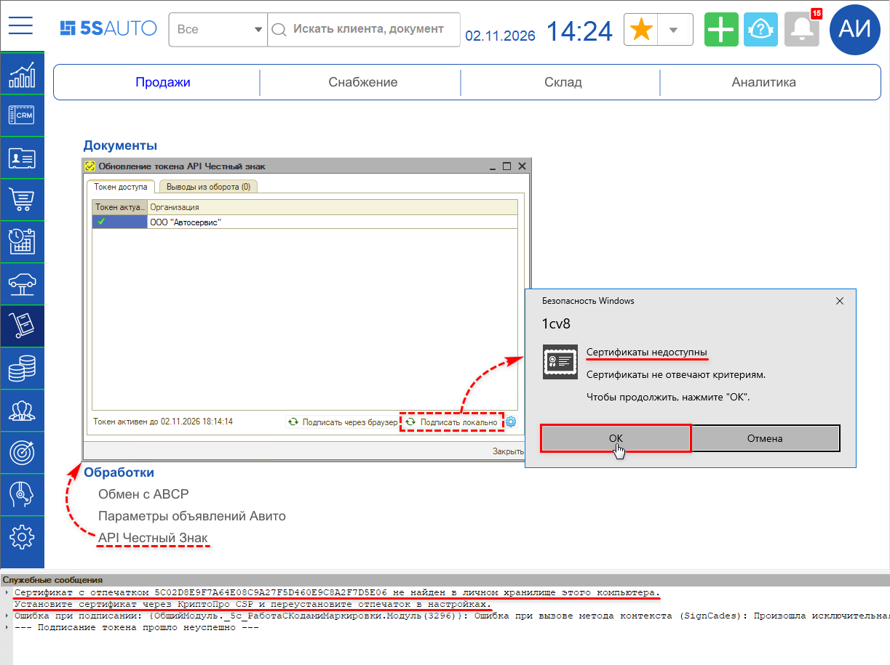
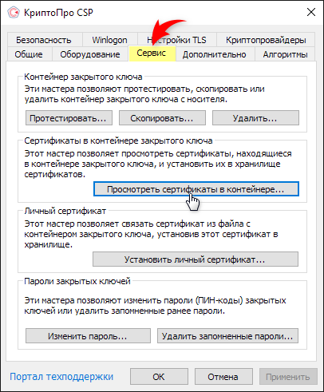
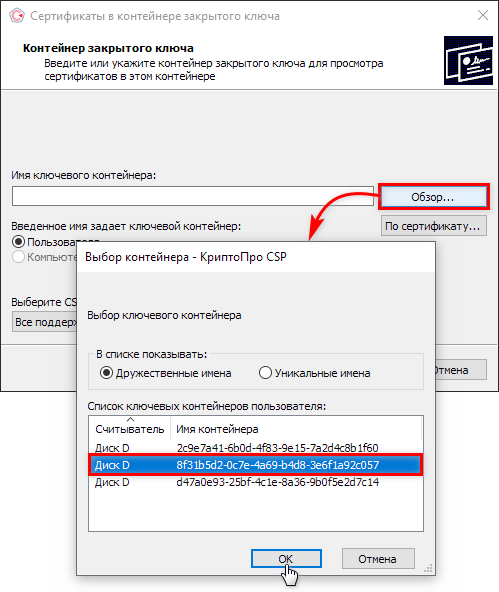
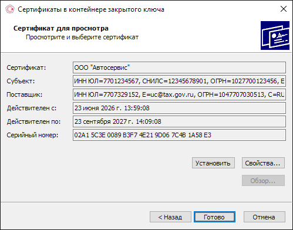
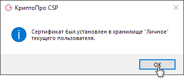
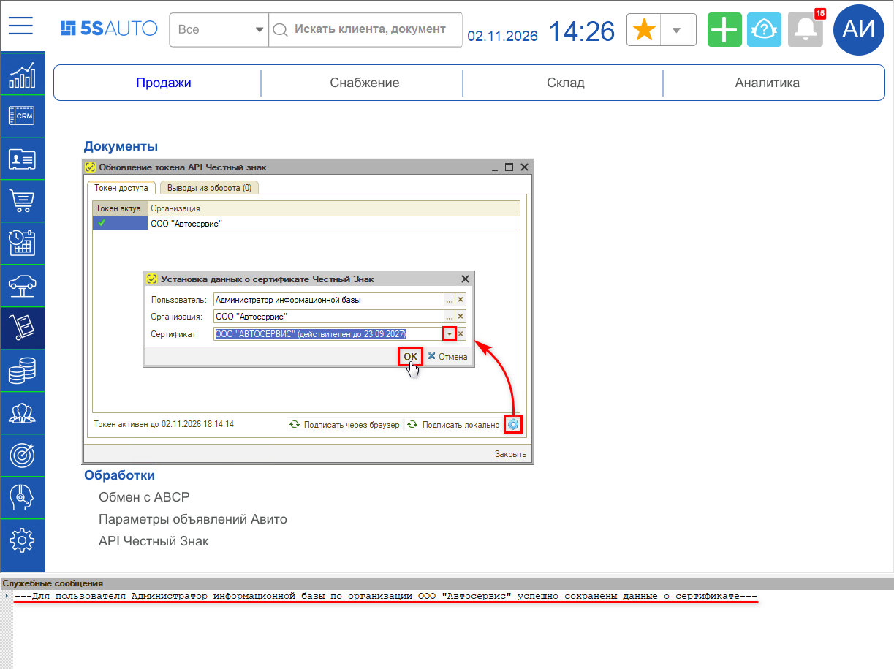
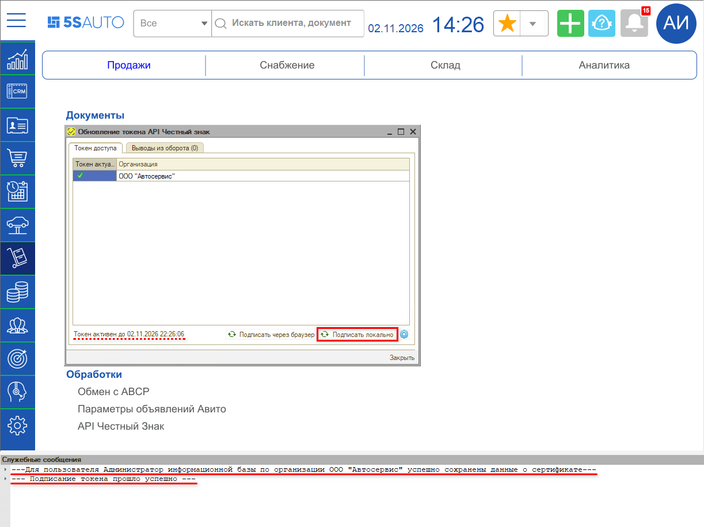

# Не подписывается токен Честного знака (сертификат не найден в личном хранилище)

<table><tr><td><b>Обновлено:</b> 03.11.2026</td></tr></table>

###### *Опубликовано 03.11.2026: [https://kb.5systems.ru/tips/5s-auto/markirovka/ne-podpisyvaetsya-token-chestnogo-znaka](https://kb.5systems.ru/tips/5s-auto/markirovka/ne-podpisyvaetsya-token-chestnogo-znaka)*

## Проблема

В форме **«Обновление токена API Честный знак»** (*Запчасти и склад → Продажи → Обработки → API Честный Знак*) при нажатии кнопки **«Подписать локально»** токен не подписывается. Windows выводит окно **«Сертификаты недоступны. Сертификаты не отвечают критериям»**, а в служебных сообщениях программы появляется ошибка:

> Сертификат с отпечатком … не найден в личном хранилище этого компьютера.
> Установите сертификат через КриптоПро CSP и переустановите отпечаток в настройках.
> Ошибка при подписании: … Достигнут физический конец ленты.
> --- Подписание токена прошло неуспешно ---

> [!NOTE]
> «Достигнут физический конец ленты» – стандартный текст Windows для кода ошибки подписи, к ленте он отношения не имеет. Сообщение появляется, если в окне «Сертификаты недоступны» нажать «ОК». Если нажать «Отмена», в служебных сообщениях будет «Операция была отменена пользователем».

## Причина

Сертификат, которым подписывается токен, не установлен в хранилище **«Личное»** текущего пользователя Windows на этом компьютере. Контейнер закрытого ключа на компьютере или носителе есть, но без установленного сертификата программа его не находит.

## Решение

1. Если сертификат хранится на носителе (флешке, токене), подключите его к компьютеру.
2. Откройте программу **«КриптоПро CSP»** – например, найдите ее через поиск Windows.
3. Перейдите на вкладку **«Сервис»** и нажмите **«Просмотреть сертификаты в контейнере…»**.

   

4. Нажмите **«Обзор…»**, выберите в списке контейнер с нужным сертификатом и нажмите **«ОК»** – имя выбранного контейнера подставится в поле **«Имя ключевого контейнера»**. Затем нажмите **«Далее»**.

   

5. В окне **«Сертификат для просмотра»** проверьте организацию и срок действия сертификата. Если сертификат не тот, нажмите **«Назад»** и выберите другой контейнер.

   

6. Нажмите **«Установить»**. Появится сообщение **«Сертификат был установлен в хранилище "Личное" текущего пользователя»** – нажмите **«ОК»**, затем **«Готово»**.

   

7. В программе в форме **«Обновление токена API Честный знак»** нажмите кнопку с шестеренкой на нижней панели. Откроется окно **«Установка данных о сертификате Честный Знак»**: поля **«Пользователь»** и **«Организация»** заполнены автоматически. В поле **«Сертификат»** выберите установленный сертификат – в списке он показан с названием организации и сроком действия – и нажмите **«ОК»**. В служебных сообщениях появится сообщение об успешном сохранении данных о сертификате. Подробнее см. «[Получение токена доступа к API Честного знака → Обновление токена API Честный знак](../../../../articles/5S%20AUTO/Маркировка/Получение%20токена%20доступа%20к%20API%20Честного%20знака/poluchenie-tokena-dostupa-k-api-chestnogo-znaka.md#обновление-токена-api-честный-знак)».

   

8. Нажмите **«Подписать локально»**. В служебных сообщениях появится сообщение **«Подписание токена прошло успешно»**, а на нижней панели формы – новая дата и время окончания действия токена (токен действует 8 часов).

   

> [!NOTE]
> Сертификат устанавливается для конкретного пользователя Windows на конкретном компьютере. Если токен подписывают на нескольких рабочих местах, установите сертификат на каждом из них.

## Материалы для изучения

- «[Получение токена доступа к API Честного знака → Обновление токена API Честный знак](../../../../articles/5S%20AUTO/Маркировка/Получение%20токена%20доступа%20к%20API%20Честного%20знака/poluchenie-tokena-dostupa-k-api-chestnogo-znaka.md#обновление-токена-api-честный-знак)» – обновление токена через браузер и локально, установка отпечатка сертификата.
- «[Регистрация в системе Честный знак → Установка криптопровайдера КриптоПро](../../../../articles/5S%20AUTO/Маркировка/Регистрация%20в%20системе%20Честный%20знак/registraciya-v-sisteme-chestnyy-znak.md#3-установка-криптопровайдера-криптопро)» – установка КриптоПро CSP.

## Похожие вопросы

- Не подписывается токен Честного знака
- Обновление токена
- Пропала кнопка «Обновить» токена
- Сертификат не найден в личном хранилище этого компьютера
- Сертификаты недоступны. Сертификаты не отвечают критериям
- Ошибка при подписании токена: достигнут физический конец ленты
- Подписание токена прошло неуспешно
- Ошибка при подписании: Операция была отменена пользователем

## Теги

маркировка, Честный знак, API токен, обновление токена, подписать локально, сертификат, КриптоПро CSP, личное хранилище, отпечаток сертификата
