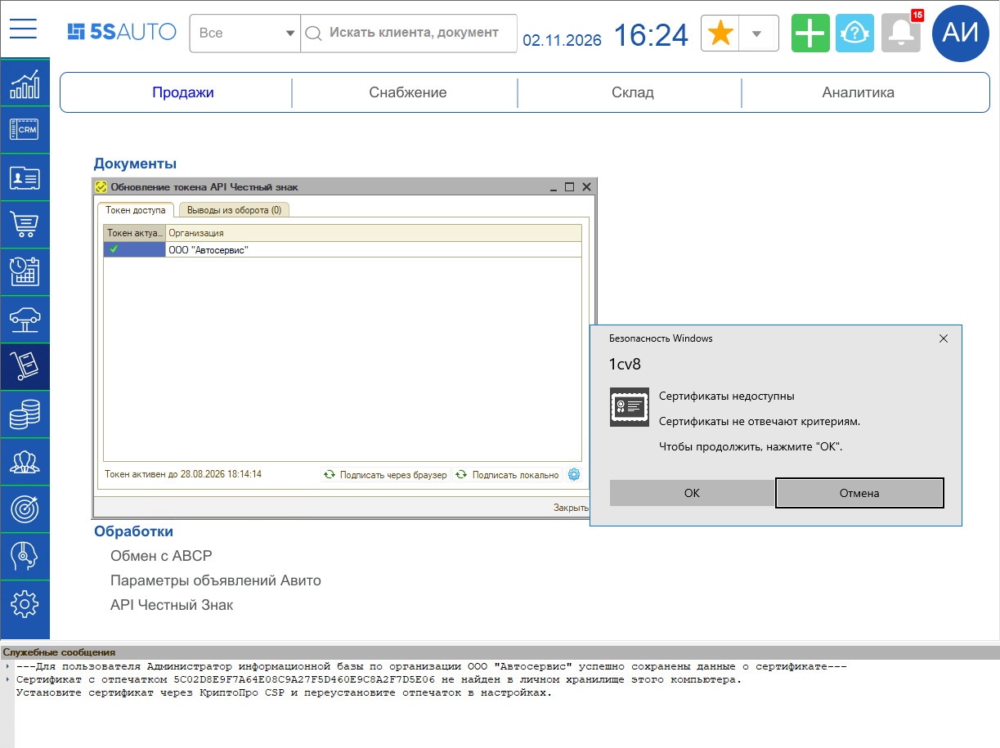
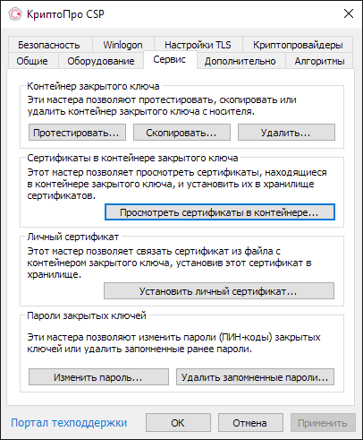
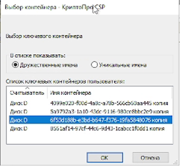

# Не подписывается токен Честного знака (сертификат не найден в личном хранилище)

<table><tr><td><b>Обновлено:</b> 02.11.2026</td></tr></table>

## Проблема

При обновлении токена в форме **«Обновление токена API Честный знак»** (кнопка **«Подписать локально»**) токен не подписывается. Windows выводит окно **«Сертификаты недоступны. Сертификаты не отвечают критериям»**, а в служебных сообщениях программы появляется ошибка:

> Сертификат с отпечатком … не найден в личном хранилище этого компьютера.
> Установите сертификат через КриптоПро CSP и переустановите отпечаток в настройках.
> Ошибка при подписании: … Достигнут физический конец ленты.
> --- Подписание токена прошло неуспешно ---

> 🛠 Комментарий для черновика: *На скрине 01 обвести окно «Сертификаты недоступны» и строки служебного сообщения «Сертификат с отпечатком … не найден в личном хранилище этого компьютера. Установите сертификат через КриптоПро CSP…».*

## Причина

Сертификат, которым подписывается токен, не установлен в хранилище **«Личное»** текущего пользователя Windows на этом компьютере. Контейнер закрытого ключа на компьютере или носителе есть, но без установленного сертификата программа его не находит.

## Решение

1. Если сертификат хранится на носителе (флешке, токене), подключите его к компьютеру.
2. Откройте программу **«КриптоПро CSP»** – например, найдите ее через поиск Windows.
3. Перейдите на вкладку **«Сервис»** и нажмите **«Просмотреть сертификаты в контейнере…»**.

   

4. Нажмите **«Обзор…»**, выберите в списке контейнер с нужным сертификатом и нажмите **«ОК»**, затем **«Далее»**.

   

5. В окне **«Сертификат для просмотра»** проверьте организацию и срок действия сертификата. Если сертификат не тот, нажмите **«Назад»** и выберите другой контейнер.

   

6. Нажмите **«Установить»**. Появится сообщение **«Сертификат был установлен в хранилище "Личное" текущего пользователя»** – нажмите **«ОК»**, затем **«Готово»**.

   

7. В программе в форме **«Обновление токена API Честный знак»** нажмите кнопку с шестеренкой, выберите сертификат и сохраните. В служебных сообщениях появится сообщение об успешном сохранении данных о сертификате.
8. Нажмите **«Подписать локально»**. После сообщения **«Подписание токена прошло успешно»** на нижней панели формы обновится дата окончания действия токена.

> 🛠 Комментарий для черновика: *Что обвести на скринах шагов:*
> - *02 – вкладку «Сервис» и кнопку «Просмотреть сертификаты в контейнере…»;*
> - *03 – выделенную строку контейнера и кнопку «OK»;*
> - *04 – поля «Сертификат» и «Действителен по» (организация и срок действия) и кнопку «Установить»;*
> - *05 – кнопку «ОК».*

> [!NOTE]
> Сертификат устанавливается для конкретного пользователя Windows на конкретном компьютере. Если токен подписывают на нескольких рабочих местах, установите сертификат на каждом из них.

## Материалы для изучения

- «[Получение токена доступа к API Честного знака → Обновление токена API Честный знак](https://kb.5systems.ru/articles/5s-auto/markirovka/poluchenie-tokena-dostupa-k-api-chestnogo-znaka#обновление-токена-api-честный-знак)» – обновление токена через браузер и локально, установка отпечатка сертификата.
- «[Регистрация в системе Честный знак → Установка криптопровайдера КриптоПро](https://kb.5systems.ru/articles/5s-auto/markirovka/registraciya-v-sisteme-chestnyy-znak#3-установка-криптопровайдера-криптопро)» – установка КриптоПро CSP.

## Похожие вопросы

- Не подписывается токен Честного знака
- Обновление токена
- Пропала кнопка «Обновить» токена
- Сертификат не найден в личном хранилище этого компьютера
- Сертификаты недоступны. Сертификаты не отвечают критериям
- Ошибка при подписании токена: достигнут физический конец ленты
- Подписание токена прошло неуспешно

## Теги

маркировка, Честный знак, API токен, обновление токена, подписать локально, сертификат, КриптоПро CSP, личное хранилище, отпечаток сертификата
