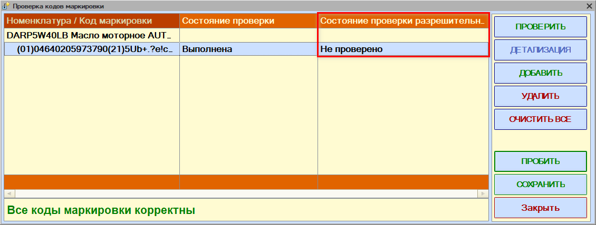
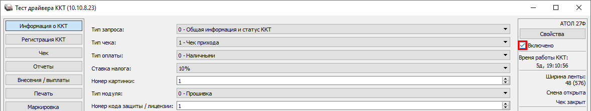
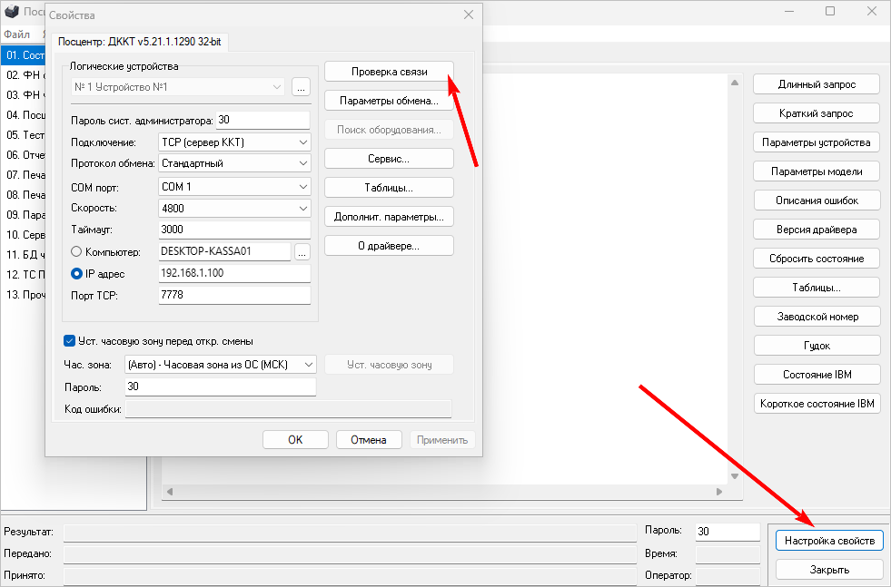
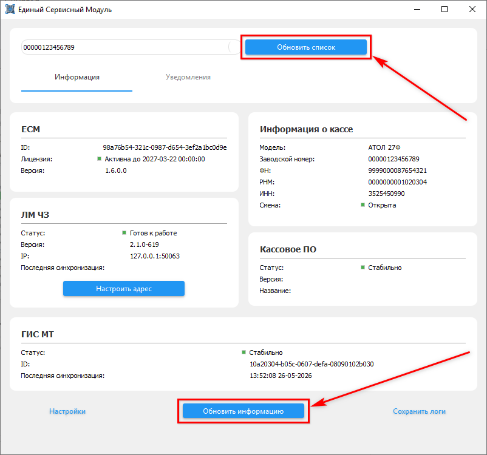

# Не проходит проверка кода маркировки в разрешительном режиме

<table><tr><td><b>Создано:</b> 21.10.2026</td></tr></table>

## Проблема

При пробитии чека с маркированным товаром код маркировки не проходит проверку в разрешительном режиме. В форме «Проверка кодов маркировки» в колонке «Состояние проверки» (проверка на ККТ) стоит «Выполнена», а в колонке «Состояние проверки разрешительного режима» – «Не проверено»:

О форме проверки и ее колонках – в статье «[Операции с кодами маркировки → Пробитие чека с маркированными товарами](../../../../articles/5S%20AUTO/Маркировка/Операции%20с%20кодами%20маркировки/operacii-s-kodami-markirovki.md#forma_proverki)».

## Причина

Единый сервисный модуль (ЕСМ) не запущен или не видит кассу: без связи ЕСМ с ККТ коды маркировки не проверяются в разрешительном режиме.

## Решение

1. Проверьте, что модуль ЕСМ запущен и видит кассу: откройте приложение «Настройка и управление» Единой сервисной платформы (окно «Единый сервисный модуль») и посмотрите блок «Информация о кассе» – в нем должны отображаться модель кассы, заводской номер, номер ФН и другие данные, а смена должна быть открыта (о статусах в окне ЕСМ – см. «[Настройка интеграции с ТС ПИоТ → Настройка взаимодействия драйвера ККТ с ЕСМ](../../../../articles/5S%20AUTO/Маркировка/Интеграция%20с%20ТС%20ПИоТ/Настройка%20интеграции%20с%20ТС%20ПИоТ/nastroyka-integracii-s-ts-piot.md#statusy_podkl)»). Если ЕСМ не запущен – запустите его. Если данных кассы нет, выполните шаги 2–5.
2. Запустите тест драйвера ККТ и включите кассу:

   - для касс АТОЛ – установите флажок «Включено» в правом верхнем углу:

     

   - для касс «Штрих» – нажмите «Настройка свойств» и в окне «Свойства» нажмите «Проверка связи»:

     

3. В окне «Единый сервисный модуль» нажмите «Обновить список», затем «Обновить информацию» – в блоке «Информация о кассе» должны появиться данные кассы:

   

   *Примечание:* Статус в блоке «ЛМ ЧЗ» может отличаться от «Готов к работе» – для этого шага важно, чтобы появились данные кассы.

4. Закройте тест драйвера ККТ.
5. Пробейте чек снова.

## См. также

- «[Не проходит проверка кода маркировки](../Не%20проходит%20проверка%20кода%20маркировки/ne-prohodit-proverka-koda-markirovki.md)»

## Материалы для изучения

- «[Настройка интеграции с ТС ПИоТ](../../../../articles/5S%20AUTO/Маркировка/Интеграция%20с%20ТС%20ПИоТ/Настройка%20интеграции%20с%20ТС%20ПИоТ/nastroyka-integracii-s-ts-piot.md)» – разрешительный режим, настройка взаимодействия драйвера ККТ с ЕСМ, статусы в окне ЕСМ.
- «[Установка Единого Сервисного Модуля (ЕСМ)](../../../../articles/5S%20AUTO/Маркировка/Интеграция%20с%20ТС%20ПИоТ/Установка%20Единого%20Сервисного%20Модуля%20%28ЕСМ%29/ustanovka-edinogo-servisnogo-modulya-esm.md)» – установка и запуск ЕСМ.

## Похожие вопросы

- Не проходит проверка кода маркировки в разрешительном режиме
- Что делать, если не проходит проверка марки в разрешительном режиме
- Не пробивается чек с маркированным товаром, ошибка разрешительного режима
- Состояние проверки разрешительного режима «Не проверено»
- ЕСМ не видит кассу
- В Едином сервисном модуле не отображается информация о кассе
- Перестала работать проверка марок через ТС ПИоТ

## Теги

маркировка, код маркировки, разрешительный режим, ТС ПИоТ, ЕСМ, Единый сервисный модуль, Единая сервисная платформа, тест драйвера ККТ, АТОЛ, Штрих, касса, чек
