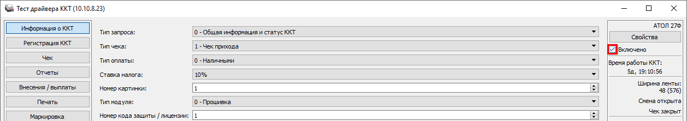
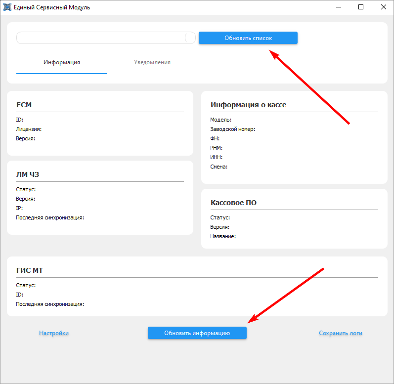

# Не проходит проверка кода маркировки в разрешительном режиме

<table><tr><td><b>Создано:</b> 21.10.2026</td></tr></table>

## Проблема

При пробитии чека с маркированным товаром не проходит проверка кода маркировки в разрешительном режиме, чек не пробивается.

## Причина

Единый сервисный модуль (ЕСМ) не запущен или не видит кассу: без связи ЕСМ с ККТ коды маркировки не проверяются в разрешительном режиме.

## Решение

1. Проверьте, что модуль ЕСМ запущен и видит кассу: откройте приложение «Настройка и управление» Единой сервисной платформы (окно «Единый сервисный модуль») и посмотрите блок «Информация о кассе» – в нем должны отображаться модель кассы, заводской номер, номер ФН и другие данные, а статусы в блоках – с зеленым индикатором (см. «[Настройка интеграции с ТС ПИоТ → Настройка взаимодействия драйвера ККТ с ЕСМ](https://kb.5systems.ru/articles/5s-auto/markirovka/nastroyka-integracii-s-ts-piot#statusy_podkl)»). Если ЕСМ не запущен – запустите его. Если блоки пустые, выполните шаги 2–5.
2. Запустите тест драйвера ККТ и включите кассу:

   - для касс АТОЛ – установите флажок «Включено» в правом верхнем углу:

     

   - для касс «Штрих» – нажмите «Настройка свойств» и в окне «Свойства» нажмите «Проверка связи»:

     

3. В окне «Единый сервисный модуль» нажмите «Обновить список», затем «Обновить информацию» – в блоках должны появиться данные кассы:

   

4. Закройте тест драйвера ККТ.
5. Пробейте чек снова.

## См. также

- «[Не проходит проверка кода маркировки](https://kb.5systems.ru/tips/5s-auto/markirovka/ne-prohodit-proverka-koda-markirovki)»

## Материалы для изучения

- «[Настройка интеграции с ТС ПИоТ](https://kb.5systems.ru/articles/5s-auto/markirovka/nastroyka-integracii-s-ts-piot)» – разрешительный режим, настройка взаимодействия драйвера ККТ с ЕСМ, статусы в окне ЕСМ.
- «[Установка Единого Сервисного Модуля (ЕСМ)](https://kb.5systems.ru/articles/5s-auto/markirovka/ustanovka-edinogo-servisnogo-modulya-esm)» – установка и запуск ЕСМ.

## Похожие вопросы

- Не проходит проверка кода маркировки в разрешительном режиме
- Что делать, если не проходит проверка марки в разрешительном режиме
- Не пробивается чек с маркированным товаром, ошибка разрешительного режима
- ЕСМ не видит кассу
- В Едином сервисном модуле не отображается информация о кассе
- Перестала работать проверка марок через ТС ПИоТ

## Теги

маркировка, код маркировки, разрешительный режим, ТС ПИоТ, ЕСМ, Единый сервисный модуль, Единая сервисная платформа, тест драйвера ККТ, АТОЛ, Штрих, касса, чек
