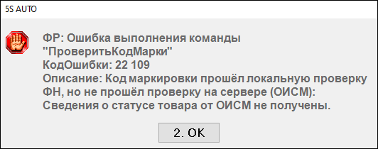
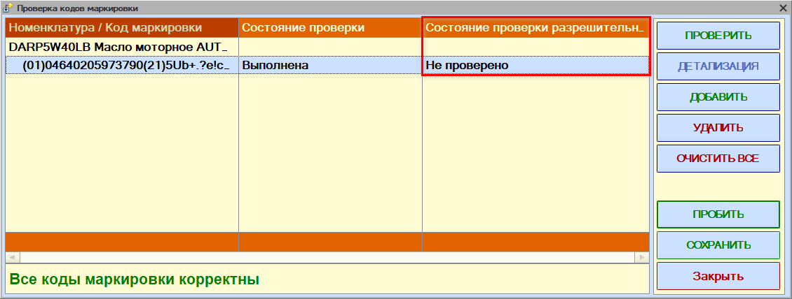
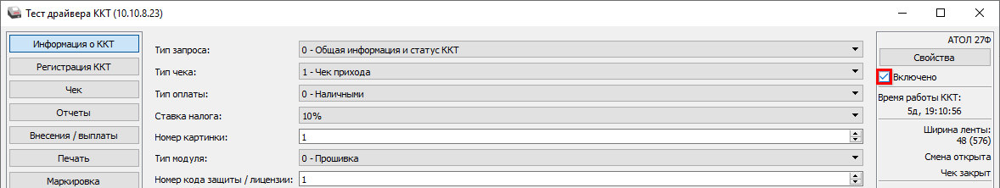
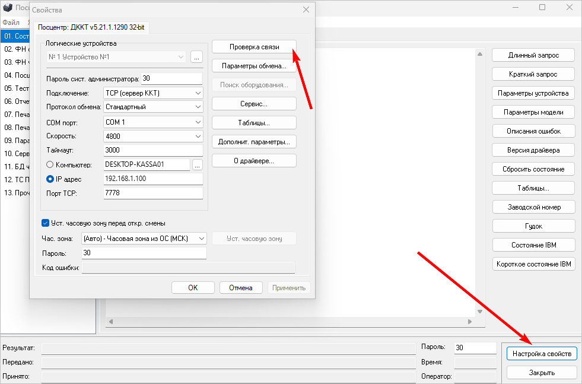
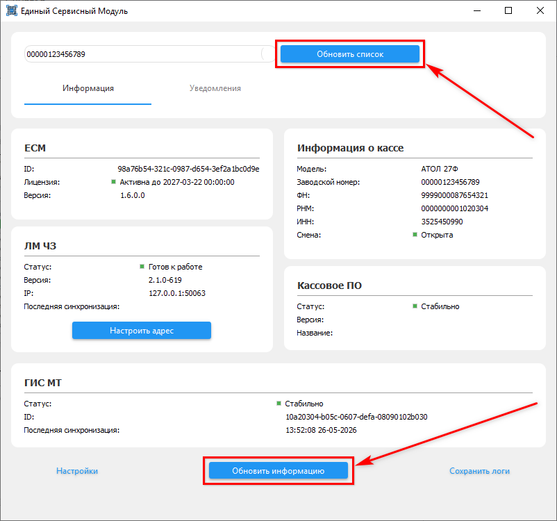

# Не проходит проверка кода маркировки в разрешительном режиме

<table><tr><td><b>Обновлено:</b> 16.11.2026</td></tr></table>

## Проблема

При пробитии чека (продажи или возврата) с маркированным товаром код маркировки не проходит проверку в разрешительном режиме. Чек не пробивается, программа может выводить ошибку 22109:

В форме «Проверка кодов маркировки» может стоять «Все коды маркировки корректны», но в колонке «Состояние проверки» (проверка на ККТ) – «Выполнена», а в колонке «Состояние проверки разрешительного режима» – «Не проверено»:

О форме проверки и ее колонках – в статье «[Операции с кодами маркировки → Пробитие чека с маркированными товарами](https://kb.5systems.ru/articles/5s-auto/markirovka/operacii-s-kodami-markirovki#forma_proverki)».

## Причина

На рабочем месте с кассой не запущен Единый сервисный модуль (ЕСМ) или ЕСМ не видит кассу. Без связи ЕСМ с ККТ код маркировки проверяется только локально в фискальном накопителе, а запрос о статусе товара в «Честный знак» (ГИС МТ) не выполняется – сведения о статусе товара от сервера (ОИСМ) не приходят, и касса блокирует продажу.

## Решение

1. Запустите ЕСМ на **каждом** рабочем месте, с которого пробиваются чеки, и проверьте, что он видит кассу: откройте приложение «Настройка и управление» Единой сервисной платформы (окно «Единый сервисный модуль») и посмотрите блок «Информация о кассе» – в нем должны отображаться модель кассы, заводской номер, номер ФН и другие данные, а смена должна быть открыта (о статусах в окне ЕСМ – см. «[Настройка интеграции с ТС ПИоТ → Настройка взаимодействия драйвера ККТ с ЕСМ](https://kb.5systems.ru/articles/5s-auto/markirovka/nastroyka-integracii-s-ts-piot#statusy_podkl)»). Если ЕСМ не запущен – запустите его. Если вышла новая версия ЕСМ или Локального модуля «Честного знака» (ЛМ ЧЗ), обновите их. Если данных кассы нет, выполните шаги 2–5.
2. Запустите тест драйвера ККТ и включите кассу:

   - для касс АТОЛ – установите флажок «Включено» в правом верхнем углу:

     

   - для касс «Штрих» – нажмите «Настройка свойств» и в окне «Свойства» нажмите «Проверка связи»:

     

3. В окне «Единый сервисный модуль» нажмите «Обновить список», затем «Обновить информацию» – в блоке «Информация о кассе» должны появиться данные кассы:

   

   *Примечание:* Статус в блоке «ЛМ ЧЗ» может отличаться от «Готов к работе» – для этого шага важно, чтобы появились данные кассы.

4. Закройте тест драйвера ККТ.
5. Пробейте чек снова.

### Если ЛМ ЧЗ не синхронизируется в начале рабочего дня

Если после включения рабочих мест в окне ЕСМ (или в личном кабинете Единой сервисной платформы) в блоке «ЛМ ЧЗ» отображается «Ошибка связи», соблюдайте порядок запуска:

1. Первый пользователь, который подключается к программе в начале дня, обновляет токен «Честного знака» (токен действует 8 часов): *Запчасти и склад → Продажи → Обработки → API токен Честный знак*, в форме **«Обновление токена API Честный знак»** нажмите **«Подписать локально»** или **«Подписать через браузер»**.
2. После этого включаются рабочие места с кассами и запускается ЕСМ.

О подписании токена – в совете «[Не подписывается токен Честного знака (сертификат не найден в личном хранилище)](https://kb.5systems.ru/tips/5s-auto/markirovka/ne-podpisyvaetsya-token-chestnogo-znaka)».

> *Примечание: данные на скриншотах вымышленные (тестовые).*

## См. также

- «[Не обновляется токен Честного знака после переезда на другой сервер](https://kb.5systems.ru/tips/5s-auto/markirovka/ne-obnovlyaetsya-token-chestnogo-znaka-posle-pereezda-na-drugoy-server)»
- «[Не проходит проверка кода маркировки](https://kb.5systems.ru/tips/5s-auto/markirovka/ne-prohodit-proverka-koda-markirovki)»
- «[Не подписывается токен Честного знака (сертификат не найден в личном хранилище)](https://kb.5systems.ru/tips/5s-auto/markirovka/ne-podpisyvaetsya-token-chestnogo-znaka)»

## Материалы для изучения

- «[Настройка интеграции с ТС ПИоТ](https://kb.5systems.ru/articles/5s-auto/markirovka/nastroyka-integracii-s-ts-piot)» – разрешительный режим, настройка взаимодействия драйвера ККТ с ЕСМ, статусы в окне ЕСМ.
- «[Установка Единого Сервисного Модуля (ЕСМ)](https://kb.5systems.ru/articles/5s-auto/markirovka/ustanovka-edinogo-servisnogo-modulya-esm)» – установка и запуск ЕСМ.
- «[Установка Локального модуля Честного знака](https://kb.5systems.ru/articles/5s-auto/markirovka/ustanovka-lokalnogo-modulya-chestnogo-znaka)» – офлайн-проверка кодов маркировки, когда нет связи с ГИС МТ.

## Похожие вопросы

- Не проходит проверка кода маркировки в разрешительном режиме
- Что делать, если не проходит проверка марки в разрешительном режиме
- Не пробивается чек с маркированным товаром, ошибка разрешительного режима
- Состояние проверки разрешительного режима «Не проверено»
- ЕСМ не видит кассу
- В Едином сервисном модуле не отображается информация о кассе
- Перестала работать проверка марок через ТС ПИоТ
- Ошибка 22109: код маркировки прошел локальную проверку ФН, но не прошел проверку на сервере (ОИСМ)
- Сведения о статусе товара от ОИСМ не получены
- Ошибка выполнения команды «ПроверитьКодМарки»
- Разрешительный режим, ошибки
- Не можем пробить чек по доплате с маркированным товаром
- В личном кабинете ЕСП ЛМ ЧЗ – «Ошибка связи»
- ЛМ ЧЗ не синхронизируется, пока не запустим токен

## Теги

ошибка 22109, ОИСМ, ПроверитьКодМарки, маркировка, код маркировки, разрешительный режим, ТС ПИоТ, ЕСМ, Единый сервисный модуль, Единая сервисная платформа, ЛМ ЧЗ, токен Честного знака, тест драйвера ККТ, АТОЛ, Штрих, касса, чек
