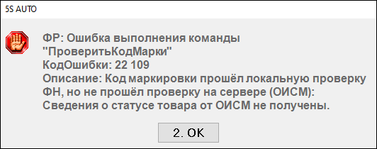
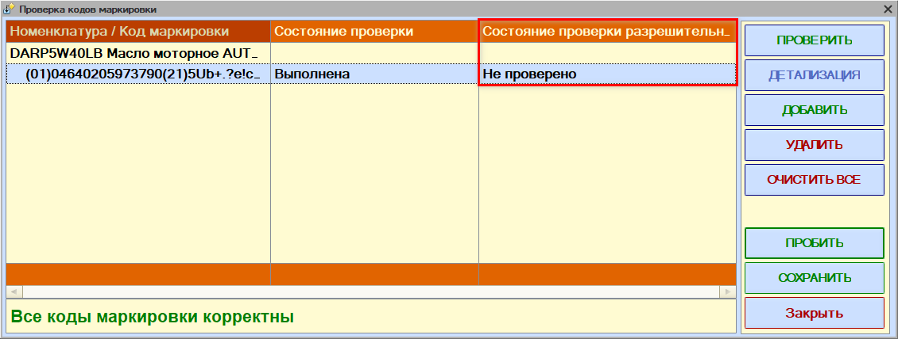

# Ошибка 22109: код маркировки не прошел проверку на сервере (ОИСМ)

<table><tr><td><b>Создано:</b> 13.11.2026</td></tr></table>

Тикет: https://support.5systems.ru/ru/ticket/list/filter/id/96/ticket/23790 (JJH-55676)

## Проблема

При пробитии чека (продажи или возврата) с маркированным товаром в разрешительном режиме программа выводит ошибку:

Чек не пробивается. При этом в форме «Проверка кодов маркировки» может стоять «Все коды маркировки корректны»: проверку на кассе код прошел («Выполнена»), а проверку в разрешительном режиме – нет («Не проверено»):

## Причина

На рабочем месте с кассой не запущен Единый сервисный модуль (ЕСМ) или ЕСМ не видит кассу. Код маркировки проверяется только локально в фискальном накопителе, а запрос о статусе товара в «Честный знак» (ГИС МТ) не выполняется – сведения о статусе товара от сервера не приходят, и касса блокирует продажу.

## Решение

1. Запустите ЕСМ на **каждом** рабочем месте, с которого пробиваются чеки, – откройте приложение «Настройка и управление» Единой сервисной платформы. Если вышла новая версия ЕСМ или Локального модуля «Честного знака» (ЛМ ЧЗ), обновите их.
2. Проверьте, что ЕСМ видит кассу: в окне «Единый сервисный модуль» в блоке «Информация о кассе» должны отображаться модель кассы, заводской номер, номер ФН и открытая смена. Если данных нет:
   1. Запустите тест драйвера ККТ и включите кассу.
   2. В окне ЕСМ нажмите «Обновить список», затем «Обновить информацию».
   3. Закройте тест драйвера ККТ.

   Подробно, со скриншотами, – в совете «[Не проходит проверка кода маркировки в разрешительном режиме](https://kb.5systems.ru/tips/5s-auto/markirovka/ne-prohodit-proverka-koda-markirovki-v-razreshitelnom-rezhime)».
3. Пробейте чек снова.

### Если ЛМ ЧЗ не синхронизируется в начале рабочего дня

Если после включения рабочих мест в окне ЕСМ (или в личном кабинете Единой сервисной платформы) в блоке «ЛМ ЧЗ» отображается «Ошибка связи», соблюдайте порядок запуска:

1. Первый пользователь, который подключается к программе в начале дня, обновляет токен «Честного знака» (токен действует 8 часов): *Запчасти и склад → Продажи → Обработки → API токен Честный знак*, в форме **«Обновление токена API Честный знак»** нажмите **«Подписать локально»** или **«Подписать через браузер»**.
2. После этого включаются рабочие места с кассами и запускается ЕСМ.

О подписании токена – в совете «[Не подписывается токен Честного знака (сертификат не найден в личном хранилище)](https://kb.5systems.ru/tips/5s-auto/markirovka/ne-podpisyvaetsya-token-chestnogo-znaka)».

## См. также

- «[Не проходит проверка кода маркировки в разрешительном режиме](https://kb.5systems.ru/tips/5s-auto/markirovka/ne-prohodit-proverka-koda-markirovki-v-razreshitelnom-rezhime)»
- «[Не проходит проверка кода маркировки](https://kb.5systems.ru/tips/5s-auto/markirovka/ne-prohodit-proverka-koda-markirovki)»
- «[Не подписывается токен Честного знака (сертификат не найден в личном хранилище)](https://kb.5systems.ru/tips/5s-auto/markirovka/ne-podpisyvaetsya-token-chestnogo-znaka)»

## Материалы для изучения

- «[Настройка интеграции с ТС ПИоТ](https://kb.5systems.ru/articles/5s-auto/markirovka/nastroyka-integracii-s-ts-piot)» – разрешительный режим, связь драйвера ККТ с ЕСМ, [статусы в окне ЕСМ](https://kb.5systems.ru/articles/5s-auto/markirovka/nastroyka-integracii-s-ts-piot#statusy_podkl).
- «[Установка Единого Сервисного Модуля (ЕСМ)](https://kb.5systems.ru/articles/5s-auto/markirovka/ustanovka-edinogo-servisnogo-modulya-esm)» – установка и запуск ЕСМ.
- «[Установка Локального модуля Честного знака](https://kb.5systems.ru/articles/5s-auto/markirovka/ustanovka-lokalnogo-modulya-chestnogo-znaka)» – офлайн-проверка кодов маркировки, когда нет связи с ГИС МТ.

## Похожие вопросы

- Ошибка 22109: код маркировки прошел локальную проверку ФН, но не прошел проверку на сервере (ОИСМ)
- Сведения о статусе товара от ОИСМ не получены
- Ошибка выполнения команды «ПроверитьКодМарки»
- Разрешительный режим, ошибки
- Не можем пробить чек по доплате с маркированным товаром
- В личном кабинете ЕСП ЛМ ЧЗ – «Ошибка связи»
- ЛМ ЧЗ не синхронизируется, пока не запустим токен

## Теги

ошибка 22109, ОИСМ, ПроверитьКодМарки, маркировка, код маркировки, разрешительный режим, ТС ПИоТ, ЕСМ, Единый сервисный модуль, ЛМ ЧЗ, токен Честного знака, касса, чек
