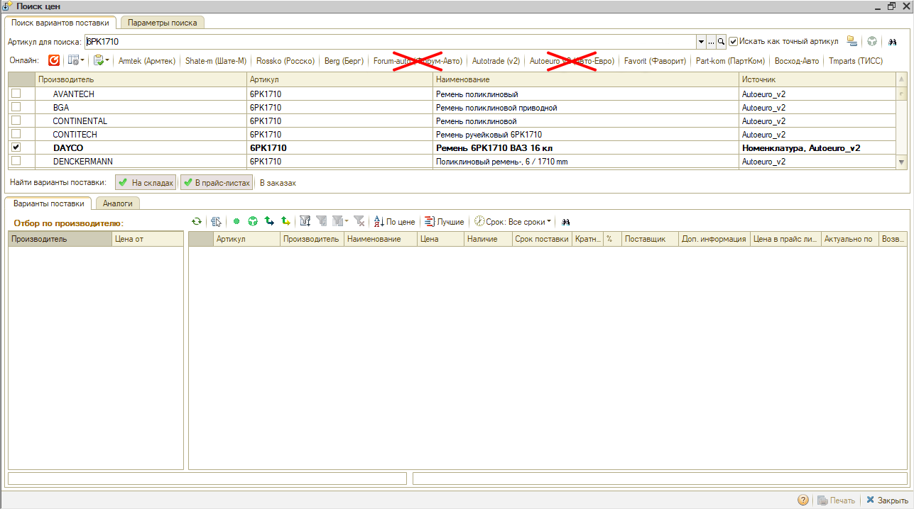
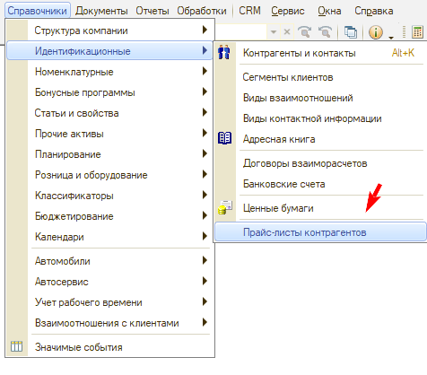
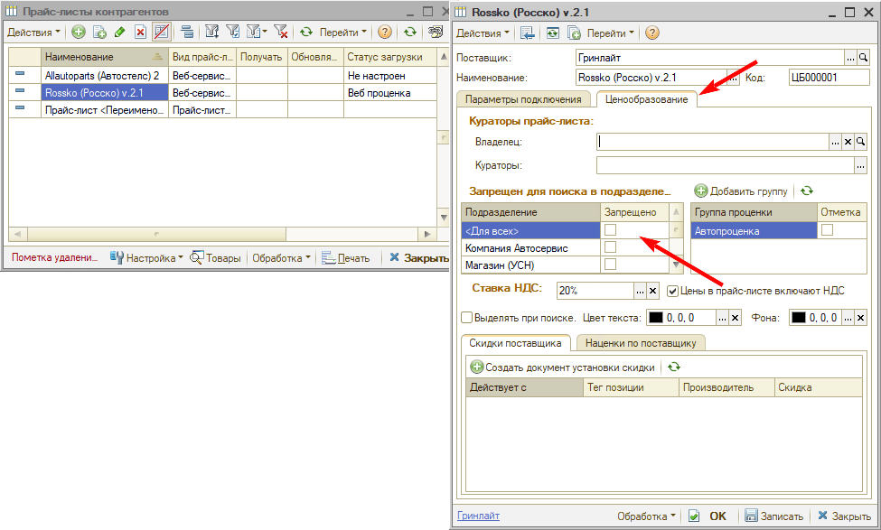

# Как убрать поставщика из Поиска цен

<table><tr><td><b>Создано:</b> 30.10.2026</td></tr></table>

###### *Опубликовано 30.10.2026: [https://kb.5systems.ru/tips/5s-auto/sklad-i-zapchasti/kak-ubrat-postavshchika-iz-poiska-cen](https://kb.5systems.ru/tips/5s-auto/sklad-i-zapchasti/kak-ubrat-postavshchika-iz-poiska-cen)*

## Вопрос

Как убрать поставщика на всех учетных записях филиала из Поиска цен?

## Ответ

Поиск цен по поставщику зависит от настройки его прайс-листа. Запретить поиск по прайс-листу для всех подразделений можно в справочнике прайс-листов контрагентов.

> [!NOTE]
> Справочник «Прайс-листы контрагентов» открывается только через верхнее меню, поэтому настройку выполняет администратор или пользователь с полными правами (руководитель). Справочник также можно вывести в меню рабочего стола — это тоже делает пользователь с правами администратора, см. статью «[Настройка рабочего стола → Пункты меню в разделах](https://kb.5systems.ru/articles/5s-auto/administrirovanie-i-nastroyka-sistemy/nastroyka-rabochego-stola#пункты-меню-в-разделах)».

1. Откройте меню **«Справочники» → «Идентификационные» → «Прайс-листы контрагентов»**:

   

2. Найдите в списке прайс-лист нужного поставщика и откройте его.
3. Перейдите на вкладку **«Ценообразование»**. В разделе **«Запрещен для поиска в подразделениях»** установите галочку в строке **«\<Для всех>»** в колонке **«Запрещено»** и нажмите **«Записать»**.

   

Чтобы запретить поиск только в отдельных подразделениях, не ставьте галочку «\<Для всех>», а отметьте нужные подразделения в списке.

## См. также

- [Поиск цен](https://kb.5systems.ru/articles/5s-auto/procenka-zapchastey-i-rabot/poisk-cen)

## Материалы для изучения

- «[Создание и настройка прайс-листа контрагента](https://kb.5systems.ru/articles/5s-auto/sklad-i-zapchasti/sozdanie-i-nastroyka-prays-lista-kontragenta)» — параметры прайс-листа, в том числе вкладка «Ценообразование» и запреты поиска по подразделениям.
- «[Настройка рабочего стола](https://kb.5systems.ru/articles/5s-auto/administrirovanie-i-nastroyka-sistemy/nastroyka-rabochego-stola)» — как вывести справочник в меню рабочего стола.

## Похожие вопросы

- Как убрать поставщика на всех учетных записях филиала из Поиска цен
- Как скрыть поставщика в поиске цен
- Как запретить поиск по прайс-листу поставщика для всех подразделений
- Рабочий стол другого вида, где найти прайс-листы контрагентов

## Теги

поиск цен, прайс-лист контрагента, ценообразование, запрет поиска, подразделения, поставщик, верхнее меню, рабочий стол
