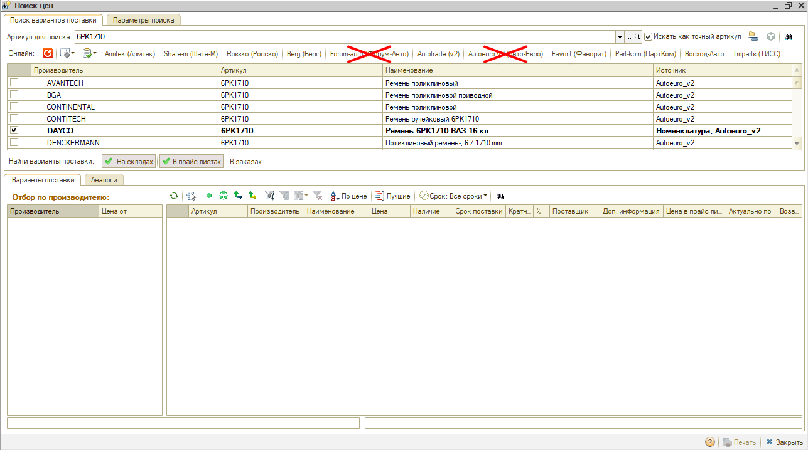
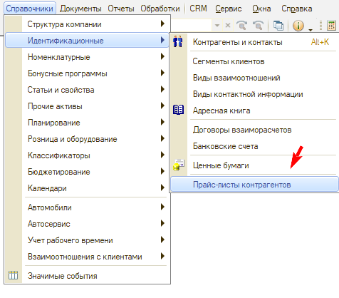
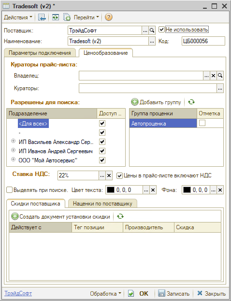
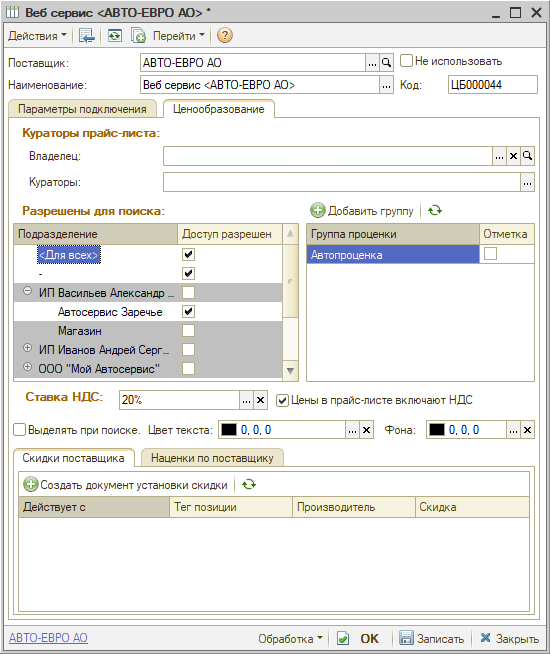

# Как убрать поставщика из Поиска цен

<table><tr><td><b>Обновлено:</b> 18.11.2026</td></tr></table>

Тикет: https://support.5systems.ru/ru/ticket/list/filter/id/96/ticket/23179 (VCX-08694)

###### *Опубликовано 30.10.2026: [https://kb.5systems.ru/tips/5s-auto/sklad-i-zapchasti/kak-ubrat-postavshchika-iz-poiska-cen](https://kb.5systems.ru/tips/5s-auto/sklad-i-zapchasti/kak-ubrat-postavshchika-iz-poiska-cen)*

## Вопрос

Как убрать поставщика из Поиска цен на всех учетных записях филиала?

## Ответ

Поставщик не попадает в Поиск цен, если его прайс-лист скрыт одним из двух способов. Оба способа настраиваются в карточке прайс-листа поставщика.

> [!NOTE]
> Справочник «Прайс-листы контрагентов» открывается только через верхнее меню, поэтому настройку выполняет администратор или пользователь с полными правами (руководитель). Справочник также можно вывести в меню рабочего стола — это тоже делает пользователь с правами администратора, см. статью «[Настройка рабочего стола → Пункты меню в разделах](https://kb.5systems.ru/articles/5s-auto/administrirovanie-i-nastroyka-sistemy/nastroyka-rabochego-stola#пункты-меню-в-разделах)».

Откройте меню **«Справочники» → «Идентификационные» → «Прайс-листы контрагентов»**, найдите в списке прайс-лист нужного поставщика и откройте его.

### Вариант 1. Убрать прайс-лист с панели прайс-листов

1. В шапке карточки установите галочку **«Не использовать»**.
2. Нажмите **«Записать»**.

Галочка исключает прайс-лист с панели прайс-листов в Поиске цен.

### Вариант 2. Закрыть доступ по организациям и подразделениям

1. Перейдите на вкладку **«Ценообразование»**. В разделе **«Разрешены для поиска»** снимите галочку **«Доступ разрешен»** у нужной организации и нажмите **«Записать»**. Галочка снимается и со всех подразделений этой организации.

   

2. Чтобы скрыть поставщика только в отдельных подразделениях, оставьте галочку у организации и снимите ее у нужных подразделений (раскрываются значком «+»). Затем нажмите **«Записать»**.
3. Чтобы скрыть поставщика во всех существующих подразделениях, снимите галочки у всех организаций в списке и нажмите **«Записать»**.

> [!NOTE]
> Галочка **«\<Для всех>»** определяет доступ новых подразделений. Она не меняет галочки у существующих организаций и подразделений. Если у организации стоит доступ, новые подразделения этой организации получают доступ тоже. Раньше подразделения, добавленные позже, получали доступ автоматически, теперь это зависит от этих галочек.

## См. также

- [Не работает проценка по отдельному поставщику](https://kb.5systems.ru/tips/5s-auto/sklad-i-zapchasti/ne-rabotaet-procenka-po-otdelnomu-postavshchiku)

## Материалы для изучения

- «[Поиск цен](https://kb.5systems.ru/articles/5s-auto/procenka-zapchastey-i-rabot/poisk-cen)» — как работает Поиск цен и отбор предложений по поставщикам.
- «[Создание и настройка прайс-листа контрагента → Шаг 2. Доступ к прайс-листу](https://kb.5systems.ru/articles/5s-auto/sklad-i-zapchasti/sozdanie-i-nastroyka-prays-lista-kontragenta#настройка-прайс-листа-шаг-2-доступ-к-прайс-листу)» — как закрыть доступ к прайс-листу по организациям и подразделениям.
- «[Создание и настройка Веб прайс-листа → Доступ к Веб прайс-листу в Поиске цен](https://kb.5systems.ru/articles/5s-auto/sklad-i-zapchasti/sozdanie-i-nastroyka-veb-prays-lista#доступ-к-веб-прайс-листу-в-поиске-цен)» — веб-сервис поставщика и настройка доступа к нему в Поиске цен.
- «[Настройка рабочего стола](https://kb.5systems.ru/articles/5s-auto/administrirovanie-i-nastroyka-sistemy/nastroyka-rabochego-stola)» — как вывести справочник в меню рабочего стола.

## Похожие вопросы

- Как убрать поставщика из Поиска цен на всех учетных записях филиала?
- Как скрыть поставщика в поиске цен
- Как закрыть доступ поставщика к Поиску цен для организации
- Как убрать прайс-лист поставщика с панели прайс-листов в Поиске цен
- Рабочий стол другого вида, где найти прайс-листы контрагентов

## Теги

поиск цен, прайс-лист контрагента, ценообразование, доступ, организации, подразделения, поставщик, не использовать, верхнее меню, рабочий стол
