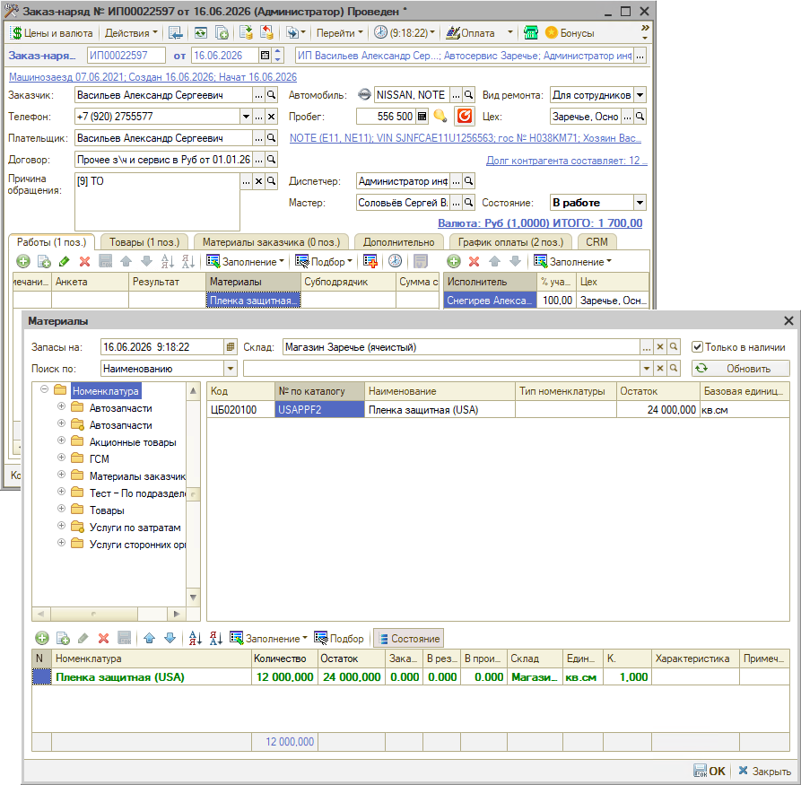
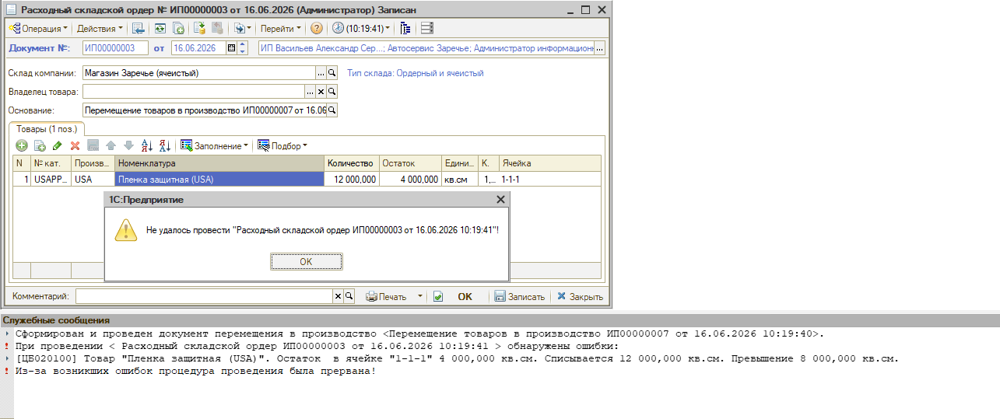
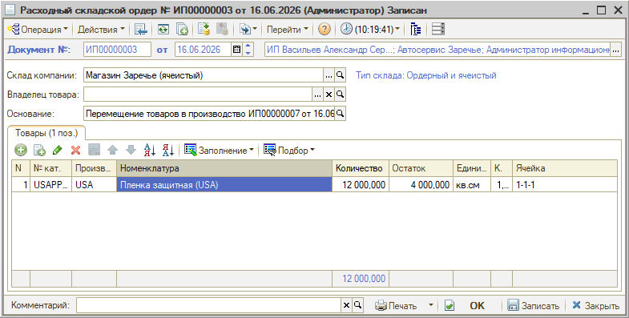
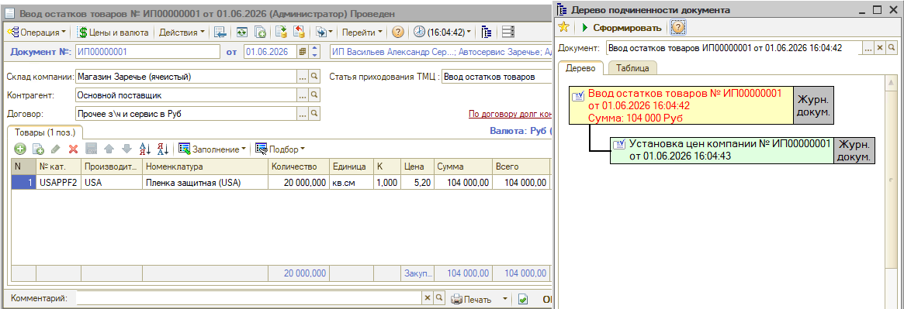
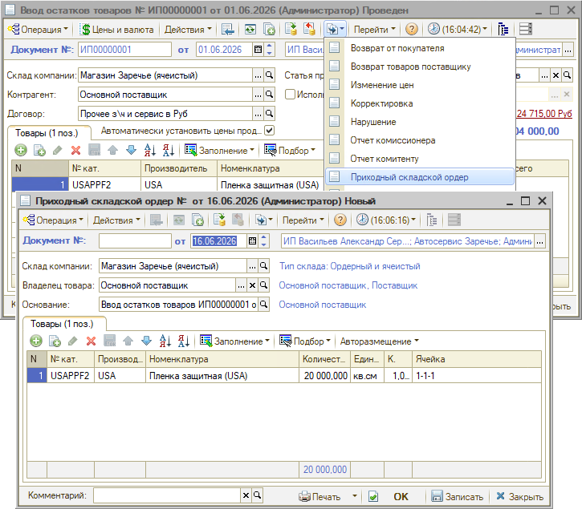

# Не удалось провести расходный складской ордер

<table><tr><td><b>Создано:</b> 05.11.2026</td></tr></table>

## Проблема

При перемещении товаров в производство из заказ-наряда не проводится расходный складской ордер, хотя товара на складе хватает: в окне **«Материалы»** заказ-наряда (открывается из ячейки «Материалы» в таблице «Работы») в колонке **«Остаток»** указано больше, чем нужно списать:

Программа выводит сообщение *«Не удалось провести "Расходный складской ордер …"»*, а в служебных сообщениях – превышение остатка в ячейке:

*[<код>] Товар "<номенклатура>". Остаток в ячейке "<ячейка>" <остаток> <ед. изм.>. Списывается <количество> <ед. изм.>. Превышение <превышение> <ед. изм.>.* 
*Из-за возникших ошибок процедура проведения была прервана!*

## Причина

Склад ордерно-ячеистый: на нем ведется двойной учет – товарный (документами поступления, перемещения, реализации и т. п.) и ордерный (приходными и расходными складскими ордерами). Колонка «Остаток» в заказ-наряде показывает остаток по товарному учету, а расходный складской ордер списывает товар из ячейки по ордерному учету – его остаток в ячейке виден в колонке «Остаток» ордера:

Если товар оприходовали документом, на основании которого не введен приходный складской ордер, – например, **«Ввод остатков товаров»**, – по товарному учету он есть, а в ячейке его нет. Расходный ордер может списать из ячейки только то, что в нее поступило по приходным ордерам.

## Решение

**1. Найдите документ, по которому товар поступил без приходного ордера.**

Откройте документ, которым оприходован товар (ввод остатков, поступление товаров и т. п.), и откройте дерево связей документа. Если в дереве подчиненности документа нет приходного складского ордера, товар по этому документу в ячейку не поступил:

Найти все документы с расхождениями между товарным и ордерным учетом можно в отчете «[Сверка остатков и оборотов ордерного склада](https://kb.5systems.ru/articles/5s-auto/otchety/otchety-po-skladskomu-uchetu#3-сверка-остатков-и-оборотов-ордерного-склада)» с настройкой вывода только расхождений.

**2. Введите приходный складской ордер.**

В документе поступления нажмите **«Ввести на основании»** и выберите **«Приходный складской ордер»**. Проверьте склад и ячейку – товар должен поступить в ту ячейку, из которой его списывает расходный ордер (она указана в сообщении об ошибке). Проведите приходный ордер:

**3. Проведите расходный складской ордер.**

Вернитесь к расходному складскому ордеру – он остался записанным, но не проведенным, – и проведите его. Если остатка в ячейке теперь хватает, ордер проведется.

## См. также

- «[Не получается провести документ (нет доступа к складу)](https://kb.5systems.ru/tips/5s-auto/sklad-i-zapchasti/ne-poluchaetsya-provesti-dokument-net-dostupa-k-skladu)»
- «[При заполнении инвентаризации по ячейкам хранения попадают не все товары](https://kb.5systems.ru/tips/5s-auto/sklad-i-zapchasti/pri-zapolnenii-inventarizacii-po-yacheykam-ne-vse-tovary)»

## Материалы для изучения

- «[Виды склада → Ордерно-ячеистый склад](https://kb.5systems.ru/articles/5s-auto/sklad-i-zapchasti/vidy-sklada#ордерно-ячеистый-склад)» – двойной учет, складские ордера, автоматическое создание ордеров.
- «[Отчеты по складскому учету](https://kb.5systems.ru/articles/5s-auto/otchety/otchety-po-skladskomu-uchetu)» – остатки по ячейкам ордерного склада и сверка товарного и ордерного учета.

## Похожие вопросы

- Не удалось провести расходный складской ордер
- Материала хватает, а расходный складской ордер ругается на количество
- Расходный складской ордер пишет, что не хватает товара
- Превышение остатка в ячейке при проведении расходного ордера
- В заказ-наряде остаток есть, а в ячейке товара нет

## Теги

расходный складской ордер, приходный складской ордер, ордерно-ячеистый склад, ячейки хранения, остаток в ячейке, ввод остатков товаров, перемещение товаров в производство, заказ-наряд, сверка остатков ордерного склада
