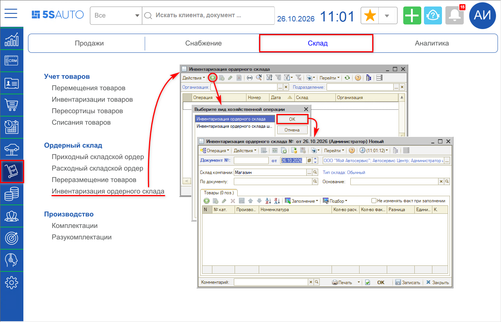
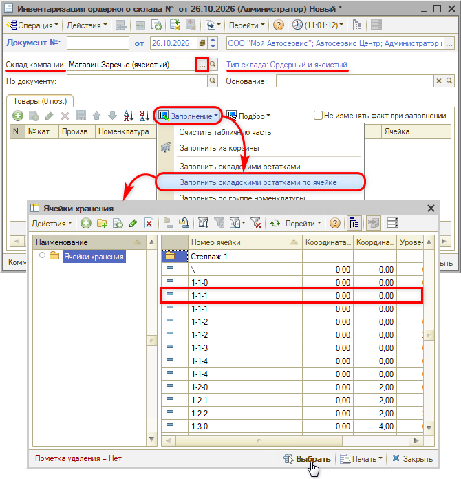
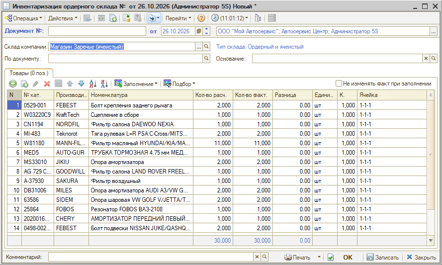

# При заполнении инвентаризации по ячейкам хранения попадают не все товары

<table><tr><td><b>Создано:</b> 25.09.2026</td></tr></table>

## Проблема

В документе «Инвентаризация товаров» указаны ячейки хранения, но при заполнении кнопкой **«Заполнение → Заполнить по ячейкам хранения»** в таблицу попадает всего несколько позиций. Если заполнить документ командой **«Заполнить складскими остатками»**, в таблицу попадают все товары, которые фактически лежат в этих ячейках.

## Причина

Команда «Заполнить по ячейкам хранения» заполняет таблицу товарами, у которых выбранная ячейка указана как **ячейка хранения по умолчанию** в карточке номенклатуры. Товары, у которых ячейка по умолчанию не указана, в документ не попадают, даже если фактически лежат в этой ячейке. Команда «Заполнить складскими остатками» ячейки не проверяет и заполняет таблицу всеми остатками склада.

## Решение

Выберите подходящий вариант:

1. Укажите товарам ячейки хранения по умолчанию – на вкладке **«Ячейки хранения по умолчанию»** в карточке номенклатуры (см. «[Номенклатура → Панель информации](https://kb.5systems.ru/articles/5s-auto/sklad-i-zapchasti/nomenklatura#панель-информации)»). После этого команда «Заполнить по ячейкам хранения» будет добавлять эти товары в инвентаризацию.

2. Если нужно заполнить документ фактическими остатками по ячейкам, используйте документ **«Инвентаризация ордерного склада»**:

   **1)** Откройте список документов *Запчасти и склад → Склад → Ордерный склад → Инвентаризация ордерного склада* и создайте новый документ. В окне выбора хозяйственной операции выберите **«Инвентаризация ордерного склада»** и нажмите **«ОК»**.

   

   **2)** Укажите склад компании – обязательно ордерно-ячеистый: в шапке документа должно отображаться *«Тип склада: Ордерный и ячеистый»*. На обычном складе остатки по ячейкам не ведутся, и заполнить по ним документ не получится. 
   **3)** Нажмите **«Заполнение → Заполнить складскими остатками по ячейке»**, в открывшемся окне *«Ячейки хранения»* выберите ячейку и нажмите **«Выбрать»**.

   

   Таблица заполнится всеми товарами, которые числятся в выбранной ячейке, – с расчетным количеством и номером ячейки:

   

   Если таблица осталась пустой, в выбранной ячейке нет остатков по складским ордерам: на ордерно-ячеистом складе остатки по ячейкам формируют приходные и расходные складские ордера. Проверить остатки можно в отчете «[Остатки и обороты ордерного склада](https://kb.5systems.ru/articles/5s-auto/otchety/otchety-po-skladskomu-uchetu#2-остатки-и-обороты-ордерного-склада)».

   *Примечание:* Документ «Инвентаризация ордерного склада» не изменяет количество товаров на складе по остаткам. Для этого введите на его основании документ «Инвентаризация товаров» – см. «[Инвентаризация → Инвентаризация ордерного склада](https://kb.5systems.ru/articles/5s-auto/sklad-i-zapchasti/inventarizaciya#инвентаризация-ордерного-склада)».

## См. также

- «[Пропала вкладка «Остатки по ячейкам» в номенклатуре](https://kb.5systems.ru/tips/5s-auto/sklad-i-zapchasti/propala-vkladka-ostatki-po-yacheykam)»

## Материалы для изучения

- «[Инвентаризация](https://kb.5systems.ru/articles/5s-auto/sklad-i-zapchasti/inventarizaciya)» – инвентаризация товаров, инвентаризация ордерного склада, инвентаризация по ячейкам хранения.
- «[Как оформить инвентаризацию по ячейкам хранения](https://kb.5systems.ru/lessons/urok-5-skladskoy-uchet/kak-oformit-inventarizaciyu-po-yacheykam-khraneniya)» – урок по заполнению инвентаризации ячейками и товарами.
- «[Виды склада → Ордерно-ячеистый склад](https://kb.5systems.ru/articles/5s-auto/sklad-i-zapchasti/vidy-sklada#ордерно-ячеистый-склад)» – учет остатков по ячейкам хранения, складские ордера.
- «[Отчеты по складскому учету → Остатки и обороты ордерного склада](https://kb.5systems.ru/articles/5s-auto/otchety/otchety-po-skladskomu-uchetu#2-остатки-и-обороты-ордерного-склада)» – остатки по ячейкам ордерного склада.

## Похожие вопросы

- При заполнении инвентаризации по ячейкам хранения попадают не все товары
- При заполнении остатками по ячейкам не подтягивается весь товар
- Инвентаризация по ячейкам хранения заполняется не полностью
- Заполнить по ячейкам хранения – в документ попадает всего несколько позиций
- Как заполнить инвентаризацию остатками по ячейкам
- Инвентаризация ордерного склада не заполняется по ячейке

## Теги

инвентаризация, инвентаризация ордерного склада, ячейки хранения, ячейка хранения по умолчанию, номенклатура, складские остатки, ордерно-ячеистый склад
