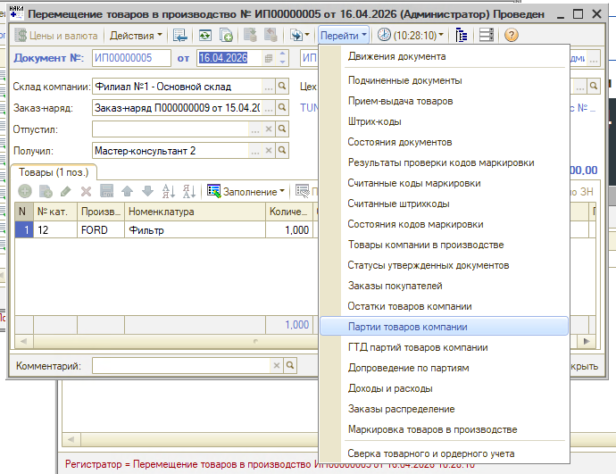
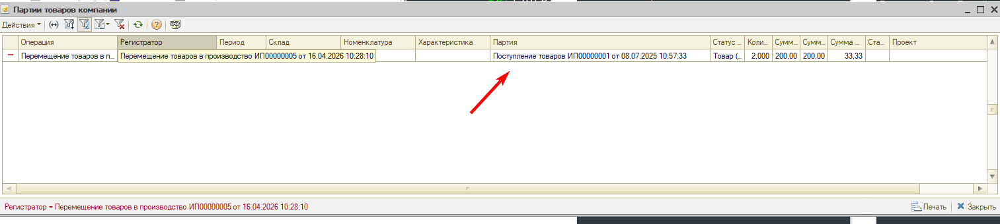

# Товар списался в производство по другой себестоимости

<table><tr><td><b>Создано:</b> 26.10.2026</td></tr></table>

## Проблема

Товар оприходован документом **«Поступление товаров»**, его сумма с учетом дополнительных расходов – например, 13 611 руб. Но при перемещении в производство (в заказ-наряд) товар списался по другой себестоимости – например, 19 631 руб.

## Причина

После перемещения товара в производство в документе «Поступление товаров» изменили сумму. Перемещение списывает товар по себестоимости партии на момент своего проведения, поэтому себестоимость в нем рассчитана по прежней сумме поступления. Если по документу поступления уже есть движения – перемещения в производство, реализации и т. п., – суммы в нем изменять нельзя.

## Решение

**1. Проверьте историю изменений поступления.**

Откройте документ «Поступление товаров» и нажмите **«Действия → История изменений объектов»**. Выделите две версии – до изменения и после – и нажмите **«Сравнить версии»**: в отчете будет видно, кто и когда изменил цену и сумму товара. Подробнее – в статье «[Версионирование → Сравнить версии](https://kb.5systems.ru/articles/5s-auto/administrirovanie-i-nastroyka-sistemy/versionirovanie#сравнить-версии)».

Сравните дату изменения с датой документа движения – например, перемещения товаров в производство. Если сумму поступления изменили после перемещения, себестоимость в перемещении рассчитана по сумме, которая была в поступлении до изменения.

**2. Проверьте, по какой партии списан товар.**

Откройте документ перемещения товаров в производство и нажмите **«Перейти → Партии товаров компании»**:

В колонке **«Партия»** указан документ поступления, из которого списан товар, а в колонках сумм – себестоимость, по которой он списан:

**3. Ограничьте изменение проведенных документов.**

Если сотрудники часто меняют суммы в проведенных документах, закройте им право **«Редактирование проведенных документов»** – см. статью «[Права на редактирование документов → Редактирование проведенных документов](https://kb.5systems.ru/articles/5s-auto/administrirovanie-i-nastroyka-sistemy/prava-na-redaktirovanie-dokumentov#4-редактирование-проведенных-документов)». Тогда изменить проведенный документ смогут только сотрудники, у которых есть это право.

## Материалы для изучения

- «[Версионирование](https://kb.5systems.ru/articles/5s-auto/administrirovanie-i-nastroyka-sistemy/versionirovanie)» – история изменений документов: просмотр и сравнение версий.
- «[Права на редактирование документов](https://kb.5systems.ru/articles/5s-auto/administrirovanie-i-nastroyka-sistemy/prava-na-redaktirovanie-dokumentov)» – запрет редактирования проведенных документов и документов в закрытом периоде.

## Похожие вопросы

- Товар списался в производство по другой себестоимости
- Себестоимость товара, ошибка в списании
- Товар списался по странной себестоимости
- Себестоимость в перемещении в производство не совпадает с суммой поступления
- Изменили сумму в поступлении, а себестоимость в перемещении осталась прежней
- Как посмотреть, по какой партии списан товар

## Теги

себестоимость, партии товаров, партии товаров компании, поступление товаров, перемещение товаров в производство, заказ-наряд, история изменений, версионирование, права на редактирование, проведенные документы
