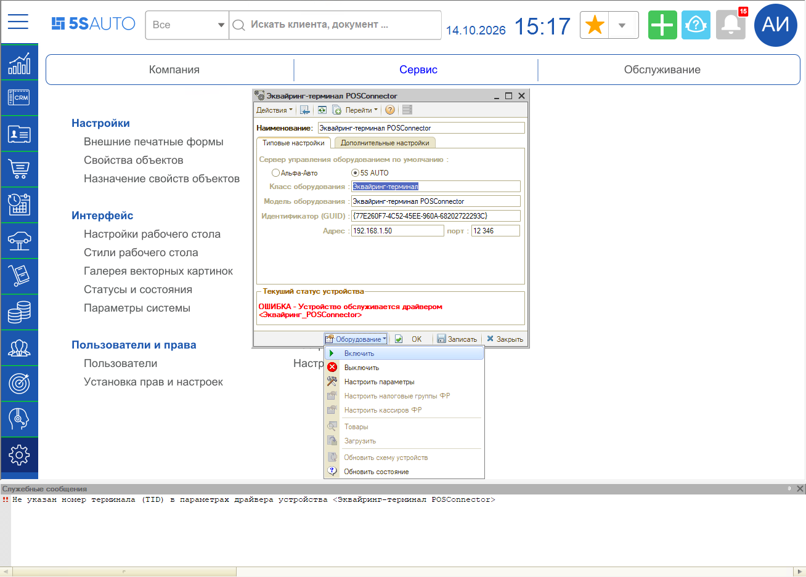
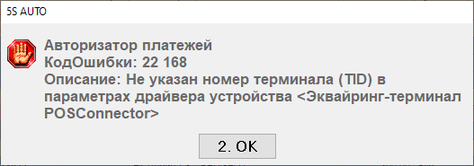
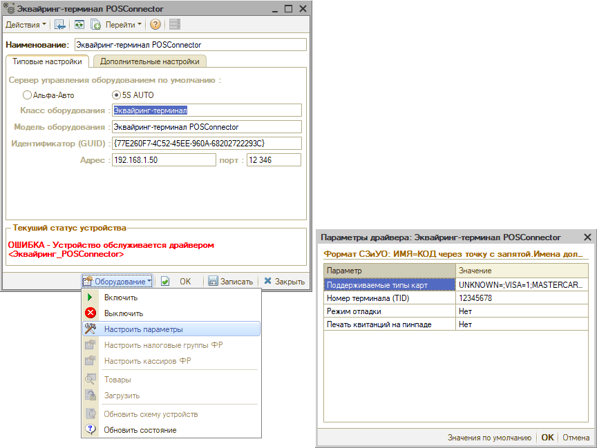

# Ошибка 22168 Не указан номер терминала (TID)

<table><tr><td><b>Создано:</b> 14.10.2026</td></tr></table>

###### *Опубликовано 14.10.2026: [https://kb.5systems.ru/tips/oborudovanie/bankovskie-terminaly/oshibka-22168-ne-ukazan-nomer-terminala-tid](https://kb.5systems.ru/tips/oborudovanie/bankovskie-terminaly/oshibka-22168-ne-ukazan-nomer-terminala-tid)*

> *Актуально начиная с версии релиза 5S AUTO **2.8.5**.*

## Проблема

При включении терминала эквайринга, подключенного через POSConnector, при открытии Фронта кассира или при оплате картой появляется ошибка с кодом 22168:

*«Не указан номер терминала (TID) в параметрах драйвера устройства <Эквайринг-терминал POSConnector>»* – в угловых скобках наименование оборудования.

При открытии Фронта кассира та же ошибка выводится в окне *«Авторизатор платежей»* с кодом и описанием:

## Причина

В параметрах драйвера терминала не заполнен номер терминала (TID), выданный банком.

## Решение

1. Откройте справочник «Оборудование» (см. статью «[Справочник «Оборудование»](../../../../articles/5S%20AUTO/Торговое%20оборудование/Справочник%20Оборудование/spravochnik-oborudovanie.md)») и выберите терминал.
2. Выключите терминал: *«Оборудование → Выключить»*.
3. Нажмите *«Оборудование → Настроить параметры»* и заполните параметр ***«Номер терминала (TID)»*** – его выдает банк.
4. Нажмите *«ОК»* и запишите карточку оборудования.
5. Включите терминал: *«Оборудование → Включить»*.

## Материалы для изучения

- [Интеграция с терминалами оплаты UniTodi](../../../../articles/5S%20AUTO/Торговое%20оборудование/Интеграция%20с%20терминалами%20оплаты%20UniTodi/integraciya-s-terminalami-oplaty-unitodi.md)

## См. также

- [Ошибка 22161 Не удалось создать COM-объект POSConnector](../%D0%9E%D1%88%D0%B8%D0%B1%D0%BA%D0%B0%2022161%20%D0%9D%D0%B5%20%D1%83%D0%B4%D0%B0%D0%BB%D0%BE%D1%81%D1%8C%20%D1%81%D0%BE%D0%B7%D0%B4%D0%B0%D1%82%D1%8C%20COM-%D0%BE%D0%B1%D1%8A%D0%B5%D0%BA%D1%82%20POSConnector/oshibka-22161-ne-udalos-sozdat-com-obekt-posconnector.md)
- [Ошибка 22162 Нет связи с процессингом](../%D0%9E%D1%88%D0%B8%D0%B1%D0%BA%D0%B0%2022162%20%D0%9D%D0%B5%D1%82%20%D1%81%D0%B2%D1%8F%D0%B7%D0%B8%20%D1%81%20%D0%BF%D1%80%D0%BE%D1%86%D0%B5%D1%81%D1%81%D0%B8%D0%BD%D0%B3%D0%BE%D0%BC/oshibka-22162-net-svyazi-s-processingom.md)

## Похожие вопросы

- Ошибка 22168 Не указан номер терминала (TID)
- Где указать TID терминала
- Не включается терминал, пишет не указан номер терминала
- Ошибка авторизатора платежей 22168 при открытии Фронта кассира
- Куда вписать номер терминала от банка

## Теги

эквайринг, терминал, POSConnector, ошибка 22168, TID, номер терминала, параметры драйвера
