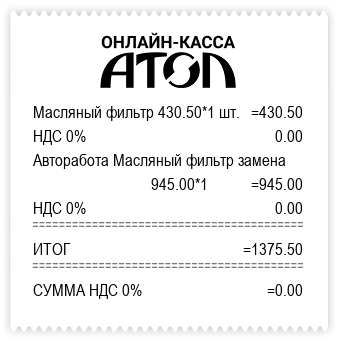
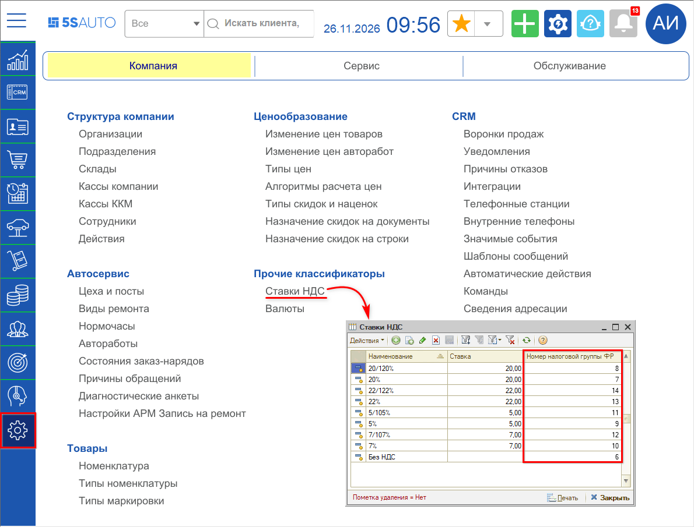
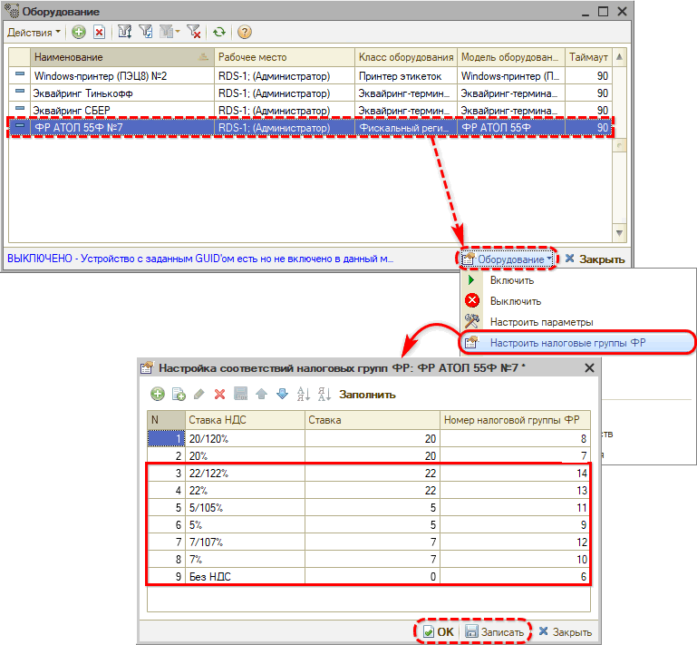

# В чеке печатается неверная ставка НДС

<table><tr><td><b>Обновлено:</b> 25.11.2026</td></tr></table>

Тикет: https://support.5systems.ru/ru/ticket/list/filter/id/1/ticket/24509/ (KEE-60674)

###### *Опубликовано 25.11.2026: [https://kb.5systems.ru/tips/oborudovanie/kassy-kkm/v-cheke-pechataetsya-nevernaya-stavka-nds](https://kb.5systems.ru/tips/oborudovanie/kassy-kkm/v-cheke-pechataetsya-nevernaya-stavka-nds)*

## Проблема

При пробитии чека касса печатает не ту ставку НДС: например, «без НДС» (0%) вместо 5%. В документах программы — реализации, счете на оплату, заказ-наряде — ставка при этом указана верно.

## Причина

[Номера налоговых групп](../../../../articles/5S%20AUTO/Торговое%20оборудование/Подключение%20кассы%20ККМ/podklyuchenie-kassy-kkm.md#ставки-ндс-и-налоговые-группы) в программе не совпадают с номерами в настройках драйвера фискального регистратора. В чек программа передает номер налоговой группы, а драйвер подставляет ставку по своей таблице. Если номера разошлись, в чеке печатается не та ставка налога — например, «без НДС» вместо 5%.

Номера групп задаются в общем справочнике «[Ставки НДС](../../../../articles/5S%20AUTO/Торговое%20оборудование/Подключение%20кассы%20ККМ/podklyuchenie-kassy-kkm.md#spr_stavok_nds)», а если в компании несколько касс разных производителей — еще и в карточках оборудования; настройки в карточке приоритетнее.

## Решение

> [!IMPORTANT]
> Прошивка кассы должна быть актуальной и поддерживать ФФД 1.2, драйвер — новый. Если нужной ставки (например, 22%) в драйвере нет, чек не пробьется с [ошибкой 144](../Ошибка%20при%20пробитии%20чека%20144%20–%20недопустимый%20номер%20ставки%20налога/oshibka-pri-probitii-cheka-144.md).

1. Откройте справочник «Ставки НДС»: *Администрирование → Компания → Прочие классификаторы → Ставки НДС*, и сверьте номера налоговых групп с тест-драйвером кассы. Для АТОЛ и ШТРИХ-М номера разные — таблица соответствия есть в статье «[Подключение кассы ККМ](../../../../articles/5S%20AUTO/Торговое%20оборудование/Подключение%20кассы%20ККМ/podklyuchenie-kassy-kkm.md#ставки-ндс-и-налоговые-группы)», раздел «Ставки НДС и Налоговые группы». Если номер не совпадает, исправьте его и сохраните изменения.

   

   Обычно, если касса одна или все кассы одного производителя, настройка ограничивается этим справочником.

2. Если в компании несколько касс разных производителей, проверьте настройки и в карточках оборудования: выделите кассу и нажмите *«Оборудование → Настроить налоговые группы ФР»*. Если номера не совпадают, исправьте их и сохраните изменения. Настройки в карточке приоритетнее, чем в общем справочнике.

   

3. Пробейте обычный и предоплатный чек — в обоих ставка НДС должна совпадать с указанной в документе.

Если чеки уже пробиты с неверной ставкой, оформите по ним чеки коррекции — см. «[Использование Чека коррекции](../../../../articles/5S%20AUTO/Касса/Использование%20Чека%20коррекции/ispolzovanie-cheka-korrekcii.md#исправление-пробитого-чека)», раздел «Исправление пробитого чека».

## См. также

- «[Ошибка при пробитии чека 144 – недопустимый номер ставки налога](../Ошибка%20при%20пробитии%20чека%20144%20–%20недопустимый%20номер%20ставки%20налога/oshibka-pri-probitii-cheka-144.md)» — та же причина: ставки в программе и в драйвере не совпадают, но чек не пробивается вовсе.
- «[Как настроить применение НДС при УСН](../../../5S%20AUTO/Практики/Как%20настроить%20применение%20НДС%20при%20УСН/primenenie-nds-pri-usn.md)» — настройка ставок НДС и налоговых групп при упрощенной системе налогообложения.
- «[В счете на оплату и заказ-наряде подставляется неверная ставка НДС](../../../5S%20AUTO/Автосервис/В%20счете%20на%20оплату%20и%20заказ-наряде%20подставляется%20неверная%20ставка%20НДС/v-schete-na-oplatu-i-zakaz-naryade-podstavlyaetsya-nevernaya-stavka-nds.md)» — похожий случай: в документах ставка неверна, а в чеке печатается верно.

## Материалы для изучения

- «[Подключение кассы ККМ](../../../../articles/5S%20AUTO/Торговое%20оборудование/Подключение%20кассы%20ККМ/podklyuchenie-kassy-kkm.md#ставки-ндс-и-налоговые-группы)», раздел «Ставки НДС и Налоговые группы» — таблицы налоговых групп для АТОЛ и ШТРИХ-М.
- «[Справочник «Оборудование»](../../../../articles/5S%20AUTO/Торговое%20оборудование/Справочник%20Оборудование/spravochnik-oborudovanie.md#действия-с-оборудованием)» — команда «Настроить налоговые группы ФР» и другие действия с оборудованием.

## Похожие вопросы

- В чеке неверная ставка НДС
- На кассе печатается НДС 0% вместо 5%
- В чеке «без НДС», хотя в документе ставка 5%
- В чеке на предоплату не та ставка НДС
- Касса пробивает чек с неправильной ставкой налога
- АТОЛ печатает не ту ставку НДС
- Как настроить налоговые группы для кассы

## Теги

касса, ккм, чек, ндс, ставка ндс, налоговые группы, оборудование, атол, штрих-м, драйвер, тест-драйвер, предоплата
