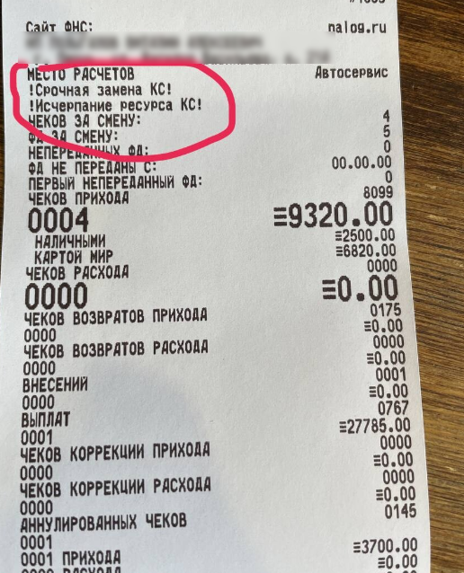

# Исчерпан ресурс ФН

<table><tr><td><b>Обновлено:</b> 24.08.2026</td></tr></table>

## Проблема

Выходит ошибка «Исчерпан ресурс ФН», чек не пробивается.

## Причина

1. Закончился ресурс фискального накопителя.
2. Чеки больше месяца не отправляются в ОФД — тогда ошибка выходит в программе, хотя в чеках нет информации о том, что ФН заканчивается.

## Решение

Если закончился ресурс накопителя, обратитесь в организацию, которая обслуживает ваши кассы, для замены фискального накопителя.

Если в чеках предупреждений об окончании ФН нет, проверьте отправку чеков в ОФД.

## См. также

- [Касса АТОЛ печатает «ККТ прекратит работу»](../Касса%20АТОЛ%20печатает%20«ККТ%20прекратит%20работу»/kassa-atol-pechataet-kkt-prekratit-rabotu.md)

## Материалы для изучения

- [Порядок работы с кассами ККМ](../../../../articles/5S%20AUTO/Касса/Порядок%20работы%20с%20кассами%20ККМ/poryadok-raboty-s-kassami-kkm.md)
- [Решение распространенных ошибок при работе с кассой](../../../../articles/5S%20AUTO/Торговое%20оборудование/Решение%20распространенных%20ошибок%20при%20работе%20с%20кассой/reshenie-rasprostranennykh-oshibok-pri-rabote-s-kassoy.md)

## Похожие вопросы

- Исчерпан ресурс ФН
- Ошибка при пробитии чека: ограничение ресурса ФН
- Касса пишет, что закончился фискальный накопитель
- Нужно ли менять ФН, если в чеках нет предупреждений
- Чеки не уходят в ОФД, касса выдает ошибку ресурса

## Теги

Торговое оборудование, касса, ККМ, ФН, фискальный накопитель, замена ФН, ОФД
