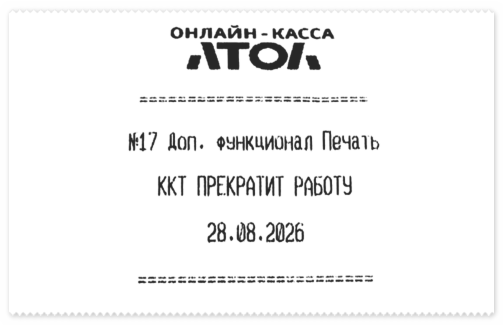

# Касса АТОЛ печатает «ККТ прекратит работу»

<table><tr><td><b>Создано:</b> 30.10.2026</td></tr></table>

## Проблема

Касса АТОЛ печатает отдельный чек с сообщением «№17 Доп. функционал Печать. ККТ прекратит работу» и датой.

## Причина

Заканчивается срок действия лицензии №17 «Доп. функционал Печать» на кассе АТОЛ. Эта лицензия входит в подписку на сопровождение кассы (ИТС) от производителя и действует до даты, указанной на чеке. Сообщение печатается при закрытии смены, пока подписка не продлена; в новых версиях прошивки вместо «ККТ прекратит работу» пишется «Лицензия прекратит действие».

## Решение

Несмотря на формулировку, касса не перестанет работать: после окончания лицензии пробитие чеков, открытие и закрытие смены и отправка чеков в ОФД продолжат работать.

Без лицензии №17 станет недоступна дополнительная печать на кассе:

- произвольный (нефискальный) текст;
- логотип и картинки в клише;
- штрихкоды и QR-коды;
- загружаемые шаблоны чеков;
- на прошивке 5.17 и выше – печать слип-чеков банковского терминала через кассу.

Точный набор зависит от модели кассы и версии прошивки.

Если эти функции нужны, продлите подписку: обратитесь в организацию, где приобретали кассу или которая ее обслуживает (авторизованный сервисный центр АТОЛ). Лицензии АТОЛ продлевает производитель и его партнеры – в 5SYSTEMS продлить лицензию кассы нельзя.

## См. также

- [Исчерпан ресурс ФН](https://kb.5systems.ru/tips/oborudovanie/kassy-kkm/ischerpan-resurs-fn)

## Похожие вопросы

- Касса АТОЛ печатает «ККТ прекратит работу»
- Как продлить кассу
- На чеке «№17 Доп. функционал Печать»
- Касса пишет, что прекратит работу с указанной даты
- Что будет с кассой после даты на чеке
- Как продлить лицензию на кассе АТОЛ

## Теги

Торговое оборудование, касса, ККМ, АТОЛ, лицензия, лицензия №17, доп. функционал печать, подписка, ИТС, продление
