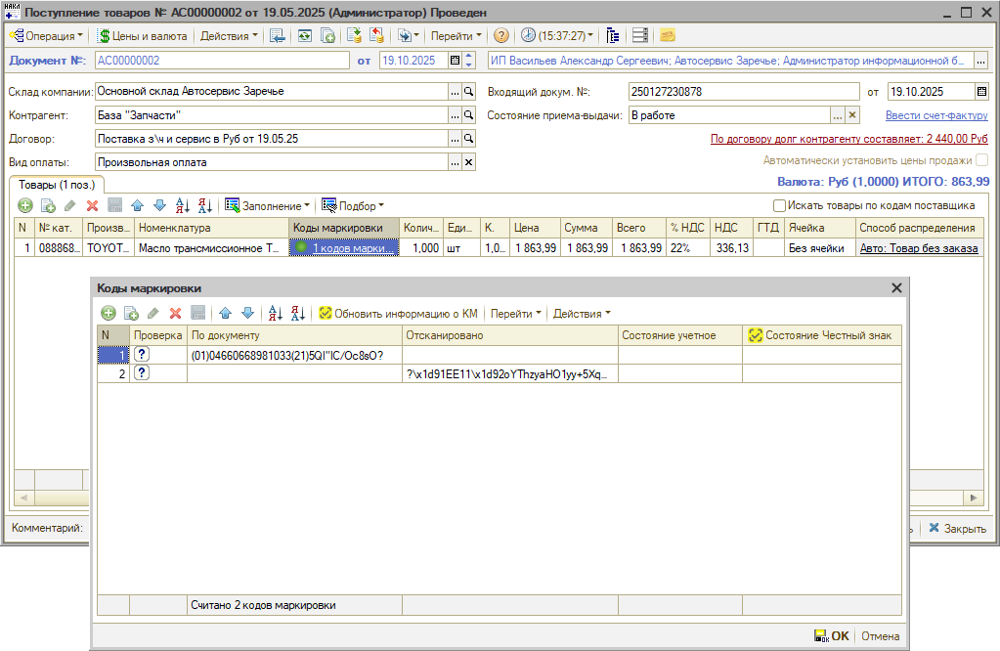
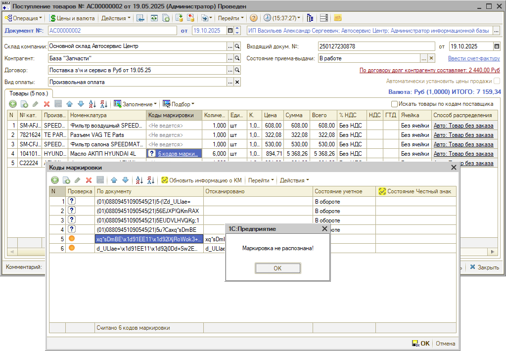
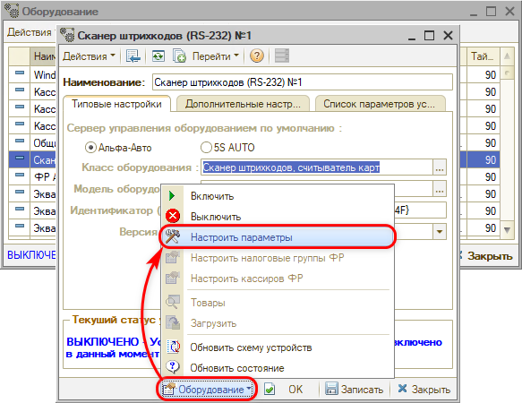
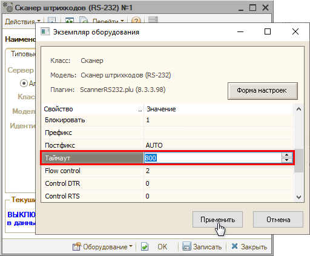

# Маркировка не распознана при сканировании

<table><tr><td><b>Создано:</b> 05.11.2026</td></tr></table>

## Проблема

При сканировании кодов маркировки в документе «Поступление товаров» отсканированный код не сопоставляется с кодом, полученным от поставщика по ЭДО. Проблема проявляется по-разному.

**Пример 1.** Отсканированный код добавляется в таблицу «Коды маркировки» отдельной строкой, а у обеих строк остается индикатор со знаком вопроса (что означает «Требуется проверка сканером – отсутствуют фактические коды маркировки», подробнее см. в [статье](https://kb.5systems.ru/articles/5s-auto/markirovka/markirovka-tovarov#skanirovanie-kodov-markirovki-v-dokumente)). При этом количество товара в документе не меняется, а индикатор в колонке «Коды маркировки» сначала остается со знаком вопроса, через некоторое время становится зеленым (поэтому проблему легко не заметить):

**Пример 2.** В другом документе проблема заметнее: каждый отсканированный код также добавляется отдельной строкой, у отсканированных строк оранжевый индикатор (не выполнена проверка кода в «Честном знаке»), а у кодов поставщика остается знак вопроса. Количество товара в документе при этом растет (например, было 4 шт., стало 6 шт.), а при сканировании программа выдает сообщение *«Маркировка не распознана»*:

Если отсканировать те же коды при проверке, они считываются корректно – значит, дело не в самих кодах маркировки.

## Причина

Сканер передает коды маркировки в программу не целиком – обрезает их: в отсканированной строке в таблице «Коды маркировки» нет начала кода – «(01)…(21)…» и первых символов серийного номера, остается только его окончание. Такой код не совпадает ни с одним кодом поставщика, поэтому не сопоставляется с ним и не распознается. Обрезание кодов устраняется увеличением параметра «Таймаут» в настройках сканера.

## Решение

Увеличьте таймаут в настройках сканера:

1. Откройте справочник «Оборудование» *(Администрирование → Сервис → Оборудование)* и выделите сканер штрихкодов того рабочего места, где коды не распознаются.
2. Выключите сканер: **«Оборудование» → «Выключить»**.
3. Откройте настройки: **«Оборудование» → «Настроить параметры»**:

   

4. В окне «Экземпляр оборудования» в строке **«Таймаут»** увеличьте значение в колонке «Значение» – в примере проблему решило значение *800* – и нажмите **«Применить»**:

   

5. Включите сканер: **«Оборудование» → «Включить»**.

После этого отсканируйте коды маркировки заново.

Если сканеры на нескольких рабочих местах настраивались одинаково, проверьте таймаут на каждом из них.

## См. также

- «[Не проходит проверка кода маркировки](https://kb.5systems.ru/tips/5s-auto/markirovka/ne-prohodit-proverka-koda-markirovki)»
- «[Не проводится документ с маркированным товаром](https://kb.5systems.ru/tips/5s-auto/markirovka/ne-provoditsya-dokument-s-markirovannym-tovarom)»

## Материалы для изучения

- «[Справочник Оборудование → Порядок изменения настроек](https://kb.5systems.ru/articles/5s-auto/torgovoe-oborudovanie/spravochnik-oborudovanie#порядок-изменения-настроек)» – как выключить оборудование, изменить параметры и включить его снова.
- «[Подключение сканера штрихкодов](https://kb.5systems.ru/articles/5s-auto/torgovoe-oborudovanie/podklyuchenie-skanera-shtrikhkodov)» – подключение сканера через COM-порт и клавиатурного сканера.
- «[Операции с кодами маркировки → Сканирование кодов маркировки в документе](https://kb.5systems.ru/articles/5s-auto/markirovka/operacii-s-kodami-markirovki#2-сканирование-кодов-маркировки-в-документе)» – сверка отсканированных кодов с кодами поставщика в поступлении товаров.

## Похожие вопросы

- Маркировка не распознана при сканировании
- Сканер обрезает коды маркировки
- Отсканированные коды маркировки не сопоставляются с кодами поставщика
- При сканировании кодов маркировки увеличивается количество товара в поступлении
- У кодов маркировки так и горит значок с вопросом
- Сканер неправильно считывает коды маркировки

## Теги

маркировка, код маркировки, сканер штрихкодов, сканирование кодов маркировки, маркировка не распознана, таймаут, настройка оборудования, поступление товаров, Честный знак
