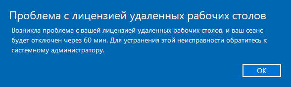

# Проблема с лицензией удаленных рабочих столов

<table><tr><td><b>Создано:</b> 03.11.2026</td></tr></table>

## Проблема

При [подключении к удаленному рабочему столу](https://kb.5systems.ru/lessons/interfeys-programmy/kak-zayti-v-programmu#2-подключение-к-удаленному-рабочему-столу-по-rdp) появляется окно Windows:

> Проблема с лицензией удаленных рабочих столов 
> Возникла проблема с вашей лицензией удаленных рабочих столов, и ваш сеанс будет отключен через 60 мин. Для устранения этой неисправности обратитесь к системному администратору.

## Причина

- Поврежден кэш лицензии удаленных рабочих столов на компьютере пользователя – если ошибка появляется у одного пользователя, а остальные подключаются к тому же серверу без нее.
- Проблема с лицензированием на сервере – если ошибка появляется у всех пользователей сервера.

## Решение

Если ошибка у одного пользователя, сбросьте кэш лицензии на его компьютере. Для этого нужны права администратора компьютера – если их нет, обратитесь к своему системному администратору.

> [!WARNING]
> Действия выполняются в реестре Windows. Перед удалением обязательно сделайте резервную копию раздела (шаг 4) – она позволит вернуть все как было.

1. Закройте все подключения к удаленному рабочему столу. В **«Диспетчере задач»** проверьте, что процесс **mstsc.exe** не запущен.
2. Откройте редактор реестра от имени администратора: нажмите **«Пуск»**, введите *regedit*, в результатах поиска нажмите правой кнопкой мыши на **«Редактор реестра»** и выберите **«Запуск от имени администратора»**.
3. Перейдите к разделу *HKEY_LOCAL_MACHINE\SOFTWARE\Microsoft\MSLicensing*.
4. Сделайте резервную копию: нажмите правой кнопкой мыши на раздел **MSLicensing**, выберите **«Экспортировать»** и сохраните файл, например на рабочий стол.
5. Удалите раздел **MSLicensing** целиком. Более мягкий вариант – удалить только вложенный раздел **Store**, обычно этого достаточно.
6. Запустите **«Подключение к удаленному рабочему столу»** от имени администратора: найдите приложение через **«Пуск»**, нажмите на него правой кнопкой мыши и выберите **«Запуск от имени администратора»**. Подключитесь к серверу.

   > [!IMPORTANT]
   > Запустить подключение нужно именно от имени администратора: при обычном запуске Windows не сможет заново создать раздел лицензии, и ошибка вернется.

7. После успешного подключения раздел **MSLicensing** создается заново, и сервер выдает новую лицензию. Закройте сеанс и подключитесь еще раз обычным способом – окно с ошибкой больше не должно появляться.

Если после этих действий возникли проблемы, откройте сохраненный в шаге 4 файл двойным щелчком и подтвердите импорт в реестр – раздел вернется в прежнее состояние.

### Если не помогло

- **Подключение через приложение «Windows App» или «Удаленный рабочий стол» из Microsoft Store.** У этих приложений свой кэш лицензии – переустановите приложение.
- **Ошибка вернулась через день-два или появляется у всех пользователей сервера.** Причина на сервере: например, не активирован сервер лицензирования или закончились лицензии на подключение. Если вы работаете в облаке 5S Cloud, [обратитесь в техническую поддержку](https://kb.5systems.ru/tips/tekhpodderzhka/kak-obratitsya-v-tekhnicheskuyu-podderzhku) 5SYSTEMS. Если программа установлена на вашем сервере, обратитесь к своему системному администратору – лицензирование удаленных рабочих столов относится к инфраструктуре Windows.

## См. также

- [Не получается подключиться к облаку](https://kb.5systems.ru/tips/tekhpodderzhka/ne-poluchaetsya-podklyuchitsya-k-oblaku)
- [Проблема с подключением к серверу — ошибка приложения](https://kb.5systems.ru/tips/tekhpodderzhka/problema-s-podklyucheniem-k-serveru-oshibka-prilozheniya)

## Материалы для изучения

- «[Как зайти в программу → Подключение к удаленному рабочему столу (по RDP)](https://kb.5systems.ru/lessons/interfeys-programmy/kak-zayti-v-programmu#2-подключение-к-удаленному-рабочему-столу-по-rdp)» – как подключиться к программе через удаленный рабочий стол.

## Похожие вопросы

- Проблема с лицензией удаленных рабочих столов
- Ошибка пользователя RDP
- Сеанс будет отключен через 60 минут
- При подключении к удаленному рабочему столу выходит ошибка лицензии
- Как сбросить лицензию удаленного рабочего стола

## Теги

удаленный рабочий стол, RDP, лицензия, MSLicensing, реестр, mstsc, подключение, сеанс, техподдержка
